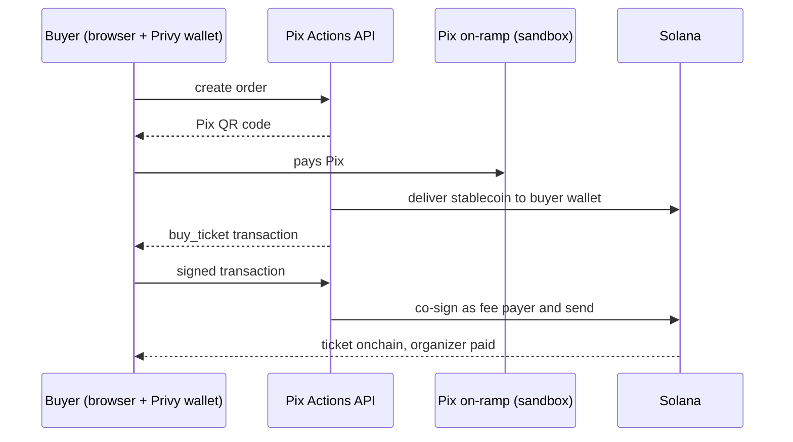

# Pix Actions

**Pay with Pix, receive onchain.** Pix Actions turns any Solana action into a link that 180 million Brazilians can pay with Pix: no wallet to install, no exchange, no seed phrase. The seller gets paid in the same transaction that delivers the asset.

We start with event tickets. The same rails work for any Solana Action: subscriptions, digital products, donations and tokens.

| | |
|---|---|
| Live app | https://pixactions.vercel.app |
| Demo event (buy a ticket) | https://pixactions.vercel.app/e/pix-actions-demo-night-0ed2 |
| API reference | https://pixactions-api.vercel.app/docs |
| Onchain program (devnet) | [`DZ5ddra1TXhkbS9ZBnimtZPVeTxoXmxbCGvFHJqKVPa9`](https://explorer.solana.com/address/DZ5ddra1TXhkbS9ZBnimtZPVeTxoXmxbCGvFHJqKVPa9?cluster=devnet) |

> Demo runs on Solana devnet with a sandbox Pix provider: the Pix QR code is simulated and confirms itself in a few seconds. Do not pay it with a real bank app.

## The problem

Pix moved R$ 35.3 trillion in 2025 and is used by about 180 million Brazilians. Buying anything onchain still means installing a wallet, writing down 12 words, opening an exchange account, doing KYC, buying and withdrawing. Every step loses people. Solana Actions and Blinks made onchain actions shareable, but they only work for people who already have a wallet extension.

## How it works

1. **Create** a ticketed event in the dashboard (login with email; a non-custodial Solana wallet is created on the spot). The event is registered onchain.
2. **Share** the link anywhere: WhatsApp, Instagram, a website or a printed QR code.
3. **Pay with Pix.** The buyer logs in with an email, scans the Pix QR code and the on-ramp delivers stablecoins to their embedded wallet. The purchase is signed automatically.
4. **Receive onchain.** The ticket is a Solana account owned by the buyer, the organizer is paid in the same transaction, and check-in at the door is recorded onchain (a ticket cannot be used twice).

Every event is also a spec-compliant **Solana Action**, so wallet users can buy straight from a Blink.



## Why Solana

- **Users never need SOL.** The API is the fee payer for every transaction; buyers and organizers only sign for what they own.
- **Fast and cheap enough for a R$ 5 ticket.** Purchase, payout and ticket issuance happen atomically in one transaction for a fraction of a cent.
- **Solana Actions as a distribution standard.** The same event is a Pix checkout for everyone and a Blink for wallet users.
- **Verifiable tickets.** Each ticket is a PDA with an onchain check-in flag, so fake or duplicated tickets do not get in.

## Architecture

```
onchain/   Anchor program: events, tickets, check-in (Rust, tests with anchor test)
backend/   FastAPI: builds transactions, Pix sandbox, mock on-ramp, Solana Actions (Python, 83 tests)
web/       Next.js: landing, Pix checkout, organizer dashboard, QR check-in (Privy embedded wallets)
docs/      Specs, plans and API guides
```

Every onchain write follows **build, sign, submit**: the API builds the transaction and pays the fees, the user's wallet signs, and the API checks that the signed message is byte for byte the one it issued before co-signing and broadcasting.

### Onchain program

| Instruction | What it does |
|---|---|
| `initialize_config` | Platform fee (1%) and treasury |
| `create_event` | Event PDA with price, capacity and check-in authority |
| `buy_ticket` | Pays organizer and fee, creates the ticket PDA, increments `sold`, all atomically |
| `check_in` | Marks the ticket as used (rejects a second check-in) |

Details: [docs/api/onchain-program.md](docs/api/onchain-program.md).

### API

Interactive reference at `/docs` (Scalar) and guides in [docs/api](docs/api): authentication, checkout flow, organizer flow, Solana Actions, webhooks and errors.

## Run locally

Requirements: Rust, Solana CLI, Anchor 1.2, Python 3.12 with [uv](https://docs.astral.sh/uv/), Node 24 and [bun](https://bun.sh).

```bash
# Program tests
cd onchain && anchor test --validator legacy

# API tests
cd backend && uv run pytest

# Web tests
cd web && npx vitest run

# Run API and web against devnet (copy backend/.env.example to backend/.env first)
./scripts/dev-up.sh
./scripts/dev-down.sh
```

`backend/scripts/bootstrap_devnet.py` creates the service wallet, the test stablecoin and the program config; `backend/scripts/smoke_devnet.py` runs create, buy and check-in against devnet.

## Roadmap

- Real Pix on-ramp and off-ramp through a licensed partner (BlindPay, Transfero, Bitso), settling in a BRL stablecoin
- Pix checkout for any existing Solana Action (paste an Action URL, get a Pix link)
- Subscriptions with Pix Automático and Solana Subscriptions and Allowances
- Digital products, donations and community tokens
- Resale caps and royalties for tickets, and an escrow mode for informal commerce

## License

MIT. Built for the Colosseum Crypto World's Fair hackathon.
