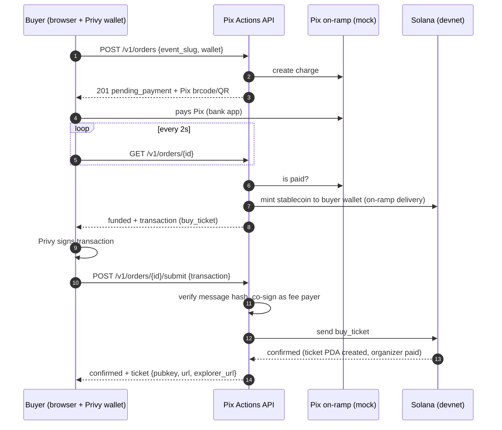

# Checkout flow

This is the buyer journey: open the event link, pay a Pix charge, receive an onchain ticket. The buyer never installs a wallet or holds SOL.

## Sequence



## Step by step

### 1. Read the event (public)

```bash
curl https://pixactions-api.vercel.app/v1/events/meetup-solana-sp-3f9a
```

Returns price, date, `remaining` (read from the onchain counter) and `sold_out`. Draft events return `404`.

### 2. Create the order

```bash
curl -X POST https://pixactions-api.vercel.app/v1/orders \
  -H "Authorization: Bearer $TOKEN" -H "Content-Type: application/json" \
  -d '{"event_slug": "meetup-solana-sp-3f9a", "wallet": "7xKXtg2CW87d97TXJSDpbD5jBkheTqA83TZRuJosgAsU"}'
```

The response has `status: "pending_payment"` and a `pix` object with the "copia e cola" payload (`brcode`), a PNG QR code (`qr_png_base64`) and `expires_at`.

`POST /v1/orders` is idempotent per buyer, event and wallet: while an order is open, calling it again returns the same order. Reloading the checkout page never creates a second charge.

### 3. Poll the order

Call `GET /v1/orders/{id}` every 2 seconds. Each call moves the order forward as far as it can:

| Status | Meaning | Client action |
|---|---|---|
| `pending_payment` | Waiting for the Pix | Show the QR and countdown |
| `paid` | Pix confirmed | Show "payment received" |
| `funding` | On-ramp delivering stablecoins to the buyer wallet | Keep polling |
| `funded` | Stablecoins in the wallet; `transaction` holds `buy_ticket` | Sign `transaction` and submit |
| `confirmed` | Ticket onchain; `ticket` is set | Show the ticket QR (`ticket.url`) |
| `expired` | The Pix charge expired unpaid | Offer a new order |
| `failed` | For example `error: "SOLD_OUT"`: tickets ran out before confirmation | Explain; funds stay in the buyer wallet |

While the order is `funded`, the `transaction` stays identical for `tx_cache_seconds` (45 s by default). Polling never invalidates a transaction the user is signing.

### 4. Sign and submit

```bash
curl -X POST https://pixactions-api.vercel.app/v1/orders/$ORDER_ID/submit \
  -H "Authorization: Bearer $TOKEN" -H "Content-Type: application/json" \
  -d '{"transaction": "<base64 signed by the buyer wallet>"}'
```

On success the order is `confirmed` and `ticket` has the ticket PDA, the public verification URL and an explorer link. Submitting again after confirmation returns the same result.

## Recovering from transient errors

| Error | Why | What to do |
|---|---|---|
| `TX_EXPIRED` (409) | The blockhash expired before submission | Poll `GET /v1/orders/{id}` again; it returns a fresh transaction. Sign and submit it. |
| `TX_STALE` (409) | Another buyer took the same ticket number at the same time | Same as above: poll, sign the new transaction, submit. |
| `ORDER_NOT_FUNDED` (409) | Submitted before the order was `funded` | Keep polling. |
| `SOLD_OUT` (409) | No tickets left | Stop; the order moves to `failed`. |

The web app does this automatically: it signs each issued transaction once and, after `TX_EXPIRED` or `TX_STALE`, simply signs the next transaction the poll returns.

## Sandbox

In the sandbox, the Pix is confirmed automatically after `MOCK_PIX_AUTOPAY_SECONDS` (8 s), or immediately with:

```bash
curl -X POST https://pixactions-api.vercel.app/v1/dev/orders/$ORDER_ID/simulate-payment
```
