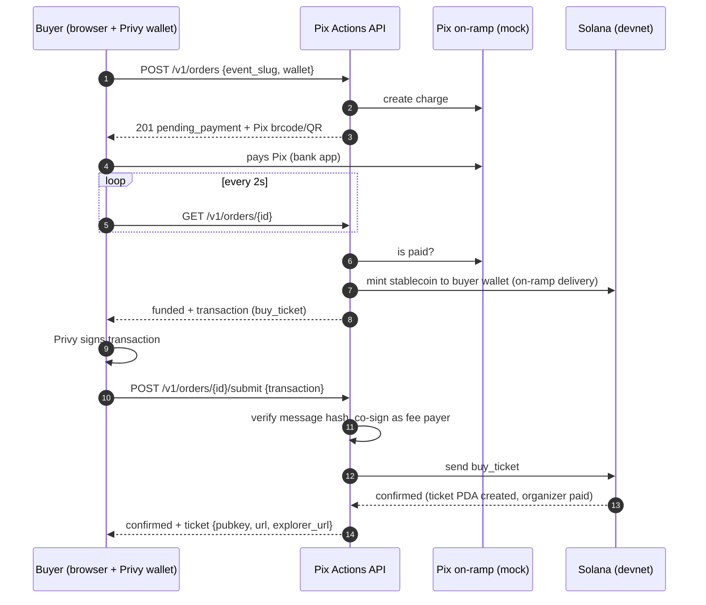

# Pix Actions MVP Implementation Plan

> **For agentic workers:** REQUIRED SUB-SKILL: Use superpowers:subagent-driven-development (recommended) or superpowers:executing-plans to implement this plan task-by-task. Steps use checkbox (`- [ ]`) syntax for tracking.

**Goal:** Qualquer pessoa paga um ingresso com Pix e recebe um ingresso on-chain na Solana (devnet) sem instalar carteira. O organizador recebe na hora e faz o check-in on-chain. Tudo publicado (landing + app + API documentada) até 12/out/2026.

**Architecture:** Programa Anchor (`onchain/`) guarda evento, lotação, ingresso e check-in. Backend FastAPI (`backend/`) monta as transações, paga o gas, simula Pix e on-ramp, persiste pedidos em Postgres e expõe as Solana Actions. Web Next.js (`web/`) tem landing, checkout, painel e check-in, com login e assinatura via carteira embutida da Privy. Padrão único de transação: o backend **monta**, o cliente **assina** e o backend **confere o hash, co-assina como fee payer e envia**.

**Tech Stack:**
- Rust/Anchor (testes TS com mocha)
- Python 3.12 + uv, FastAPI, Pydantic v2, SQLAlchemy 2 async, solders + solana-py, PyJWT, qrcode, scalar-fastapi, pytest
- Next.js (App Router, TS, Tailwind v4), `@privy-io/react-auth`, `openapi-typescript`, `qrcode.react`, `@yudiel/react-qr-scanner`, vitest
- Vercel (web + backend), Neon Postgres, Solana devnet

**Spec:** `docs/superpowers/specs/2026-10-07-pixactions-mvp-design.md`

## Global Constraints

- Commits: Conventional Commits, só no nome do usuário (sem trailer de co-autoria). README sem travessão.
- Prazo de submissão: **12/out/2026 23h59 PT (13/out 3h59 BRT)**. O fluxo de ponta a ponta tem prioridade sobre landing, check-in e Actions.
- Cluster: **devnet**. Moeda da demo: mock de USDC (mint próprio, **6 decimais**), configurável por evento (`payment_mint`).
- Taxa da plataforma: `fee_bps = 100` (1%), máximo `1000`. `fee = price * fee_bps / 10_000`, arredondado para baixo.
- Conversão de preço: `MOCK_BRL_PER_USD = 5.50`, com arredondamento `ROUND_HALF_UP` para unidades de 6 decimais.
- O usuário **nunca** precisa de SOL: o backend (carteira de serviço) é fee payer e paga o rent de todas as contas.
- **Nenhum dado pessoal on-chain.** O banco guarda só `privy_did` e endereço de carteira.
- Formato único de erro da API: `{"error": {"code": "...", "message": "...", "details": {}}}`. Rotas de Solana Actions usam o formato da spec das Actions: `{"message": "..."}`.
- Códigos de erro: `UNAUTHORIZED`, `NOT_FOUND`, `VALIDATION_ERROR`, `SOLD_OUT`, `ORDER_NOT_FUNDED`, `TX_MISMATCH`, `TX_EXPIRED`, `TX_STALE`, `ALREADY_CHECKED_IN`, `RPC_ERROR`.
- Documentação da API em **inglês**. App (checkout e painel) em **pt-BR**. Landing em **PT e EN** com seletor.
- Paleta: fundo `#FFFFFF`, texto grafite `#0B1215`, texto secundário `#5B6770`, linhas `#E6EBE8`, verde-neon `#00E676`, verde para texto sobre branco `#00873E`, verde suave `#E9FFF2`. A paleta final pode ser ajustada pelo brandkit (Task 13).
- Projeto open-source, licença MIT. Repositório público só **com confirmação do usuário** (Task 14).
- Segredos (`SERVICE_KEYPAIR`, `PRIVY_VERIFICATION_KEY`, `DATABASE_URL`, `PIX_WEBHOOK_SECRET`) só em `.env` ou nas env vars da Vercel. Nunca commitados.
- Privy App ID (público): `cmuyxgszw01ds0djtom9ee65r`.

## Review Focus

1. **Dois compradores disputando o mesmo número de ingresso:** o segundo envio falha com "already in use". Deve virar `409 TX_STALE`, o pedido continua `funded`, e o próximo `GET` devolve uma transação nova. Ninguém paga duas vezes. Teste: Task 7, `test_tx_stale_then_refetch`.
2. **Polling enquanto o usuário assina:** `GET /v1/orders/{id}` em `funded` deve devolver **a mesma** transação dentro de `tx_cache_seconds`. Caso contrário, o hash muda no meio da assinatura e o envio dá `TX_MISMATCH`. Teste: Task 7, `test_polling_returns_same_tx`.
3. **Assinatura que demora mais que o blockhash:** depois de `tx_cache_seconds`, o `GET` remonta a transação, e o envio de uma transação expirada vira `TX_EXPIRED`. Teste: Task 7, `test_stale_cache_rebuilds_tx`.
4. **Acesso a recurso de outro usuário:** ler ou enviar pedido de outro comprador, ou enviar e fazer check-in em evento de outro organizador, retorna `404`, nunca vaza dados. Testes: Task 6 `test_submit_by_other_user_is_404`; Task 7 `test_other_user_cannot_read_order`; Task 8 `test_checkin_by_non_organizer_404`.
5. **Evento em rascunho** (organizador não assinou) acessado pelo link ou comprado retorna `404`. Testes: Task 6 `test_public_get_draft_is_404`; Task 7 `test_order_on_draft_event_404`.

---

## Estrutura de arquivos

```
pixactions/
├── LICENSE, README.md, .gitignore
├── onchain/                                Workspace Anchor
│   ├── Anchor.toml
│   ├── programs/pixactions/src/lib.rs      Programa inteiro (contas, instruções, erros)
│   └── tests/pixactions.ts                 Testes mocha (anchor test)
├── backend/
│   ├── pyproject.toml, .env.example
│   ├── pixactions_api/
│   │   ├── main.py            create_app() + app (entrypoint da Vercel)
│   │   ├── config.py          Settings (pydantic-settings)
│   │   ├── errors.py          ErrorCode, ApiError, ErrorResponse, handlers
│   │   ├── db.py              engine, sessão, init lazy, normalize_db_url
│   │   ├── models.py          EventRow, OrderRow, WaitlistRow
│   │   ├── timeutil.py        utcnow() naive-UTC, as_utc()
│   │   ├── deps.py            dependências tipadas (settings, gateway, pix, service, sessão)
│   │   ├── auth.py            validação do JWT da Privy → User
│   │   ├── pricing.py         BRL → unidades do token, taxa, formatação
│   │   ├── docs_meta.py       descrição da API e tags do OpenAPI
│   │   ├── solana/
│   │   │   ├── idl/pixactions.json   copiado de onchain/target/idl
│   │   │   ├── constants.py   PROGRAM_ID (do IDL), ids de programas, genesis devnet
│   │   │   ├── pda.py         config/event/ticket PDA, ATA
│   │   │   ├── spl.py         ixs SPL Token/ATA feitas à mão
│   │   │   ├── instructions.py ixs do programa (discriminators + borsh)
│   │   │   ├── accounts.py    decode/encode das contas
│   │   │   ├── tx.py          build, base64, hash, cosign
│   │   │   └── gateway.py     SolanaGateway (Protocol), RpcSolanaGateway, map_rpc_error
│   │   ├── pix/
│   │   │   ├── base.py        PixCharge, PixProvider (Protocol)
│   │   │   ├── brcode.py      payload EMV "copia e cola" + CRC16
│   │   │   ├── qr.py          QR PNG base64
│   │   │   └── mock.py        MockPixProvider
│   │   ├── services/
│   │   │   ├── events.py      slug, tx de create_event, leitura on-chain, serialização
│   │   │   └── orders.py      máquina de estados, funding, tx de compra, submit
│   │   ├── schemas/           common, events, orders, tickets, actions, waitlist, health
│   │   └── routers/           health, waitlist, events, orders, tickets, actions, dev, webhooks
│   ├── scripts/               bootstrap_devnet.py, smoke_devnet.py, export_openapi.py
│   └── tests/                 conftest.py, helpers.py, test_*.py
├── web/
│   ├── next.config.ts, .env.example, vitest.config.ts
│   ├── public/brand/          logo, ilustrações, og (Higgsfield)
│   └── src/
│       ├── app/               layout, providers, page (landing), e/[slug], t/[pubkey], dashboard/...
│       ├── components/        ui.tsx, AuthGate.tsx, Checkout.tsx, landing/*
│       ├── i18n/landing.ts
│       └── lib/               api.ts, api-types.ts (gerado), useAuthedApi.ts, useTxSigner.ts, b64.ts, format.ts
└── docs/
    ├── api/                   README + 7 guias + openapi.json
    └── superpowers/           specs, plans
```

---

## Task 1: Ferramentas e scaffold dos 3 projetos

**Files:**
- Create: `onchain/` (via `anchor init`), `backend/pyproject.toml`, `backend/pixactions_api/__init__.py`, `backend/tests/__init__.py`, `backend/.env.example`, `web/` (via `create-next-app`), `README.md`

**Interfaces:**
- Produces: `solana`, `anchor`, `uv` no PATH; `anchor build` funcionando; `uv run pytest` funcionando; `npm run build` funcionando.

- [ ] **Step 1: Instalar Solana CLI**

```bash
sh -c "$(curl -sSfL https://release.anza.xyz/stable/install)"
echo 'export PATH="$HOME/.local/share/solana/install/active_release/bin:$PATH"' >> ~/.bashrc
export PATH="$HOME/.local/share/solana/install/active_release/bin:$PATH"
solana --version
```
Expected: `solana-cli 2.x` ou superior.

- [ ] **Step 2: Instalar AVM + Anchor**

```bash
cargo install --git https://github.com/solana-foundation/anchor avm --force
avm install latest && avm use latest
anchor --version
```
Expected: `anchor-cli 0.31.x` ou superior. Anote a versão. Se `avm install latest` falhar por incompatibilidade de Rust, use `avm install 0.31.1 && avm use 0.31.1`.

- [ ] **Step 3: Instalar uv e configurar a carteira de deploy**

```bash
curl -LsSf https://astral.sh/uv/install.sh | sh
source ~/.bashrc
uv --version
solana config set --url devnet
test -f ~/.config/solana/id.json || solana-keygen new --no-bip39-passphrase -o ~/.config/solana/id.json
solana airdrop 2 || echo "Airdrop falhou: use https://faucet.solana.com com o endereço $(solana address)"
solana balance
```
Expected: saldo ≥ 2 SOL. O deploy do programa custa cerca de 2 a 3 SOL; se preciso, repita o faucet.

- [ ] **Step 4: Criar o workspace Anchor**

```bash
cd /home/matheus/dev/projetos/pixactions
anchor init pixactions --no-git --test-template mocha
mv pixactions onchain
cd onchain && anchor build && anchor keys sync && anchor build
```
Se `anchor init` reclamar de `yarn`, rode `corepack enable` e repita. Expected: `target/deploy/pixactions.so` e `target/idl/pixactions.json` existem.

- [ ] **Step 5: Criar o backend**

`backend/pyproject.toml`:
```toml
[project]
name = "pixactions-api"
version = "0.1.0"
description = "Pix Actions API: pay with Pix, receive onchain on Solana"
requires-python = ">=3.12"
dependencies = [
  "fastapi>=0.115",
  "uvicorn[standard]>=0.30",
  "pydantic[email]>=2.8",
  "pydantic-settings>=2.4",
  "sqlalchemy[asyncio]>=2.0.30",
  "asyncpg>=0.29",
  "solders>=0.23",
  "solana>=0.36",
  "pyjwt[crypto]>=2.9",
  "qrcode[pil]>=7.4",
  "scalar-fastapi>=1.0",
  "httpx>=0.27",
]

[dependency-groups]
dev = ["pytest>=8", "pytest-asyncio>=0.24", "aiosqlite>=0.20", "ruff>=0.6"]

[tool.vercel]
entrypoint = "pixactions_api.main:app"

[tool.pytest.ini_options]
asyncio_mode = "auto"
testpaths = ["tests"]
pythonpath = ["."]

[tool.ruff]
line-length = 100
```

```bash
cd /home/matheus/dev/projetos/pixactions/backend
uv python install 3.12 && uv venv --python 3.12
mkdir -p pixactions_api tests scripts && touch pixactions_api/__init__.py tests/__init__.py
uv sync
uv run python -c "import solders, solana, fastapi, jwt, qrcode, scalar_fastapi; print('ok')"
```
Expected: `ok`. Se `solana` e `solders` conflitarem, deixe o uv resolver removendo o piso de `solders`.

`backend/pixactions_api/__init__.py`:
```python
__version__ = "0.1.0"
```

`backend/.env.example`:
```bash
ENV=development
DATABASE_URL=sqlite+aiosqlite:///./dev.db
SOLANA_RPC_URL=https://api.devnet.solana.com
SERVICE_KEYPAIR=            # base58, gerado por scripts/bootstrap_devnet.py
MOCK_USDC_MINT=             # gerado por scripts/bootstrap_devnet.py
PRIVY_APP_ID=cmuyxgszw01ds0djtom9ee65r
PRIVY_VERIFICATION_KEY=     # PEM do dashboard da Privy (quebras de linha como \n)
PIX_WEBHOOK_SECRET=dev-secret
MOCK_PIX_AUTOPAY_SECONDS=8
MOCK_BRL_PER_USD=5.50
PUBLIC_WEB_URL=http://localhost:3000
PUBLIC_API_URL=http://localhost:8000
```

- [ ] **Step 6: Criar a web**

```bash
cd /home/matheus/dev/projetos/pixactions
npx create-next-app@latest web --ts --tailwind --eslint --app --src-dir --import-alias "@/*" --use-npm --yes
cd web && npm install @privy-io/react-auth qrcode.react @yudiel/react-qr-scanner && npm install -D openapi-typescript vitest
npm run build
```
Expected: build OK.

`web/.env.example`:
```bash
NEXT_PUBLIC_PRIVY_APP_ID=cmuyxgszw01ds0djtom9ee65r
NEXT_PUBLIC_API_URL=http://localhost:8000
NEXT_PUBLIC_WEB_URL=http://localhost:3000
NEXT_PUBLIC_SOLANA_CLUSTER=devnet
NEXT_PUBLIC_SHOW_DEV_TOOLS=1
NEXT_PUBLIC_DEMO_EVENT_SLUG=
API_URL=http://localhost:8000
```
Copie para `web/.env.local`.

- [ ] **Step 7: README inicial e commit**

`README.md`:
```markdown
# Pix Actions

Pay with Pix, receive onchain. Pix Actions turns any Solana action, starting with event tickets, into a WhatsApp link that 180 million Brazilians can pay with Pix: no wallet setup, no exchange.

- `onchain/`: Anchor program (events, tickets, check-in)
- `backend/`: FastAPI API (transactions, Pix, Solana Actions). Docs at `/docs`
- `web/`: Next.js landing, checkout, organizer dashboard
- `docs/`: specs, plans and API guides

License: MIT
```

```bash
cd /home/matheus/dev/projetos/pixactions
git add -A && git commit -m "chore: scaffold onchain, backend e web"
```

---

## Task 2: Programa Anchor completo com testes

**Files:**
- Modify: `onchain/programs/pixactions/src/lib.rs` (substituir inteiro)
- Modify: `onchain/programs/pixactions/Cargo.toml`
- Modify: `onchain/package.json` (dependência `@solana/spl-token`)
- Test: `onchain/tests/pixactions.ts` (substituir inteiro)

**Interfaces:**
- Produces (IDL que o backend consome na Task 5):
  - `initialize_config(fee_bps: u16, treasury: Pubkey)`, contas `payer, admin, config, system_program`
  - `create_event(event_id: u64, price: u64, capacity: u32, starts_at: i64, checkin_authority: Pubkey)`, contas `payer, organizer, payment_mint, event, system_program`
  - `buy_ticket()`, contas `payer, buyer, config, event, payment_mint, buyer_token, organizer_token, treasury_token, ticket, token_program, system_program`
  - `check_in()`, contas `checkin_authority, event, ticket`
  - PDAs: `["config"]`, `["event", organizer, event_id u64 LE]`, `["ticket", event, serial u32 LE]`
  - Contas: `Config {admin, fee_bps u16, treasury, bump}`, `Event {organizer, event_id u64, payment_mint, price u64, capacity u32, sold u32, starts_at i64, checkin_authority, bump}`, `Ticket {event, owner, serial u32, checked_in bool, bump}`
  - Erros (nesta ordem, códigos 6000 a 6005): `SoldOut, AlreadyCheckedIn, InvalidFee, InvalidCapacity, MintMismatch, Unauthorized`

- [ ] **Step 1: Escrever os testes (falham porque o programa ainda é o template)**

`onchain/tests/pixactions.ts`:
```ts
import * as anchor from "@coral-xyz/anchor";
import { BN, Program } from "@coral-xyz/anchor";
import { Pixactions } from "../target/types/pixactions";
import {
  createAssociatedTokenAccount,
  createMint,
  getAccount,
  mintTo,
  TOKEN_PROGRAM_ID,
} from "@solana/spl-token";
import { ComputeBudgetProgram, Keypair, PublicKey, SystemProgram } from "@solana/web3.js";
import { assert } from "chai";

describe("pixactions", () => {
  const provider = anchor.AnchorProvider.env();
  anchor.setProvider(provider);
  const program = anchor.workspace.Pixactions as Program<Pixactions>;
  const conn = provider.connection;
  const payer = (provider.wallet as anchor.Wallet).payer;

  const admin = Keypair.generate();
  const treasury = Keypair.generate();
  const organizer = Keypair.generate();
  const buyer = Keypair.generate();
  const PRICE = new BN(3_636_364);
  const FEE = 36_363; // 1% de PRICE, arredondado para baixo

  let mint: PublicKey;
  let otherMint: PublicKey;
  let buyerToken: PublicKey;
  let organizerToken: PublicKey;
  let treasuryToken: PublicKey;

  const pda = (seeds: Buffer[]) => PublicKey.findProgramAddressSync(seeds, program.programId)[0];
  const configPda = pda([Buffer.from("config")]);
  const eventPda = (id: BN) =>
    pda([Buffer.from("event"), organizer.publicKey.toBuffer(), id.toArrayLike(Buffer, "le", 8)]);
  const ticketPda = (event: PublicKey, serial: number) => {
    const b = Buffer.alloc(4);
    b.writeUInt32LE(serial);
    return pda([Buffer.from("ticket"), event.toBuffer(), b]);
  };

  async function expectError(p: Promise<unknown>, code: string) {
    try {
      await p;
    } catch (e: any) {
      const got = e?.error?.errorCode?.code ?? String(e);
      assert.include(got, code);
      return;
    }
    assert.fail(`expected error ${code}`);
  }

  const createEvent = (id: BN, capacity: number) =>
    program.methods
      .createEvent(id, PRICE, capacity, new BN(Math.floor(Date.now() / 1000) + 86_400), organizer.publicKey)
      .accountsPartial({
        payer: payer.publicKey,
        organizer: organizer.publicKey,
        paymentMint: mint,
        event: eventPda(id),
        systemProgram: SystemProgram.programId,
      })
      .signers([organizer])
      .rpc();

  const buy = (event: PublicKey, serial: number, paymentMint: PublicKey = mint) =>
    program.methods
      .buyTicket()
      .accountsPartial({
        payer: payer.publicKey,
        buyer: buyer.publicKey,
        config: configPda,
        event,
        paymentMint,
        buyerToken,
        organizerToken,
        treasuryToken,
        ticket: ticketPda(event, serial),
        tokenProgram: TOKEN_PROGRAM_ID,
        systemProgram: SystemProgram.programId,
      })
      .signers([buyer])
      .rpc();

  const checkIn = (signer: Keypair, event: PublicKey, ticket: PublicKey, cuLimit = 200_000) =>
    program.methods
      .checkIn()
      .accountsPartial({ checkinAuthority: signer.publicKey, event, ticket })
      .preInstructions([ComputeBudgetProgram.setComputeUnitLimit({ units: cuLimit })])
      .signers([signer])
      .rpc();

  before(async () => {
    mint = await createMint(conn, payer, payer.publicKey, null, 6);
    otherMint = await createMint(conn, payer, payer.publicKey, null, 6);
    buyerToken = await createAssociatedTokenAccount(conn, payer, mint, buyer.publicKey);
    organizerToken = await createAssociatedTokenAccount(conn, payer, mint, organizer.publicKey);
    treasuryToken = await createAssociatedTokenAccount(conn, payer, mint, treasury.publicKey);
    await mintTo(conn, payer, mint, buyerToken, payer, 100_000_000);
  });

  it("rejects a fee above 10%", async () => {
    await expectError(
      program.methods
        .initializeConfig(1001, treasury.publicKey)
        .accountsPartial({ payer: payer.publicKey, admin: admin.publicKey, config: configPda, systemProgram: SystemProgram.programId })
        .signers([admin])
        .rpc(),
      "InvalidFee",
    );
  });

  it("initializes config", async () => {
    await program.methods
      .initializeConfig(100, treasury.publicKey)
      .accountsPartial({ payer: payer.publicKey, admin: admin.publicKey, config: configPda, systemProgram: SystemProgram.programId })
      .signers([admin])
      .rpc();
    const cfg = await program.account.config.fetch(configPda);
    assert.equal(cfg.feeBps, 100);
    assert.ok(cfg.treasury.equals(treasury.publicKey));
    assert.ok(cfg.admin.equals(admin.publicKey));
  });

  it("rejects zero capacity", async () => {
    await expectError(createEvent(new BN(99), 0), "InvalidCapacity");
  });

  it("creates an event", async () => {
    await createEvent(new BN(1), 2);
    const ev = await program.account.event.fetch(eventPda(new BN(1)));
    assert.equal(ev.sold, 0);
    assert.equal(ev.capacity, 2);
    assert.ok(ev.price.eq(PRICE));
    assert.ok(ev.organizer.equals(organizer.publicKey));
    assert.ok(ev.paymentMint.equals(mint));
    assert.ok(ev.checkinAuthority.equals(organizer.publicKey));
  });

  it("sells a ticket and splits the payment", async () => {
    const ev = eventPda(new BN(1));
    await buy(ev, 0);
    assert.equal(Number((await getAccount(conn, organizerToken)).amount), PRICE.toNumber() - FEE);
    assert.equal(Number((await getAccount(conn, treasuryToken)).amount), FEE);
    assert.equal(Number((await getAccount(conn, buyerToken)).amount), 100_000_000 - PRICE.toNumber());
    const t = await program.account.ticket.fetch(ticketPda(ev, 0));
    assert.ok(t.owner.equals(buyer.publicKey));
    assert.ok(t.event.equals(ev));
    assert.equal(t.serial, 0);
    assert.isFalse(t.checkedIn);
    assert.equal((await program.account.event.fetch(ev)).sold, 1);
  });

  it("enforces capacity", async () => {
    const ev = eventPda(new BN(1));
    await buy(ev, 1);
    await expectError(buy(ev, 2), "SoldOut");
  });

  it("rejects a payment mint different from the event's", async () => {
    await createEvent(new BN(2), 5);
    await expectError(buy(eventPda(new BN(2)), 0, otherMint), "MintMismatch");
  });

  it("checks a ticket in exactly once", async () => {
    const ev = eventPda(new BN(1));
    const t = ticketPda(ev, 0);
    await checkIn(organizer, ev, t);
    assert.isTrue((await program.account.ticket.fetch(t)).checkedIn);
    await expectError(checkIn(organizer, ev, t, 200_001), "AlreadyCheckedIn");
  });

  it("rejects a stranger at the door", async () => {
    const ev = eventPda(new BN(1));
    await expectError(checkIn(Keypair.generate(), ev, ticketPda(ev, 1)), "Unauthorized");
  });
});
```

```bash
cd /home/matheus/dev/projetos/pixactions/onchain && npm install -D @solana/spl-token
```

- [ ] **Step 2: Rodar e ver falhar**

Run: `cd onchain && anchor test`
Expected: FAIL na compilação TS (`initializeConfig` não existe no tipo `Pixactions`).

- [ ] **Step 3: Implementar o programa**

`onchain/programs/pixactions/Cargo.toml`: na seção `[features]`, garanta `idl-build = ["anchor-lang/idl-build", "anchor-spl/idl-build"]`. Em `[dependencies]`, adicione `anchor-spl` com **a mesma versão** de `anchor-lang`:
```toml
anchor-spl = "<mesma versão de anchor-lang>"
```

`onchain/programs/pixactions/src/lib.rs` (preserve a linha `declare_id!` gerada pelo `anchor keys sync`):
```rust
use anchor_lang::prelude::*;
use anchor_spl::token::{self, Mint, Token, TokenAccount, TransferChecked};

declare_id!("<preservar o id gerado>");

pub const MAX_FEE_BPS: u16 = 1_000;

#[program]
pub mod pixactions {
    use super::*;

    pub fn initialize_config(ctx: Context<InitializeConfig>, fee_bps: u16, treasury: Pubkey) -> Result<()> {
        require!(fee_bps <= MAX_FEE_BPS, PixError::InvalidFee);
        let config = &mut ctx.accounts.config;
        config.admin = ctx.accounts.admin.key();
        config.fee_bps = fee_bps;
        config.treasury = treasury;
        config.bump = ctx.bumps.config;
        Ok(())
    }

    pub fn create_event(
        ctx: Context<CreateEvent>,
        event_id: u64,
        price: u64,
        capacity: u32,
        starts_at: i64,
        checkin_authority: Pubkey,
    ) -> Result<()> {
        require!(capacity > 0, PixError::InvalidCapacity);
        let event = &mut ctx.accounts.event;
        event.organizer = ctx.accounts.organizer.key();
        event.event_id = event_id;
        event.payment_mint = ctx.accounts.payment_mint.key();
        event.price = price;
        event.capacity = capacity;
        event.sold = 0;
        event.starts_at = starts_at;
        event.checkin_authority = checkin_authority;
        event.bump = ctx.bumps.event;
        Ok(())
    }

    pub fn buy_ticket(ctx: Context<BuyTicket>) -> Result<()> {
        let event_key = ctx.accounts.event.key();
        let (price, sold, capacity) = {
            let e = &ctx.accounts.event;
            (e.price, e.sold, e.capacity)
        };
        require!(sold < capacity, PixError::SoldOut);

        let fee = ((price as u128) * (ctx.accounts.config.fee_bps as u128) / 10_000) as u64;
        {
            let a = &ctx.accounts;
            let decimals = a.payment_mint.decimals;
            pay(&a.token_program, &a.buyer_token, &a.payment_mint, &a.organizer_token, &a.buyer, price - fee, decimals)?;
            if fee > 0 {
                pay(&a.token_program, &a.buyer_token, &a.payment_mint, &a.treasury_token, &a.buyer, fee, decimals)?;
            }
        }

        let ticket = &mut ctx.accounts.ticket;
        ticket.event = event_key;
        ticket.owner = ctx.accounts.buyer.key();
        ticket.serial = sold;
        ticket.checked_in = false;
        ticket.bump = ctx.bumps.ticket;
        ctx.accounts.event.sold = sold + 1;
        Ok(())
    }

    pub fn check_in(ctx: Context<CheckIn>) -> Result<()> {
        let ticket = &mut ctx.accounts.ticket;
        require!(!ticket.checked_in, PixError::AlreadyCheckedIn);
        ticket.checked_in = true;
        Ok(())
    }
}

fn pay<'info>(
    token_program: &Program<'info, Token>,
    from: &Account<'info, TokenAccount>,
    mint: &Account<'info, Mint>,
    to: &Account<'info, TokenAccount>,
    authority: &Signer<'info>,
    amount: u64,
    decimals: u8,
) -> Result<()> {
    token::transfer_checked(
        CpiContext::new(
            token_program.to_account_info(),
            TransferChecked {
                from: from.to_account_info(),
                mint: mint.to_account_info(),
                to: to.to_account_info(),
                authority: authority.to_account_info(),
            },
        ),
        amount,
        decimals,
    )
}

#[derive(Accounts)]
pub struct InitializeConfig<'info> {
    #[account(mut)]
    pub payer: Signer<'info>,
    pub admin: Signer<'info>,
    #[account(init, payer = payer, space = 8 + Config::INIT_SPACE, seeds = [b"config"], bump)]
    pub config: Account<'info, Config>,
    pub system_program: Program<'info, System>,
}

#[derive(Accounts)]
#[instruction(event_id: u64)]
pub struct CreateEvent<'info> {
    #[account(mut)]
    pub payer: Signer<'info>,
    pub organizer: Signer<'info>,
    pub payment_mint: Account<'info, Mint>,
    #[account(
        init,
        payer = payer,
        space = 8 + Event::INIT_SPACE,
        seeds = [b"event", organizer.key().as_ref(), &event_id.to_le_bytes()],
        bump
    )]
    pub event: Account<'info, Event>,
    pub system_program: Program<'info, System>,
}

#[derive(Accounts)]
pub struct BuyTicket<'info> {
    #[account(mut)]
    pub payer: Signer<'info>,
    pub buyer: Signer<'info>,
    #[account(seeds = [b"config"], bump = config.bump)]
    pub config: Account<'info, Config>,
    #[account(
        mut,
        seeds = [b"event", event.organizer.as_ref(), &event.event_id.to_le_bytes()],
        bump = event.bump
    )]
    pub event: Account<'info, Event>,
    #[account(address = event.payment_mint @ PixError::MintMismatch)]
    pub payment_mint: Account<'info, Mint>,
    #[account(mut, token::mint = payment_mint, token::authority = buyer)]
    pub buyer_token: Account<'info, TokenAccount>,
    #[account(mut, token::mint = payment_mint, token::authority = event.organizer)]
    pub organizer_token: Account<'info, TokenAccount>,
    #[account(mut, token::mint = payment_mint, token::authority = config.treasury)]
    pub treasury_token: Account<'info, TokenAccount>,
    #[account(
        init,
        payer = payer,
        space = 8 + Ticket::INIT_SPACE,
        seeds = [b"ticket", event.key().as_ref(), &event.sold.to_le_bytes()],
        bump
    )]
    pub ticket: Account<'info, Ticket>,
    pub token_program: Program<'info, Token>,
    pub system_program: Program<'info, System>,
}

#[derive(Accounts)]
pub struct CheckIn<'info> {
    pub checkin_authority: Signer<'info>,
    #[account(has_one = checkin_authority @ PixError::Unauthorized)]
    pub event: Account<'info, Event>,
    #[account(mut, has_one = event)]
    pub ticket: Account<'info, Ticket>,
}

#[account]
#[derive(InitSpace)]
pub struct Config {
    pub admin: Pubkey,
    pub fee_bps: u16,
    pub treasury: Pubkey,
    pub bump: u8,
}

#[account]
#[derive(InitSpace)]
pub struct Event {
    pub organizer: Pubkey,
    pub event_id: u64,
    pub payment_mint: Pubkey,
    pub price: u64,
    pub capacity: u32,
    pub sold: u32,
    pub starts_at: i64,
    pub checkin_authority: Pubkey,
    pub bump: u8,
}

#[account]
#[derive(InitSpace)]
pub struct Ticket {
    pub event: Pubkey,
    pub owner: Pubkey,
    pub serial: u32,
    pub checked_in: bool,
    pub bump: u8,
}

#[error_code]
pub enum PixError {
    #[msg("Event is sold out")]
    SoldOut,
    #[msg("Ticket already checked in")]
    AlreadyCheckedIn,
    #[msg("Fee above the 10% maximum")]
    InvalidFee,
    #[msg("Capacity must be greater than zero")]
    InvalidCapacity,
    #[msg("Payment mint does not match the event")]
    MintMismatch,
    #[msg("Signer is not the event check-in authority")]
    Unauthorized,
}
```

- [ ] **Step 4: Rodar e ver passar**

Run: `cd onchain && anchor test`
Expected: 9 passing.

- [ ] **Step 5: Commit**

```bash
git add onchain && git commit -m "feat(onchain): programa de eventos, ingressos e check-in"
```

---

## Task 3: Deploy na devnet e exportar o IDL

**Files:**
- Modify: `onchain/Anchor.toml` (`[programs.devnet]`)
- Create: `backend/pixactions_api/solana/__init__.py`, `backend/pixactions_api/solana/idl/pixactions.json`

**Interfaces:**
- Produces: programa publicado na devnet com o mesmo id do IDL; `backend/pixactions_api/solana/idl/pixactions.json` com o campo `address`.

- [ ] **Step 1: Deploy**

```bash
cd /home/matheus/dev/projetos/pixactions/onchain
grep -q "programs.devnet" Anchor.toml || printf '\n[programs.devnet]\npixactions = "%s"\n' "$(solana address -k target/deploy/pixactions-keypair.json)" >> Anchor.toml
anchor deploy --provider.cluster devnet
solana program show "$(solana address -k target/deploy/pixactions-keypair.json)" --url devnet
```
Expected: `Program Id: ...` com `Authority` igual a `solana address`. Se faltar SOL: faucet web e `anchor deploy` de novo.

- [ ] **Step 2: Copiar o IDL e conferir**

```bash
mkdir -p ../backend/pixactions_api/solana/idl && touch ../backend/pixactions_api/solana/__init__.py
cp target/idl/pixactions.json ../backend/pixactions_api/solana/idl/pixactions.json
python3 -c "import json;d=json.load(open('../backend/pixactions_api/solana/idl/pixactions.json'));print(d['address'], [i['name'] for i in d['instructions']])"
```
Expected: o id do programa e `['buy_ticket', 'check_in', 'create_event', 'initialize_config']` (em qualquer ordem).

**Importante:** a keypair `onchain/target/deploy/pixactions-keypair.json` está no `.gitignore` (`*-keypair.json`). Faça backup dela fora do repositório (por exemplo, em `~/.config/solana/pixactions-program.json`), senão você perde a autoridade de upgrade.

- [ ] **Step 3: Commit**

```bash
git add onchain/Anchor.toml backend/pixactions_api/solana && git commit -m "feat(onchain): deploy na devnet e IDL para o backend"
```

---
## Task 4: Fundações puras do backend (config, erros, preço, módulo Solana)

**Files:**
- Create: `backend/pixactions_api/config.py`, `timeutil.py`, `errors.py`, `pricing.py`
- Create: `backend/pixactions_api/solana/constants.py`, `pda.py`, `spl.py`, `instructions.py`, `accounts.py`, `tx.py`, `gateway.py`
- Test: `backend/tests/helpers.py`, `backend/tests/test_solana.py`

**Interfaces:**
- Consumes: IDL em `backend/pixactions_api/solana/idl/pixactions.json` (Task 3).
- Produces:
  - `Settings` (campos abaixo) + `get_settings()`; propriedades `is_production`, `privy_key_pem`
  - `utcnow() -> datetime` (UTC sem tzinfo), `as_utc(dt) -> datetime` (com tzinfo UTC), `to_naive_utc(dt) -> datetime`
  - `ErrorCode` (StrEnum), `ApiError(code, message, details=None)` com `.status_code`, `ErrorResponse`, `error_responses(*codes) -> dict`, `install_error_handlers(app)`
  - `brl_cents_to_token_units(cents: int, brl_per_usd: Decimal) -> int`, `fee_units(price: int, fee_bps: int) -> int`, `format_token(units: int) -> str`
  - `PROGRAM_ID`, `SYSTEM_PROGRAM_ID`, `TOKEN_PROGRAM_ID`, `ASSOCIATED_TOKEN_PROGRAM_ID`, `DEVNET_GENESIS_HASH`, `IDL`
  - `config_pda()`, `event_pda(organizer, event_id)`, `ticket_pda(event, serial)`, `ata_address(owner, mint)` (todos `-> Pubkey`)
  - `create_ata_idempotent_ix(*, payer, owner, mint)`, `mint_to_ix(*, mint, destination, authority, amount)`, `initialize_mint2_ix(*, mint, decimals, mint_authority)`, `MINT_SIZE = 82`
  - `ix_discriminator(name)`, `initialize_config_ix(*, payer, admin, fee_bps, treasury)`, `create_event_ix(*, payer, organizer, payment_mint, event_id, price, capacity, starts_at, checkin_authority)`, `buy_ticket_ix(*, payer, buyer, organizer, event, payment_mint, treasury, serial)`, `check_in_ix(*, checkin_authority, event, ticket)`
  - `ConfigAccount`, `EventAccount`, `TicketAccount` (dataclasses frozen) + `decode_*` / `encode_*` + `account_discriminator(name)`
  - `build_tx(instructions, payer, blockhash) -> Transaction`, `tx_to_b64(tx) -> str`, `tx_from_b64(b64) -> Transaction`, `message_hash(tx) -> str` (sha256 hex), `cosign(signed_b64, expected_hash, signer) -> Transaction`
  - `SolanaGateway` (Protocol: `latest_blockhash()`, `send_and_confirm(tx) -> str`, `get_account_data(pubkey) -> bytes | None`), `RpcSolanaGateway(url)`, `map_rpc_error(text) -> ApiError`
  - Teste: `tests.helpers.sign_b64(b64, *signers) -> str`

- [ ] **Step 1: Escrever os testes**

`backend/tests/helpers.py`:
```python
from solders.keypair import Keypair

from pixactions_api.solana.tx import tx_from_b64, tx_to_b64


def sign_b64(b64: str, *signers: Keypair) -> str:
    """Simulates the user's wallet (Privy) signing a transaction issued by the API."""
    tx = tx_from_b64(b64)
    tx.partial_sign(list(signers), tx.message.recent_blockhash)
    return tx_to_b64(tx)
```

`backend/tests/test_solana.py`:
```python
import struct
from decimal import Decimal

import pytest
from solders.hash import Hash
from solders.keypair import Keypair
from spl.token.instructions import get_associated_token_address

from pixactions_api.errors import ApiError, ErrorCode
from pixactions_api.pricing import brl_cents_to_token_units, fee_units, format_token
from pixactions_api.solana.accounts import (
    ConfigAccount,
    EventAccount,
    TicketAccount,
    account_discriminator,
    decode_config,
    decode_event,
    decode_ticket,
    encode_config,
    encode_event,
    encode_ticket,
)
from pixactions_api.solana.constants import IDL, PROGRAM_ID
from pixactions_api.solana.gateway import map_rpc_error
from pixactions_api.solana.instructions import (
    BUY_TICKET_ACCOUNTS,
    CHECK_IN_ACCOUNTS,
    CREATE_EVENT_ACCOUNTS,
    INITIALIZE_CONFIG_ACCOUNTS,
    buy_ticket_ix,
    create_event_ix,
    ix_discriminator,
)
from pixactions_api.solana.pda import ata_address, event_pda, ticket_pda
from pixactions_api.solana.tx import build_tx, cosign, message_hash, tx_to_b64
from tests.helpers import sign_b64

ORGANIZER = Keypair().pubkey()
MINT = Keypair().pubkey()
EVENT = event_pda(ORGANIZER, 1)
BLOCKHASH = Hash.new_unique()


def test_instruction_discriminators_match_idl():
    for ix in IDL["instructions"]:
        assert ix_discriminator(ix["name"]) == bytes(ix["discriminator"]), ix["name"]


def test_account_discriminators_match_idl():
    for acc in IDL["accounts"]:
        assert account_discriminator(acc["name"]) == bytes(acc["discriminator"]), acc["name"]


def test_account_order_matches_idl():
    expected = {
        "initialize_config": INITIALIZE_CONFIG_ACCOUNTS,
        "create_event": CREATE_EVENT_ACCOUNTS,
        "buy_ticket": BUY_TICKET_ACCOUNTS,
        "check_in": CHECK_IN_ACCOUNTS,
    }
    for ix in IDL["instructions"]:
        assert tuple(a["name"] for a in ix["accounts"]) == expected[ix["name"]], ix["name"]


def test_create_event_ix_encodes_args():
    payer = Keypair().pubkey()
    ix = create_event_ix(
        payer=payer, organizer=ORGANIZER, payment_mint=MINT, event_id=42,
        price=3_636_364, capacity=50, starts_at=1_760_000_000, checkin_authority=ORGANIZER,
    )
    data = bytes(ix.data)
    assert ix.program_id == PROGRAM_ID
    assert data[:8] == ix_discriminator("create_event")
    assert struct.unpack_from("<QQIq", data, 8) == (42, 3_636_364, 50, 1_760_000_000)
    assert data[36:68] == bytes(ORGANIZER)
    assert len(data) == 68
    assert ix.accounts[3].pubkey == event_pda(ORGANIZER, 42)
    assert ix.accounts[0].is_signer and ix.accounts[0].is_writable
    assert ix.accounts[1].is_signer and not ix.accounts[1].is_writable


def test_buy_ticket_ix_accounts():
    payer, buyer, treasury = Keypair().pubkey(), Keypair().pubkey(), Keypair().pubkey()
    ix = buy_ticket_ix(
        payer=payer, buyer=buyer, organizer=ORGANIZER, event=EVENT,
        payment_mint=MINT, treasury=treasury, serial=7,
    )
    keys = [m.pubkey for m in ix.accounts]
    assert bytes(ix.data) == ix_discriminator("buy_ticket")
    assert keys[5] == ata_address(buyer, MINT)
    assert keys[6] == ata_address(ORGANIZER, MINT)
    assert keys[7] == ata_address(treasury, MINT)
    assert keys[8] == ticket_pda(EVENT, 7)
    assert ix.accounts[1].is_signer


def test_ata_matches_spl_library():
    owner = Keypair().pubkey()
    assert ata_address(owner, MINT) == get_associated_token_address(owner, MINT)


def test_account_roundtrips():
    ev = EventAccount(ORGANIZER, 9, MINT, 1_000_000, 50, 3, 1_760_000_000, ORGANIZER, 254)
    tk = TicketAccount(EVENT, ORGANIZER, 3, True, 253)
    cf = ConfigAccount(ORGANIZER, 100, MINT, 252)
    assert decode_event(encode_event(ev)) == ev
    assert decode_ticket(encode_ticket(tk)) == tk
    assert decode_config(encode_config(cf)) == cf


def test_decode_rejects_wrong_account_type():
    with pytest.raises(ValueError):
        decode_event(encode_ticket(TicketAccount(EVENT, ORGANIZER, 0, False, 1)))


def _buy_tx(service: Keypair, buyer: Keypair, serial: int = 0):
    ix = buy_ticket_ix(
        payer=service.pubkey(), buyer=buyer.pubkey(), organizer=ORGANIZER, event=EVENT,
        payment_mint=MINT, treasury=service.pubkey(), serial=serial,
    )
    return build_tx([ix], service.pubkey(), BLOCKHASH)


def test_cosign_accepts_tx_signed_by_user():
    service, buyer = Keypair(), Keypair()
    tx = _buy_tx(service, buyer)
    final = cosign(sign_b64(tx_to_b64(tx), buyer), message_hash(tx), service)
    assert all(final.verify_with_results())
    assert final.message.account_keys[0] == service.pubkey()


def test_cosign_rejects_tampered_tx():
    service, buyer = Keypair(), Keypair()
    issued = _buy_tx(service, buyer, serial=0)
    tampered = _buy_tx(service, buyer, serial=1)
    with pytest.raises(ApiError) as err:
        cosign(sign_b64(tx_to_b64(tampered), buyer), message_hash(issued), service)
    assert err.value.code == ErrorCode.TX_MISMATCH


def test_cosign_rejects_missing_user_signature():
    service, buyer = Keypair(), Keypair()
    tx = _buy_tx(service, buyer)
    with pytest.raises(ApiError) as err:
        cosign(tx_to_b64(tx), message_hash(tx), service)
    assert err.value.code == ErrorCode.TX_MISMATCH


def test_cosign_rejects_garbage():
    with pytest.raises(ApiError) as err:
        cosign("not base64 !!", "deadbeef", Keypair())
    assert err.value.code == ErrorCode.VALIDATION_ERROR


@pytest.mark.parametrize(
    ("text", "code"),
    [
        ("Transaction simulation failed: Blockhash not found", ErrorCode.TX_EXPIRED),
        ("custom program error: 0x1770", ErrorCode.SOLD_OUT),
        ("Program log: AnchorError ... custom program error: 0x1771", ErrorCode.ALREADY_CHECKED_IN),
        ("InstructionErrorCustom(6000)", ErrorCode.SOLD_OUT),
        ("Allocate: account Address { address: 9x.. } already in use", ErrorCode.TX_STALE),
        ("connection reset", ErrorCode.RPC_ERROR),
    ],
)
def test_map_rpc_error(text, code):
    assert map_rpc_error(text).code == code


def test_pricing():
    assert brl_cents_to_token_units(2000, Decimal("5.50")) == 3_636_364
    assert fee_units(3_636_364, 100) == 36_363
    assert format_token(3_636_364) == "3.64"
```

- [ ] **Step 2: Rodar e ver falhar**

Run: `cd backend && uv run pytest tests/test_solana.py -q`
Expected: FAIL com `ModuleNotFoundError: pixactions_api.errors`.

- [ ] **Step 3: Implementar config, tempo, erros e preço**

`backend/pixactions_api/config.py`:
```python
from decimal import Decimal
from functools import lru_cache

from pydantic_settings import BaseSettings, SettingsConfigDict


class Settings(BaseSettings):
    model_config = SettingsConfigDict(env_file=".env", extra="ignore")

    env: str = "development"
    database_url: str = "sqlite+aiosqlite:///./dev.db"
    solana_rpc_url: str = "https://api.devnet.solana.com"
    solana_cluster: str = "devnet"
    service_keypair: str = ""
    mock_usdc_mint: str = ""
    privy_app_id: str = ""
    privy_verification_key: str = ""
    pix_webhook_secret: str = "dev-secret"
    mock_pix_autopay_seconds: int = 8
    mock_brl_per_usd: Decimal = Decimal("5.50")
    pix_expiration_seconds: int = 900
    tx_cache_seconds: int = 45
    public_web_url: str = "http://localhost:3000"
    public_api_url: str = "http://localhost:8000"

    @property
    def is_production(self) -> bool:
        return self.env == "production"

    @property
    def privy_key_pem(self) -> str:
        return self.privy_verification_key.replace("\\n", "\n")


@lru_cache
def get_settings() -> Settings:
    return Settings()
```

`backend/pixactions_api/timeutil.py`:
```python
from datetime import UTC, datetime


def utcnow() -> datetime:
    """Naive UTC 'now'. All datetimes are stored naive-UTC (SQLite drops tzinfo)."""
    return datetime.now(UTC).replace(tzinfo=None)


def as_utc(dt: datetime) -> datetime:
    return dt.replace(tzinfo=UTC) if dt.tzinfo is None else dt.astimezone(UTC)


def to_naive_utc(dt: datetime) -> datetime:
    return as_utc(dt).replace(tzinfo=None)
```

`backend/pixactions_api/errors.py`:
```python
from enum import StrEnum
from typing import Any

from fastapi import FastAPI, Request
from fastapi.exceptions import RequestValidationError
from fastapi.responses import JSONResponse
from pydantic import BaseModel, ConfigDict, Field
from starlette.exceptions import HTTPException as StarletteHTTPException


class ErrorCode(StrEnum):
    UNAUTHORIZED = "UNAUTHORIZED"
    NOT_FOUND = "NOT_FOUND"
    VALIDATION_ERROR = "VALIDATION_ERROR"
    SOLD_OUT = "SOLD_OUT"
    ORDER_NOT_FUNDED = "ORDER_NOT_FUNDED"
    TX_MISMATCH = "TX_MISMATCH"
    TX_EXPIRED = "TX_EXPIRED"
    TX_STALE = "TX_STALE"
    ALREADY_CHECKED_IN = "ALREADY_CHECKED_IN"
    RPC_ERROR = "RPC_ERROR"


HTTP_STATUS: dict[ErrorCode, int] = {
    ErrorCode.UNAUTHORIZED: 401,
    ErrorCode.NOT_FOUND: 404,
    ErrorCode.VALIDATION_ERROR: 422,
    ErrorCode.SOLD_OUT: 409,
    ErrorCode.ORDER_NOT_FUNDED: 409,
    ErrorCode.TX_MISMATCH: 400,
    ErrorCode.TX_EXPIRED: 409,
    ErrorCode.TX_STALE: 409,
    ErrorCode.ALREADY_CHECKED_IN: 409,
    ErrorCode.RPC_ERROR: 502,
}

ERROR_DESCRIPTIONS: dict[ErrorCode, str] = {
    ErrorCode.UNAUTHORIZED: "missing, invalid or expired Privy access token",
    ErrorCode.NOT_FOUND: "resource does not exist or does not belong to you",
    ErrorCode.VALIDATION_ERROR: "request body or parameters are invalid",
    ErrorCode.SOLD_OUT: "the event has no tickets left",
    ErrorCode.ORDER_NOT_FUNDED: "the order is not ready to be signed (Pix not confirmed yet)",
    ErrorCode.TX_MISMATCH: "the signed transaction differs from the one issued, or lacks a signature",
    ErrorCode.TX_EXPIRED: "the transaction blockhash expired; fetch a fresh transaction",
    ErrorCode.TX_STALE: "a concurrent purchase took this ticket slot; fetch a fresh transaction",
    ErrorCode.ALREADY_CHECKED_IN: "the ticket was already used",
    ErrorCode.RPC_ERROR: "Solana RPC failure",
}


class ApiError(Exception):
    def __init__(self, code: ErrorCode, message: str, details: dict[str, Any] | None = None):
        super().__init__(message)
        self.code = code
        self.message = message
        self.details = details or {}

    @property
    def status_code(self) -> int:
        return HTTP_STATUS[self.code]


class ErrorBody(BaseModel):
    code: ErrorCode = Field(description="Stable, machine-readable error code.")
    message: str = Field(description="Human-readable explanation.")
    details: dict[str, Any] = Field(default_factory=dict, description="Optional structured context.")


class ErrorResponse(BaseModel):
    model_config = ConfigDict(
        json_schema_extra={
            "examples": [{"error": {"code": "SOLD_OUT", "message": "Event is sold out", "details": {}}}]
        }
    )
    error: ErrorBody


def error_responses(*codes: ErrorCode) -> dict[int | str, dict[str, Any]]:
    """OpenAPI `responses=` entries for the given error codes, grouped by HTTP status."""
    out: dict[int | str, dict[str, Any]] = {}
    for code in codes:
        entry = out.setdefault(HTTP_STATUS[code], {"model": ErrorResponse, "description": ""})
        line = f"`{code}`: {ERROR_DESCRIPTIONS[code]}"
        entry["description"] = f"{entry['description']}; {line}" if entry["description"] else line
    return out


def _payload(code: ErrorCode, message: str, details: dict[str, Any] | None = None) -> dict:
    return {"error": {"code": code.value, "message": message, "details": details or {}}}


def install_error_handlers(app: FastAPI) -> None:
    @app.exception_handler(ApiError)
    async def _api_error(_: Request, exc: ApiError) -> JSONResponse:
        return JSONResponse(_payload(exc.code, exc.message, exc.details), status_code=exc.status_code)

    @app.exception_handler(RequestValidationError)
    async def _validation(_: Request, exc: RequestValidationError) -> JSONResponse:
        errors = [{k: e[k] for k in ("loc", "msg", "type") if k in e} for e in exc.errors()]
        return JSONResponse(
            _payload(ErrorCode.VALIDATION_ERROR, "Request validation failed", {"errors": errors}),
            status_code=422,
        )

    @app.exception_handler(StarletteHTTPException)
    async def _http(_: Request, exc: StarletteHTTPException) -> JSONResponse:
        code = {404: ErrorCode.NOT_FOUND, 401: ErrorCode.UNAUTHORIZED, 403: ErrorCode.UNAUTHORIZED}.get(
            exc.status_code, ErrorCode.VALIDATION_ERROR
        )
        return JSONResponse(_payload(code, str(exc.detail)), status_code=exc.status_code)
```

`backend/pixactions_api/pricing.py`:
```python
from decimal import ROUND_HALF_UP, Decimal

TOKEN_DECIMALS = 6


def brl_cents_to_token_units(cents: int, brl_per_usd: Decimal) -> int:
    usd = Decimal(cents) / Decimal(100) / brl_per_usd
    return int((usd * Decimal(10**TOKEN_DECIMALS)).quantize(Decimal(1), rounding=ROUND_HALF_UP))


def fee_units(price: int, fee_bps: int) -> int:
    return price * fee_bps // 10_000


def format_token(units: int) -> str:
    return f"{Decimal(units) / Decimal(10**TOKEN_DECIMALS):.2f}"
```

- [ ] **Step 4: Implementar o módulo Solana**

`backend/pixactions_api/solana/constants.py`:
```python
import json
from pathlib import Path

from solders.pubkey import Pubkey

IDL: dict = json.loads((Path(__file__).parent / "idl" / "pixactions.json").read_text())
PROGRAM_ID = Pubkey.from_string(IDL["address"])
SYSTEM_PROGRAM_ID = Pubkey.from_string("11111111111111111111111111111111")
TOKEN_PROGRAM_ID = Pubkey.from_string("TokenkegQfeZyiNwAJbNbGKPFXCWuBvf9Ss623VQ5DA")
ASSOCIATED_TOKEN_PROGRAM_ID = Pubkey.from_string("ATokenGPvbdGVxr1b2hvZbsiqW5xWH25efTNsLJA8knL")
DEVNET_GENESIS_HASH = "EtWTRABZaYq6iMfeYKouRu166VU2xqa1"
```

`backend/pixactions_api/solana/pda.py`:
```python
from solders.pubkey import Pubkey

from .constants import ASSOCIATED_TOKEN_PROGRAM_ID, PROGRAM_ID, TOKEN_PROGRAM_ID


def config_pda() -> Pubkey:
    return Pubkey.find_program_address([b"config"], PROGRAM_ID)[0]


def event_pda(organizer: Pubkey, event_id: int) -> Pubkey:
    return Pubkey.find_program_address(
        [b"event", bytes(organizer), event_id.to_bytes(8, "little")], PROGRAM_ID
    )[0]


def ticket_pda(event: Pubkey, serial: int) -> Pubkey:
    return Pubkey.find_program_address(
        [b"ticket", bytes(event), serial.to_bytes(4, "little")], PROGRAM_ID
    )[0]


def ata_address(owner: Pubkey, mint: Pubkey) -> Pubkey:
    return Pubkey.find_program_address(
        [bytes(owner), bytes(TOKEN_PROGRAM_ID), bytes(mint)], ASSOCIATED_TOKEN_PROGRAM_ID
    )[0]
```

`backend/pixactions_api/solana/spl.py`:
```python
"""Minimal SPL Token / Associated Token instructions, hand-encoded to avoid version drift."""

import struct

from solders.instruction import AccountMeta, Instruction
from solders.pubkey import Pubkey

from .constants import ASSOCIATED_TOKEN_PROGRAM_ID, SYSTEM_PROGRAM_ID, TOKEN_PROGRAM_ID
from .pda import ata_address

MINT_SIZE = 82


def create_ata_idempotent_ix(*, payer: Pubkey, owner: Pubkey, mint: Pubkey) -> Instruction:
    return Instruction(
        ASSOCIATED_TOKEN_PROGRAM_ID,
        bytes([1]),  # CreateIdempotent
        [
            AccountMeta(payer, True, True),
            AccountMeta(ata_address(owner, mint), False, True),
            AccountMeta(owner, False, False),
            AccountMeta(mint, False, False),
            AccountMeta(SYSTEM_PROGRAM_ID, False, False),
            AccountMeta(TOKEN_PROGRAM_ID, False, False),
        ],
    )


def mint_to_ix(*, mint: Pubkey, destination: Pubkey, authority: Pubkey, amount: int) -> Instruction:
    return Instruction(
        TOKEN_PROGRAM_ID,
        bytes([7]) + struct.pack("<Q", amount),  # MintTo
        [
            AccountMeta(mint, False, True),
            AccountMeta(destination, False, True),
            AccountMeta(authority, True, False),
        ],
    )


def initialize_mint2_ix(*, mint: Pubkey, decimals: int, mint_authority: Pubkey) -> Instruction:
    data = bytes([20, decimals]) + bytes(mint_authority) + bytes([0])  # no freeze authority
    return Instruction(TOKEN_PROGRAM_ID, data, [AccountMeta(mint, False, True)])
```

`backend/pixactions_api/solana/instructions.py`:
```python
"""Instruction builders for the pixactions Anchor program (discriminator + borsh args)."""

import hashlib
import struct

from solders.instruction import AccountMeta, Instruction
from solders.pubkey import Pubkey

from .constants import PROGRAM_ID, SYSTEM_PROGRAM_ID, TOKEN_PROGRAM_ID
from .pda import ata_address, config_pda, event_pda, ticket_pda

INITIALIZE_CONFIG_ACCOUNTS = ("payer", "admin", "config", "system_program")
CREATE_EVENT_ACCOUNTS = ("payer", "organizer", "payment_mint", "event", "system_program")
BUY_TICKET_ACCOUNTS = (
    "payer", "buyer", "config", "event", "payment_mint", "buyer_token",
    "organizer_token", "treasury_token", "ticket", "token_program", "system_program",
)
CHECK_IN_ACCOUNTS = ("checkin_authority", "event", "ticket")


def ix_discriminator(name: str) -> bytes:
    return hashlib.sha256(f"global:{name}".encode()).digest()[:8]


def initialize_config_ix(*, payer: Pubkey, admin: Pubkey, fee_bps: int, treasury: Pubkey) -> Instruction:
    data = ix_discriminator("initialize_config") + struct.pack("<H", fee_bps) + bytes(treasury)
    return Instruction(
        PROGRAM_ID,
        data,
        [
            AccountMeta(payer, True, True),
            AccountMeta(admin, True, False),
            AccountMeta(config_pda(), False, True),
            AccountMeta(SYSTEM_PROGRAM_ID, False, False),
        ],
    )


def create_event_ix(
    *, payer: Pubkey, organizer: Pubkey, payment_mint: Pubkey, event_id: int, price: int,
    capacity: int, starts_at: int, checkin_authority: Pubkey,
) -> Instruction:
    data = (
        ix_discriminator("create_event")
        + struct.pack("<QQIq", event_id, price, capacity, starts_at)
        + bytes(checkin_authority)
    )
    return Instruction(
        PROGRAM_ID,
        data,
        [
            AccountMeta(payer, True, True),
            AccountMeta(organizer, True, False),
            AccountMeta(payment_mint, False, False),
            AccountMeta(event_pda(organizer, event_id), False, True),
            AccountMeta(SYSTEM_PROGRAM_ID, False, False),
        ],
    )


def buy_ticket_ix(
    *, payer: Pubkey, buyer: Pubkey, organizer: Pubkey, event: Pubkey, payment_mint: Pubkey,
    treasury: Pubkey, serial: int,
) -> Instruction:
    return Instruction(
        PROGRAM_ID,
        ix_discriminator("buy_ticket"),
        [
            AccountMeta(payer, True, True),
            AccountMeta(buyer, True, False),
            AccountMeta(config_pda(), False, False),
            AccountMeta(event, False, True),
            AccountMeta(payment_mint, False, False),
            AccountMeta(ata_address(buyer, payment_mint), False, True),
            AccountMeta(ata_address(organizer, payment_mint), False, True),
            AccountMeta(ata_address(treasury, payment_mint), False, True),
            AccountMeta(ticket_pda(event, serial), False, True),
            AccountMeta(TOKEN_PROGRAM_ID, False, False),
            AccountMeta(SYSTEM_PROGRAM_ID, False, False),
        ],
    )


def check_in_ix(*, checkin_authority: Pubkey, event: Pubkey, ticket: Pubkey) -> Instruction:
    return Instruction(
        PROGRAM_ID,
        ix_discriminator("check_in"),
        [
            AccountMeta(checkin_authority, True, False),
            AccountMeta(event, False, False),
            AccountMeta(ticket, False, True),
        ],
    )
```

`backend/pixactions_api/solana/accounts.py`:
```python
import hashlib
import struct
from dataclasses import dataclass

from solders.pubkey import Pubkey


def account_discriminator(name: str) -> bytes:
    return hashlib.sha256(f"account:{name}".encode()).digest()[:8]


@dataclass(frozen=True)
class ConfigAccount:
    admin: Pubkey
    fee_bps: int
    treasury: Pubkey
    bump: int


@dataclass(frozen=True)
class EventAccount:
    organizer: Pubkey
    event_id: int
    payment_mint: Pubkey
    price: int
    capacity: int
    sold: int
    starts_at: int
    checkin_authority: Pubkey
    bump: int


@dataclass(frozen=True)
class TicketAccount:
    event: Pubkey
    owner: Pubkey
    serial: int
    checked_in: bool
    bump: int


_CONFIG = struct.Struct("<32sH32sB")
_EVENT = struct.Struct("<32sQ32sQIIq32sB")
_TICKET = struct.Struct("<32s32sI?B")


def _fields(data: bytes, name: str, layout: struct.Struct) -> tuple:
    if len(data) < 8 + layout.size or data[:8] != account_discriminator(name):
        raise ValueError(f"not a {name} account")
    return layout.unpack_from(data, 8)


def decode_config(data: bytes) -> ConfigAccount:
    admin, fee_bps, treasury, bump = _fields(data, "Config", _CONFIG)
    return ConfigAccount(Pubkey(admin), fee_bps, Pubkey(treasury), bump)


def decode_event(data: bytes) -> EventAccount:
    f = _fields(data, "Event", _EVENT)
    return EventAccount(Pubkey(f[0]), f[1], Pubkey(f[2]), f[3], f[4], f[5], f[6], Pubkey(f[7]), f[8])


def decode_ticket(data: bytes) -> TicketAccount:
    event, owner, serial, checked_in, bump = _fields(data, "Ticket", _TICKET)
    return TicketAccount(Pubkey(event), Pubkey(owner), serial, checked_in, bump)


def encode_config(a: ConfigAccount) -> bytes:
    return account_discriminator("Config") + _CONFIG.pack(bytes(a.admin), a.fee_bps, bytes(a.treasury), a.bump)


def encode_event(a: EventAccount) -> bytes:
    return account_discriminator("Event") + _EVENT.pack(
        bytes(a.organizer), a.event_id, bytes(a.payment_mint), a.price, a.capacity, a.sold,
        a.starts_at, bytes(a.checkin_authority), a.bump,
    )


def encode_ticket(a: TicketAccount) -> bytes:
    return account_discriminator("Ticket") + _TICKET.pack(
        bytes(a.event), bytes(a.owner), a.serial, a.checked_in, a.bump
    )
```

`backend/pixactions_api/solana/tx.py`:
```python
import base64
import binascii
import hashlib
from collections.abc import Sequence

from solders.hash import Hash
from solders.instruction import Instruction
from solders.keypair import Keypair
from solders.message import Message
from solders.pubkey import Pubkey
from solders.transaction import Transaction

from ..errors import ApiError, ErrorCode


def build_tx(instructions: Sequence[Instruction], payer: Pubkey, blockhash: Hash) -> Transaction:
    return Transaction.new_unsigned(Message.new_with_blockhash(list(instructions), payer, blockhash))


def tx_to_b64(tx: Transaction) -> str:
    return base64.b64encode(bytes(tx)).decode()


def tx_from_b64(b64: str) -> Transaction:
    try:
        return Transaction.from_bytes(base64.b64decode(b64, validate=True))
    except (binascii.Error, ValueError, Exception) as exc:
        raise ApiError(
            ErrorCode.VALIDATION_ERROR, "transaction is not a valid base64 Solana transaction"
        ) from exc


def message_hash(tx: Transaction) -> str:
    return hashlib.sha256(bytes(tx.message)).hexdigest()


def cosign(signed_b64: str, expected_hash: str, signer: Keypair) -> Transaction:
    """Accept a user-signed tx only if its message is exactly the one we issued, then co-sign."""
    tx = tx_from_b64(signed_b64)
    if message_hash(tx) != expected_hash:
        raise ApiError(ErrorCode.TX_MISMATCH, "Transaction differs from the one issued by the API")
    tx.partial_sign([signer], tx.message.recent_blockhash)
    if not all(tx.verify_with_results()):
        raise ApiError(ErrorCode.TX_MISMATCH, "Transaction is missing a valid user signature")
    return tx
```

`backend/pixactions_api/solana/gateway.py`:
```python
import re
from typing import Protocol

from solana.rpc.async_api import AsyncClient
from solana.rpc.commitment import Confirmed
from solana.rpc.types import TxOpts
from solders.hash import Hash
from solders.pubkey import Pubkey
from solders.transaction import Transaction

from ..errors import ApiError, ErrorCode

_PROGRAM_ERRORS = {
    6000: (ErrorCode.SOLD_OUT, "Event is sold out"),
    6001: (ErrorCode.ALREADY_CHECKED_IN, "Ticket already checked in"),
}


def map_rpc_error(text: str) -> ApiError:
    low = text.lower()
    if "blockhash not found" in low or "block height exceeded" in low or "has expired" in low:
        return ApiError(ErrorCode.TX_EXPIRED, "Transaction expired; fetch a fresh one and sign again")
    if "already in use" in low:
        return ApiError(
            ErrorCode.TX_STALE,
            "Ticket slot taken by a concurrent purchase; fetch a fresh transaction",
        )
    code: int | None = None
    if m := re.search(r"custom program error: 0x([0-9a-f]+)", low):
        code = int(m.group(1), 16)
    elif m := re.search(r"custom\((\d+)\)", low):
        code = int(m.group(1))
    if code in _PROGRAM_ERRORS:
        err_code, message = _PROGRAM_ERRORS[code]
        return ApiError(err_code, message)
    return ApiError(ErrorCode.RPC_ERROR, "Solana RPC error", {"detail": text[:500]})


class SolanaGateway(Protocol):
    async def latest_blockhash(self) -> Hash: ...
    async def send_and_confirm(self, tx: Transaction) -> str: ...
    async def get_account_data(self, pubkey: Pubkey) -> bytes | None: ...


class RpcSolanaGateway:
    """Real RPC gateway. Opens a client per call: safe across serverless event loops."""

    def __init__(self, url: str) -> None:
        self._url = url

    def _client(self) -> AsyncClient:
        return AsyncClient(self._url, commitment=Confirmed)

    async def latest_blockhash(self) -> Hash:
        try:
            async with self._client() as c:
                return (await c.get_latest_blockhash()).value.blockhash
        except Exception as exc:
            raise map_rpc_error(str(exc)) from exc

    async def send_and_confirm(self, tx: Transaction) -> str:
        try:
            async with self._client() as c:
                opts = TxOpts(skip_confirmation=True, preflight_commitment=Confirmed)
                sig = (await c.send_raw_transaction(bytes(tx), opts=opts)).value
                await c.confirm_transaction(sig, commitment=Confirmed, sleep_seconds=0.4)
                status = (await c.get_signature_statuses([sig])).value[0]
        except ApiError:
            raise
        except Exception as exc:
            raise map_rpc_error(str(exc)) from exc
        if status is not None and status.err is not None:
            raise map_rpc_error(str(status.err))
        return str(sig)

    async def get_account_data(self, pubkey: Pubkey) -> bytes | None:
        try:
            async with self._client() as c:
                resp = await c.get_account_info(pubkey)
        except Exception as exc:
            raise map_rpc_error(str(exc)) from exc
        return bytes(resp.value.data) if resp.value is not None else None
```

- [ ] **Step 5: Rodar e ver passar**

Run: `cd backend && uv run pytest tests/test_solana.py -q && uv run ruff check .`
Expected: todos passam; ruff limpo. Se algum nome da API do `solders` divergir na versão instalada (por exemplo, `verify_with_results`), confira com `uv run python -c "from solders.transaction import Transaction; print(dir(Transaction))"` e ajuste mantendo o comportamento.

- [ ] **Step 6: Commit**

```bash
git add backend && git commit -m "feat(backend): config, erros, preço e cliente Solana do programa"
```

---

## Task 5: Núcleo do app (banco, Pix simulado, health, docs UI, lista de espera)

**Files:**
- Create: `backend/pixactions_api/db.py`, `models.py`, `deps.py`, `docs_meta.py`, `main.py`
- Create: `backend/pixactions_api/pix/__init__.py`, `pix/base.py`, `pix/brcode.py`, `pix/qr.py`, `pix/mock.py`
- Create: `backend/pixactions_api/schemas/__init__.py`, `schemas/common.py`, `schemas/health.py`, `schemas/waitlist.py`
- Create: `backend/pixactions_api/routers/__init__.py`, `routers/health.py`, `routers/waitlist.py`
- Modify: `backend/tests/helpers.py` (adicionar `FakeSolanaGateway`)
- Test: `backend/tests/conftest.py`, `backend/tests/test_core.py`, `backend/tests/test_pix.py`

**Interfaces:**
- Consumes: Task 4 inteira.
- Produces:
  - `Base`, `normalize_db_url(url) -> tuple[str, dict]`, `make_engine(url)`, `init_db(engine)`, `get_session(request)` (cria as tabelas no primeiro uso)
  - `EventRow`, `OrderRow`, `WaitlistRow` (campos abaixo)
  - `deps`: `SettingsDep`, `SessionDep`, `GatewayDep`, `PixDep`, `ServiceDep` (Keypair de serviço)
  - `PixCharge(charge_id, brcode, expires_at)`, `PixProvider` (Protocol: `name`, `create_charge(*, order_id, amount_brl_cents, description)`, `is_paid(order)`, `parse_webhook(body, headers) -> str`), `MockPixProvider(settings)`
  - `crc16_ccitt(data) -> str`, `build_brcode(*, pix_key, amount_brl_cents, merchant_name, merchant_city, txid) -> str`, `qr_png_base64(text) -> str`
  - `SolanaAddress` (str anotado e validado), `SignedTransaction {transaction}`
  - `create_app(settings=None, *, gateway=None, pix=None, engine=None) -> FastAPI`, `app`
  - Rotas: `GET /health`, `POST /v1/waitlist`, `GET /docs` (Scalar), `GET /redoc`
  - Testes: fixtures `privy_keys`, `service`, `settings`, `gateway`, `app`, `client`, `auth(did=...) -> headers`; `FakeSolanaGateway` com `.sent`, `.accounts`, `.fail_next`, `.blockhash`

- [ ] **Step 1: Escrever os testes**

Acrescentar em `backend/tests/helpers.py` (imports no topo do arquivo):
```python
from solders.hash import Hash
from solders.pubkey import Pubkey
from solders.transaction import Transaction


class FakeSolanaGateway:
    """In-memory stand-in for the RPC: records sent txs, serves seeded account data."""

    def __init__(self) -> None:
        self.sent: list[Transaction] = []
        self.accounts: dict[str, bytes] = {}
        self.fail_next: Exception | None = None
        self.blockhash = Hash.new_unique()

    async def latest_blockhash(self) -> Hash:
        return self.blockhash

    async def send_and_confirm(self, tx: Transaction) -> str:
        if self.fail_next is not None:
            err, self.fail_next = self.fail_next, None
            raise err
        assert all(tx.verify_with_results()), "fake RPC got a tx with missing signatures"
        self.sent.append(tx)
        return str(tx.signatures[0])

    async def get_account_data(self, pubkey: Pubkey) -> bytes | None:
        return self.accounts.get(str(pubkey))


def sent_to_program(gateway: FakeSolanaGateway, program_id: Pubkey) -> list[Transaction]:
    """Transactions with at least one instruction for `program_id`."""
    out = []
    for tx in gateway.sent:
        keys = tx.message.account_keys
        if any(keys[ix.program_id_index] == program_id for ix in tx.message.instructions):
            out.append(tx)
    return out
```

`backend/tests/conftest.py`:
```python
import time

import jwt
import pytest
from cryptography.hazmat.primitives import serialization
from cryptography.hazmat.primitives.asymmetric import ec
from httpx import ASGITransport, AsyncClient
from solders.keypair import Keypair

from pixactions_api.config import Settings
from pixactions_api.main import create_app
from pixactions_api.pix.mock import MockPixProvider
from tests.helpers import FakeSolanaGateway


@pytest.fixture
def privy_keys():
    priv = ec.generate_private_key(ec.SECP256R1())
    pub = priv.public_key().public_bytes(
        serialization.Encoding.PEM, serialization.PublicFormat.SubjectPublicKeyInfo
    ).decode()
    return priv, pub


@pytest.fixture
def service() -> Keypair:
    return Keypair()


@pytest.fixture
def settings(privy_keys, service) -> Settings:
    return Settings(
        _env_file=None,
        env="test",
        database_url="sqlite+aiosqlite:///:memory:",
        service_keypair=str(service),
        mock_usdc_mint=str(Keypair().pubkey()),
        privy_app_id="test-app",
        privy_verification_key=privy_keys[1],
        pix_webhook_secret="whsec",
        mock_pix_autopay_seconds=0,
        public_web_url="https://pixactions.test",
        public_api_url="https://api.pixactions.test",
    )


@pytest.fixture
def gateway() -> FakeSolanaGateway:
    return FakeSolanaGateway()


@pytest.fixture
def app(settings, gateway):
    return create_app(settings, gateway=gateway, pix=MockPixProvider(settings))


@pytest.fixture
async def client(app):
    async with AsyncClient(transport=ASGITransport(app=app), base_url="http://test") as c:
        yield c


@pytest.fixture
def auth(privy_keys, settings):
    def make(did: str = "did:privy:alice") -> dict[str, str]:
        now = int(time.time())
        claims = {"sub": did, "iss": "privy.io", "aud": settings.privy_app_id, "iat": now, "exp": now + 3600}
        return {"Authorization": f"Bearer {jwt.encode(claims, privy_keys[0], algorithm='ES256')}"}

    return make
```

`backend/tests/test_core.py`:
```python
from pixactions_api.db import normalize_db_url
from pixactions_api.solana.constants import PROGRAM_ID


async def test_health(client, settings, service):
    r = await client.get("/health")
    assert r.status_code == 200
    body = r.json()
    assert body["status"] == "ok"
    assert body["cluster"] == "devnet"
    assert body["program_id"] == str(PROGRAM_ID)
    assert body["service_wallet"] == str(service.pubkey())
    assert body["payment_mint"] == settings.mock_usdc_mint


async def test_docs_ui_is_scalar(client):
    r = await client.get("/docs")
    assert r.status_code == 200
    assert "scalar" in r.text.lower()


async def test_openapi_is_served(client):
    r = await client.get("/openapi.json")
    assert r.status_code == 200
    assert r.json()["info"]["title"] == "Pix Actions API"


async def test_waitlist_is_idempotent(client):
    body = {"email": "Ana@Example.com", "role": "organizer", "lang": "pt"}
    r1 = await client.post("/v1/waitlist", json=body)
    r2 = await client.post("/v1/waitlist", json=body)
    assert r1.status_code == 200 and r1.json() == {"email": "ana@example.com", "role": "organizer", "created": True}
    assert r2.status_code == 200 and r2.json()["created"] is False


async def test_validation_error_has_standard_shape(client):
    r = await client.post("/v1/waitlist", json={"email": "nope", "role": "organizer"})
    assert r.status_code == 422
    assert r.json()["error"]["code"] == "VALIDATION_ERROR"
    assert r.json()["error"]["details"]["errors"]


async def test_unknown_route_has_standard_shape(client):
    r = await client.get("/nope")
    assert r.status_code == 404
    assert r.json()["error"]["code"] == "NOT_FOUND"


def test_normalize_db_url():
    assert normalize_db_url("postgresql://u:p@h/db?sslmode=require&channel_binding=require") == (
        "postgresql+asyncpg://u:p@h/db?prepared_statement_cache_size=0",
        {"ssl": "require", "statement_cache_size": 0},
    )
    assert normalize_db_url("postgres://u:p@h/db") == (
        "postgresql+asyncpg://u:p@h/db?prepared_statement_cache_size=0",
        {"statement_cache_size": 0},
    )
    assert normalize_db_url("sqlite+aiosqlite:///:memory:") == ("sqlite+aiosqlite:///:memory:", {})
```

`backend/tests/test_pix.py`:
```python
from types import SimpleNamespace

from pixactions_api.pix.brcode import build_brcode, crc16_ccitt
from pixactions_api.pix.mock import MockPixProvider
from pixactions_api.timeutil import utcnow


def test_crc16_ccitt_known_vector():
    assert crc16_ccitt("123456789") == "29B1"


def test_brcode_structure_and_crc():
    code = build_brcode(
        pix_key="sandbox@pixactions.dev", amount_brl_cents=2000,
        merchant_name="PIX ACTIONS SANDBOX", merchant_city="SAO PAULO", txid="MOCKABC123",
    )
    assert code.startswith("000201")
    assert "0014br.gov.bcb.pix" in code
    assert "540520.00" in code
    assert "5303986" in code and "5802BR" in code
    assert code[-8:-4] == "6304"
    assert code[-4:] == crc16_ccitt(code[:-4])


async def test_mock_charge_and_payment(settings):
    pix = MockPixProvider(settings)
    charge = await pix.create_charge(order_id="0a1b2c3d-0000-0000-0000-000000000000", amount_brl_cents=2000, description="x")
    assert charge.charge_id.startswith("MOCK") and len(charge.charge_id) <= 25
    assert charge.expires_at > utcnow()
    unpaid = SimpleNamespace(created_at=utcnow(), pix_paid_at=None)
    assert await pix.is_paid(unpaid) is False
    assert await pix.is_paid(SimpleNamespace(created_at=utcnow(), pix_paid_at=utcnow())) is True
```

- [ ] **Step 2: Rodar e ver falhar**

Run: `cd backend && uv run pytest tests/test_core.py tests/test_pix.py -q`
Expected: FAIL (`ModuleNotFoundError: pixactions_api.main`).

- [ ] **Step 3: Implementar banco e modelos**

`backend/pixactions_api/db.py`:
```python
from collections.abc import AsyncIterator
from typing import Any
from urllib.parse import parse_qsl, urlencode, urlsplit, urlunsplit

from fastapi import Request
from sqlalchemy.ext.asyncio import AsyncEngine, AsyncSession, create_async_engine
from sqlalchemy.orm import DeclarativeBase
from sqlalchemy.pool import NullPool, StaticPool


class Base(DeclarativeBase):
    pass


def normalize_db_url(url: str) -> tuple[str, dict[str, Any]]:
    """Turn a Neon/Vercel Postgres URL into an asyncpg URL + connect_args (PgBouncer-safe)."""
    if url.startswith("sqlite"):
        return url, {}
    parts = urlsplit(url)
    query = dict(parse_qsl(parts.query))
    connect_args: dict[str, Any] = {}
    if query.pop("sslmode", None) in {"require", "verify-ca", "verify-full", "prefer"}:
        connect_args["ssl"] = "require"
    query.pop("channel_binding", None)
    query["prepared_statement_cache_size"] = "0"
    connect_args["statement_cache_size"] = 0
    return urlunsplit(("postgresql+asyncpg", parts.netloc, parts.path, urlencode(query), "")), connect_args


def make_engine(url: str) -> AsyncEngine:
    url, connect_args = normalize_db_url(url)
    if url.startswith("sqlite"):
        kwargs: dict[str, Any] = {"connect_args": {"check_same_thread": False}}
        if ":memory:" in url:
            kwargs["poolclass"] = StaticPool
        return create_async_engine(url, **kwargs)
    return create_async_engine(url, poolclass=NullPool, connect_args=connect_args)


async def init_db(engine: AsyncEngine) -> None:
    from . import models  # noqa: F401  (registers tables on Base.metadata)

    async with engine.begin() as conn:
        await conn.run_sync(Base.metadata.create_all)


async def get_session(request: Request) -> AsyncIterator[AsyncSession]:
    state = request.app.state
    if not state.db_ready:
        await init_db(state.engine)
        state.db_ready = True
    async with state.sessionmaker() as session:
        yield session
```

`backend/pixactions_api/models.py`:
```python
from datetime import datetime
from uuid import uuid4

from sqlalchemy import BigInteger, DateTime, ForeignKey, Integer, String, Text
from sqlalchemy.orm import Mapped, mapped_column

from .db import Base
from .timeutil import utcnow


def _uuid() -> str:
    return str(uuid4())


class EventRow(Base):
    __tablename__ = "events"

    id: Mapped[str] = mapped_column(String(36), primary_key=True, default=_uuid)
    slug: Mapped[str] = mapped_column(String(64), unique=True, index=True)
    event_id: Mapped[int] = mapped_column(BigInteger)
    onchain_pubkey: Mapped[str] = mapped_column(String(44), index=True)
    organizer_did: Mapped[str] = mapped_column(String(128), index=True)
    organizer_wallet: Mapped[str] = mapped_column(String(44))
    title: Mapped[str] = mapped_column(String(80))
    description: Mapped[str] = mapped_column(Text, default="")
    venue: Mapped[str] = mapped_column(String(120), default="")
    image_url: Mapped[str | None] = mapped_column(Text, nullable=True)
    starts_at: Mapped[datetime] = mapped_column(DateTime)
    price_brl_cents: Mapped[int] = mapped_column(Integer)
    price_token: Mapped[int] = mapped_column(BigInteger)
    payment_mint: Mapped[str] = mapped_column(String(44))
    capacity: Mapped[int] = mapped_column(Integer)
    status: Mapped[str] = mapped_column(String(16), default="draft")
    create_tx_b64: Mapped[str | None] = mapped_column(Text, nullable=True)
    create_tx_hash: Mapped[str | None] = mapped_column(String(64), nullable=True)
    created_at: Mapped[datetime] = mapped_column(DateTime, default=utcnow)


class OrderRow(Base):
    __tablename__ = "orders"

    id: Mapped[str] = mapped_column(String(36), primary_key=True, default=_uuid)
    event_id: Mapped[str] = mapped_column(ForeignKey("events.id"), index=True)
    buyer_did: Mapped[str] = mapped_column(String(128), index=True)
    buyer_wallet: Mapped[str] = mapped_column(String(44))
    amount_brl_cents: Mapped[int] = mapped_column(Integer)
    amount_token: Mapped[int] = mapped_column(BigInteger)
    status: Mapped[str] = mapped_column(String(24), default="pending_payment")
    pix_provider: Mapped[str] = mapped_column(String(32))
    pix_charge_id: Mapped[str | None] = mapped_column(String(64), index=True, nullable=True)
    pix_brcode: Mapped[str | None] = mapped_column(Text, nullable=True)
    pix_expires_at: Mapped[datetime] = mapped_column(DateTime)
    pix_paid_at: Mapped[datetime | None] = mapped_column(DateTime, nullable=True)
    funding_tx_sig: Mapped[str | None] = mapped_column(String(100), nullable=True)
    buy_tx_b64: Mapped[str | None] = mapped_column(Text, nullable=True)
    buy_tx_hash: Mapped[str | None] = mapped_column(String(64), nullable=True)
    buy_tx_built_at: Mapped[datetime | None] = mapped_column(DateTime, nullable=True)
    buy_tx_ticket: Mapped[str | None] = mapped_column(String(44), nullable=True)
    buy_tx_sig: Mapped[str | None] = mapped_column(String(100), nullable=True)
    ticket_pubkey: Mapped[str | None] = mapped_column(String(44), nullable=True)
    error: Mapped[str | None] = mapped_column(String(64), nullable=True)
    created_at: Mapped[datetime] = mapped_column(DateTime, default=utcnow)
    updated_at: Mapped[datetime] = mapped_column(DateTime, default=utcnow, onupdate=utcnow)


class WaitlistRow(Base):
    __tablename__ = "waitlist"

    id: Mapped[str] = mapped_column(String(36), primary_key=True, default=_uuid)
    email: Mapped[str] = mapped_column(String(254), unique=True, index=True)
    role: Mapped[str] = mapped_column(String(16))
    lang: Mapped[str] = mapped_column(String(2))
    created_at: Mapped[datetime] = mapped_column(DateTime, default=utcnow)
```

- [ ] **Step 4: Implementar o Pix simulado**

`backend/pixactions_api/pix/__init__.py`: vazio.

`backend/pixactions_api/pix/base.py`:
```python
from collections.abc import Mapping
from dataclasses import dataclass
from datetime import datetime
from typing import Protocol


@dataclass(frozen=True)
class PixCharge:
    charge_id: str
    brcode: str
    expires_at: datetime  # naive UTC


class PaymentState(Protocol):
    created_at: datetime
    pix_paid_at: datetime | None


class PixProvider(Protocol):
    """A Pix on-ramp: charges BRL via Pix; production providers deliver stablecoins onchain."""

    name: str

    async def create_charge(self, *, order_id: str, amount_brl_cents: int, description: str) -> PixCharge: ...

    async def is_paid(self, order: PaymentState) -> bool: ...

    def parse_webhook(self, body: bytes, headers: Mapping[str, str]) -> str:
        """Validate a provider webhook and return the paid charge id (raises ApiError)."""
        ...
```

`backend/pixactions_api/pix/brcode.py`:
```python
"""EMV 'copia e cola' payload (BR Code) for static-format Pix charges."""


def _tlv(tag: str, value: str) -> str:
    return f"{tag}{len(value):02d}{value}"


def crc16_ccitt(data: str) -> str:
    crc = 0xFFFF
    for byte in data.encode():
        crc ^= byte << 8
        for _ in range(8):
            crc = ((crc << 1) ^ 0x1021) if crc & 0x8000 else (crc << 1)
            crc &= 0xFFFF
    return f"{crc:04X}"


def build_brcode(
    *, pix_key: str, amount_brl_cents: int, merchant_name: str, merchant_city: str, txid: str
) -> str:
    amount = f"{amount_brl_cents // 100}.{amount_brl_cents % 100:02d}"
    account = _tlv("00", "br.gov.bcb.pix") + _tlv("01", pix_key)
    payload = (
        _tlv("00", "01")
        + _tlv("26", account)
        + _tlv("52", "0000")
        + _tlv("53", "986")
        + _tlv("54", amount)
        + _tlv("58", "BR")
        + _tlv("59", merchant_name[:25])
        + _tlv("60", merchant_city[:15])
        + _tlv("62", _tlv("05", txid[:25]))
        + "6304"
    )
    return payload + crc16_ccitt(payload)
```

`backend/pixactions_api/pix/qr.py`:
```python
import base64
import io

import qrcode


def qr_png_base64(text: str) -> str:
    img = qrcode.make(text, box_size=8, border=2)
    buf = io.BytesIO()
    img.save(buf, format="PNG")
    return base64.b64encode(buf.getvalue()).decode()
```

`backend/pixactions_api/pix/mock.py`:
```python
import hashlib
import hmac
import json
from collections.abc import Mapping
from datetime import timedelta

from ..config import Settings
from ..errors import ApiError, ErrorCode
from ..timeutil import utcnow
from .base import PaymentState, PixCharge
from .brcode import build_brcode


class MockPixProvider:
    """Sandbox Pix: auto-confirms after MOCK_PIX_AUTOPAY_SECONDS, or via the dev endpoint/webhook."""

    name = "mock"

    def __init__(self, settings: Settings) -> None:
        self._settings = settings

    async def create_charge(self, *, order_id: str, amount_brl_cents: int, description: str) -> PixCharge:
        charge_id = "MOCK" + order_id.replace("-", "")[:21].upper()
        brcode = build_brcode(
            pix_key="sandbox@pixactions.dev",
            amount_brl_cents=amount_brl_cents,
            merchant_name="PIX ACTIONS SANDBOX",
            merchant_city="SAO PAULO",
            txid=charge_id,
        )
        expires_at = utcnow() + timedelta(seconds=self._settings.pix_expiration_seconds)
        return PixCharge(charge_id=charge_id, brcode=brcode, expires_at=expires_at)

    async def is_paid(self, order: PaymentState) -> bool:
        if order.pix_paid_at is not None:
            return True
        delay = self._settings.mock_pix_autopay_seconds
        return delay > 0 and (utcnow() - order.created_at).total_seconds() >= delay

    def parse_webhook(self, body: bytes, headers: Mapping[str, str]) -> str:
        expected = hmac.new(self._settings.pix_webhook_secret.encode(), body, hashlib.sha256).hexdigest()
        if not hmac.compare_digest(expected, headers.get("x-pix-signature", "")):
            raise ApiError(ErrorCode.UNAUTHORIZED, "Invalid webhook signature")
        try:
            return str(json.loads(body)["charge_id"])
        except (ValueError, KeyError, TypeError) as exc:
            raise ApiError(ErrorCode.VALIDATION_ERROR, "Webhook body must be JSON with charge_id") from exc
```

- [ ] **Step 5: Implementar schemas, deps, rotas e app**

`backend/pixactions_api/schemas/__init__.py`: vazio.

`backend/pixactions_api/schemas/common.py`:
```python
from typing import Annotated

from pydantic import AfterValidator, BaseModel, ConfigDict, Field
from solders.pubkey import Pubkey

EXAMPLE_WALLET = "7xKXtg2CW87d97TXJSDpbD5jBkheTqA83TZRuJosgAsU"


def _validate_pubkey(value: str) -> str:
    try:
        Pubkey.from_string(value)
    except Exception as exc:
        raise ValueError("must be a base58 Solana address") from exc
    return value


SolanaAddress = Annotated[
    str,
    AfterValidator(_validate_pubkey),
    Field(description="Base58 Solana address.", examples=[EXAMPLE_WALLET]),
]


class SignedTransaction(BaseModel):
    model_config = ConfigDict(json_schema_extra={"examples": [{"transaction": "AgAAAAAAAAAAAAAAAAAA...=="}]})

    transaction: str = Field(
        description="Base64 Solana transaction previously issued by the API, now signed by the user's wallet."
    )
```

`backend/pixactions_api/schemas/health.py`:
```python
from pydantic import BaseModel, ConfigDict


class HealthOut(BaseModel):
    model_config = ConfigDict(
        json_schema_extra={
            "examples": [
                {
                    "status": "ok",
                    "version": "0.1.0",
                    "env": "production",
                    "cluster": "devnet",
                    "program_id": "PiXAct1ons1111111111111111111111111111111111",
                    "service_wallet": "9WzDXwBbmkg8ZTbNMqUxvQRAyrZzDsGYdLVL9zYtAWWM",
                    "payment_mint": "4zMMC9srt5Ri5X14GAgXhaHii3GnPAEERYPJgZJDncDU",
                }
            ]
        }
    )

    status: str
    version: str
    env: str
    cluster: str
    program_id: str
    service_wallet: str
    payment_mint: str
```

`backend/pixactions_api/schemas/waitlist.py`:
```python
from typing import Literal

from pydantic import BaseModel, ConfigDict, EmailStr, Field

Role = Literal["organizer", "buyer", "developer"]


class WaitlistIn(BaseModel):
    model_config = ConfigDict(json_schema_extra={"examples": [{"email": "ana@example.com", "role": "organizer", "lang": "pt"}]})

    email: EmailStr
    role: Role = Field(description="Who is signing up.")
    lang: Literal["pt", "en"] = "pt"


class WaitlistOut(BaseModel):
    model_config = ConfigDict(json_schema_extra={"examples": [{"email": "ana@example.com", "role": "organizer", "created": True}]})

    email: str
    role: Role
    created: bool = Field(description="False when the email was already on the list.")
```

`backend/pixactions_api/deps.py`:
```python
from typing import Annotated

from fastapi import Depends, Request
from solders.keypair import Keypair
from sqlalchemy.ext.asyncio import AsyncSession

from .config import Settings
from .db import get_session
from .pix.base import PixProvider
from .solana.gateway import SolanaGateway


def _settings(request: Request) -> Settings:
    return request.app.state.settings


def _gateway(request: Request) -> SolanaGateway:
    return request.app.state.gateway


def _pix(request: Request) -> PixProvider:
    return request.app.state.pix


def _service(request: Request) -> Keypair:
    return request.app.state.service


SettingsDep = Annotated[Settings, Depends(_settings)]
GatewayDep = Annotated[SolanaGateway, Depends(_gateway)]
PixDep = Annotated[PixProvider, Depends(_pix)]
ServiceDep = Annotated[Keypair, Depends(_service)]
SessionDep = Annotated[AsyncSession, Depends(get_session)]
```

`backend/pixactions_api/docs_meta.py`:
```python
API_DESCRIPTION = """
**Pix Actions** lets anyone pay with **Pix** and receive an **onchain asset on Solana**, with no wallet setup.
The first use case is event tickets.

## Flow
1. **Organizer** creates an event (`POST /v1/events`), signs `create_event` with their Privy embedded wallet
   and submits it (`POST /v1/events/{id}/submit`).
2. **Buyer** opens the checkout link and creates an order (`POST /v1/orders`), which returns a Pix charge.
3. When the Pix is confirmed, the on-ramp delivers stablecoins to the buyer's wallet and the order
   (`GET /v1/orders/{id}`) exposes the `buy_ticket` transaction to sign (`POST /v1/orders/{id}/submit`).
4. At the door, the organizer scans the ticket and signs `check_in`.

## Transaction pattern: build → sign → submit
The API builds every transaction and is always the **fee payer** (users never need SOL). The client signs
with the user's wallet; the API checks that the signed message is byte-for-byte the one it issued,
co-signs and broadcasts.

## Authentication
`Authorization: Bearer <Privy access token>` (from `getAccessToken()` in the Privy SDK).

## Errors
Every error has the shape `{"error": {"code", "message", "details"}}`. Codes are stable; see `ErrorResponse`.
Solana Actions routes follow the Actions spec and return `{"message"}` instead.

Guides with sequence diagrams live in `docs/api/` in the repository.
"""

TAGS = [
    {"name": "Health", "description": "Service status and the onchain configuration in use."},
    {"name": "Waitlist", "description": "Landing page waitlist."},
    {"name": "Events", "description": "Organizer events: create, publish onchain, list."},
    {"name": "Orders", "description": "Buyer checkout: Pix charge → onchain funding → signed purchase."},
    {"name": "Tickets", "description": "Ticket verification and onchain check-in."},
    {"name": "Solana Actions", "description": "Spec-compliant Actions so any event is also a Blink."},
    {"name": "Webhooks", "description": "Pix provider callbacks."},
    {"name": "Dev", "description": "Sandbox helpers, disabled in production."},
]
```

`backend/pixactions_api/routers/__init__.py`: vazio.

`backend/pixactions_api/routers/health.py`:
```python
from fastapi import APIRouter

from .. import __version__
from ..deps import ServiceDep, SettingsDep
from ..schemas.health import HealthOut
from ..solana.constants import PROGRAM_ID

router = APIRouter(tags=["Health"])


@router.get("/health", response_model=HealthOut, summary="Service health")
async def health(settings: SettingsDep, service: ServiceDep) -> HealthOut:
    """Returns the API status plus the Solana cluster, program id, service wallet (fee payer and mock
    on-ramp) and payment mint currently in use."""
    return HealthOut(
        status="ok",
        version=__version__,
        env=settings.env,
        cluster=settings.solana_cluster,
        program_id=str(PROGRAM_ID),
        service_wallet=str(service.pubkey()),
        payment_mint=settings.mock_usdc_mint,
    )
```

`backend/pixactions_api/routers/waitlist.py`:
```python
from fastapi import APIRouter
from sqlalchemy import select

from ..deps import SessionDep
from ..errors import ErrorCode, error_responses
from ..models import WaitlistRow
from ..schemas.waitlist import WaitlistIn, WaitlistOut

router = APIRouter(prefix="/v1", tags=["Waitlist"])


@router.post(
    "/waitlist",
    response_model=WaitlistOut,
    summary="Join the waitlist",
    responses=error_responses(ErrorCode.VALIDATION_ERROR),
)
async def join_waitlist(body: WaitlistIn, session: SessionDep) -> WaitlistOut:
    """Adds an email to the waitlist. Idempotent by (case-insensitive) email: repeating the call returns
    `created: false` instead of an error."""
    email = body.email.lower()
    existing = await session.scalar(select(WaitlistRow).where(WaitlistRow.email == email))
    if existing is not None:
        return WaitlistOut(email=email, role=existing.role, created=False)
    session.add(WaitlistRow(email=email, role=body.role, lang=body.lang))
    await session.commit()
    return WaitlistOut(email=email, role=body.role, created=True)
```

`backend/pixactions_api/main.py`:
```python
from fastapi import FastAPI
from fastapi.middleware.cors import CORSMiddleware
from scalar_fastapi import get_scalar_api_reference
from solders.keypair import Keypair
from sqlalchemy.ext.asyncio import AsyncEngine, async_sessionmaker

from . import __version__
from .config import Settings, get_settings
from .db import make_engine
from .docs_meta import API_DESCRIPTION, TAGS
from .errors import install_error_handlers
from .pix.base import PixProvider
from .pix.mock import MockPixProvider
from .routers import health, waitlist
from .solana.gateway import RpcSolanaGateway, SolanaGateway

ACTION_HEADERS = [
    "Content-Type", "Authorization", "Content-Encoding", "Accept-Encoding",
    "X-Action-Version", "X-Blockchain-Ids",
]


def create_app(
    settings: Settings | None = None,
    *,
    gateway: SolanaGateway | None = None,
    pix: PixProvider | None = None,
    engine: AsyncEngine | None = None,
) -> FastAPI:
    settings = settings or get_settings()
    app = FastAPI(
        title="Pix Actions API",
        version=__version__,
        description=API_DESCRIPTION,
        openapi_tags=TAGS,
        docs_url=None,
        redoc_url="/redoc",
    )
    engine = engine or make_engine(settings.database_url)
    app.state.settings = settings
    app.state.engine = engine
    app.state.sessionmaker = async_sessionmaker(engine, expire_on_commit=False)
    app.state.db_ready = False
    app.state.gateway = gateway or RpcSolanaGateway(settings.solana_rpc_url)
    app.state.pix = pix or MockPixProvider(settings)
    app.state.service = (
        Keypair.from_base58_string(settings.service_keypair) if settings.service_keypair else Keypair()
    )

    # Bearer tokens (no cookies), so a wildcard origin is safe; Solana Actions require it.
    app.add_middleware(
        CORSMiddleware,
        allow_origins=["*"],
        allow_methods=["GET", "POST", "PUT", "OPTIONS"],
        allow_headers=ACTION_HEADERS,
        expose_headers=["X-Action-Version", "X-Blockchain-Ids"],
    )
    install_error_handlers(app)
    for router in (health.router, waitlist.router):
        app.include_router(router)

    @app.get("/docs", include_in_schema=False)
    async def scalar_docs():
        return get_scalar_api_reference(openapi_url=app.openapi_url, title=app.title)

    return app


app = create_app()
```

- [ ] **Step 6: Rodar e ver passar**

Run: `cd backend && uv run pytest -q && uv run ruff check .`
Expected: todos passam (incluindo `test_solana.py`).

- [ ] **Step 7: Rodar o servidor e olhar a documentação**

```bash
cd backend && uv run uvicorn pixactions_api.main:app --port 8000 &
sleep 3 && curl -s localhost:8000/health && curl -s -o /dev/null -w "%{http_code}\n" localhost:8000/docs
kill %1
```
Expected: JSON com `"status":"ok"` e `200`.

- [ ] **Step 8: Commit**

```bash
git add backend && git commit -m "feat(backend): app FastAPI, banco, Pix simulado, health, docs e lista de espera"
```

---
## Task 6: Autenticação Privy + Eventos

**Files:**
- Create: `backend/pixactions_api/auth.py`, `links.py`, `schemas/events.py`, `services/__init__.py`, `services/events.py`, `routers/events.py`
- Modify: `backend/pixactions_api/main.py` (incluir `events.router`)
- Modify: `backend/tests/helpers.py` (`create_draft`, `seed_event_account`), `backend/tests/conftest.py` (`live_event`)
- Test: `backend/tests/test_events.py`

**Interfaces:**
- Consumes: Tasks 4 e 5.
- Produces:
  - `User(did: str)`, `current_user`, `UserDep`
  - `links.event_links(settings, slug) -> EventLinks`, `links.ticket_url(settings, pubkey) -> str`, `links.explorer_url(settings, address) -> str`
  - Schemas: `EventCreate`, `EventLinks`, `EventOut`, `EventPublic`, `EventDraft`
  - `services.events`: `slugify(title)`, `build_create_event_tx(row, *, gateway, service)`, `read_event_account(gateway, row) -> EventAccount | None`, `read_sold(gateway, row) -> int`, `event_out(row, settings, *, sold)`, `event_public(row, settings, *, sold)`, `get_owned_event(session, event_id, user)`, `get_live_event_by_slug(session, slug)`
  - Rotas: `POST /v1/events`, `POST /v1/events/{event_id}/transaction`, `POST /v1/events/{event_id}/submit`, `GET /v1/me/events`, `GET /v1/events/{slug}`
  - Testes: `create_draft(client, auth, organizer, **overrides) -> dict`, `seed_event_account(gateway, event_json, *, sold=0, capacity=None)`, fixture `live_event -> {"event": EventOut json, "organizer": Keypair}` (organizador = `did:privy:alice`)

- [ ] **Step 1: Escrever os testes**

Acrescentar em `backend/tests/helpers.py` (imports no topo do arquivo):
```python
from solders.keypair import Keypair
from solders.pubkey import Pubkey

from pixactions_api.solana.accounts import EventAccount, encode_event


async def create_draft(client, auth, organizer: Keypair, **overrides) -> dict:
    body = {
        "title": "Meetup Solana SP",
        "description": "Primeiro meetup",
        "venue": "São Paulo, SP",
        "starts_at": "2026-10-20T22:00:00Z",
        "price_brl_cents": 2000,
        "capacity": 50,
        "wallet": str(organizer.pubkey()),
    } | overrides
    r = await client.post("/v1/events", json=body, headers=auth())
    assert r.status_code == 201, r.text
    return r.json()


def seed_event_account(gateway, event: dict, *, sold: int = 0, capacity: int | None = None) -> None:
    """Pretend the Event PDA exists onchain with the given counters."""
    organizer = Pubkey.from_string(event["organizer_wallet"])
    gateway.accounts[event["onchain_pubkey"]] = encode_event(
        EventAccount(
            organizer=organizer,
            event_id=0,
            payment_mint=Pubkey.from_string(event["payment_mint"]),
            price=event["price_token"],
            capacity=capacity if capacity is not None else event["capacity"],
            sold=sold,
            starts_at=0,
            checkin_authority=organizer,
            bump=255,
        )
    )
```

Acrescentar em `backend/tests/conftest.py` (import no topo do arquivo):
```python
from tests.helpers import create_draft, seed_event_account, sign_b64


@pytest.fixture
async def live_event(client, auth, gateway):
    organizer = Keypair()
    draft = await create_draft(client, auth, organizer)
    signed = sign_b64(draft["transaction"], organizer)
    r = await client.post(f"/v1/events/{draft['event']['id']}/submit", json={"transaction": signed}, headers=auth())
    assert r.status_code == 200, r.text
    event = r.json()
    seed_event_account(gateway, event)
    return {"event": event, "organizer": organizer}
```

`backend/tests/test_events.py`:
```python
from solders.hash import Hash
from solders.keypair import Keypair

from pixactions_api.solana.constants import PROGRAM_ID
from pixactions_api.solana.instructions import ix_discriminator
from pixactions_api.solana.tx import tx_from_b64
from tests.helpers import create_draft, seed_event_account, sign_b64

EVENT_BODY = {
    "title": "Meetup", "starts_at": "2026-10-20T22:00:00Z", "price_brl_cents": 2000, "capacity": 5,
}


async def test_create_requires_auth(client):
    r = await client.post("/v1/events", json=EVENT_BODY | {"wallet": str(Keypair().pubkey())})
    assert r.status_code == 401
    assert r.json()["error"]["code"] == "UNAUTHORIZED"


async def test_create_rejects_bad_token(client):
    r = await client.post(
        "/v1/events",
        json=EVENT_BODY | {"wallet": str(Keypair().pubkey())},
        headers={"Authorization": "Bearer not-a-jwt"},
    )
    assert r.status_code == 401


async def test_create_rejects_invalid_wallet(client, auth):
    r = await client.post("/v1/events", json=EVENT_BODY | {"wallet": "not-a-key"}, headers=auth())
    assert r.status_code == 422


async def test_create_returns_draft_and_unsigned_tx(client, auth, service):
    organizer = Keypair()
    d = await create_draft(client, auth, organizer)
    ev = d["event"]
    assert ev["status"] == "draft"
    assert ev["price_token"] == 3_636_364 and ev["price_token_display"] == "3.64"
    assert ev["slug"].startswith("meetup-solana-sp-")
    assert ev["links"]["checkout_url"] == f"https://pixactions.test/e/{ev['slug']}"
    tx = tx_from_b64(d["transaction"])
    keys = tx.message.account_keys
    assert keys[0] == service.pubkey()  # API is the fee payer
    ix = tx.message.instructions[0]
    assert keys[ix.program_id_index] == PROGRAM_ID
    assert bytes(ix.data[:8]) == ix_discriminator("create_event")


async def test_submit_marks_live(client, auth, gateway):
    organizer = Keypair()
    d = await create_draft(client, auth, organizer)
    r = await client.post(
        f"/v1/events/{d['event']['id']}/submit",
        json={"transaction": sign_b64(d["transaction"], organizer)},
        headers=auth(),
    )
    assert r.status_code == 200, r.text
    assert r.json()["status"] == "live"
    assert len(gateway.sent) == 1


async def test_submit_rejects_tampered_tx(client, auth):
    organizer = Keypair()
    d1 = await create_draft(client, auth, organizer)
    d2 = await create_draft(client, auth, organizer)
    r = await client.post(
        f"/v1/events/{d1['event']['id']}/submit",
        json={"transaction": sign_b64(d2["transaction"], organizer)},
        headers=auth(),
    )
    assert r.status_code == 400
    assert r.json()["error"]["code"] == "TX_MISMATCH"


async def test_submit_by_other_user_is_404(client, auth):
    organizer = Keypair()
    d = await create_draft(client, auth, organizer)
    r = await client.post(
        f"/v1/events/{d['event']['id']}/submit",
        json={"transaction": sign_b64(d["transaction"], organizer)},
        headers=auth("did:privy:mallory"),
    )
    assert r.status_code == 404


async def test_reissue_transaction_uses_fresh_blockhash(client, auth, gateway):
    d = await create_draft(client, auth, Keypair())
    gateway.blockhash = Hash.new_unique()
    r = await client.post(f"/v1/events/{d['event']['id']}/transaction", headers=auth())
    assert r.status_code == 200
    assert r.json()["transaction"] != d["transaction"]


async def test_public_get_draft_is_404(client, auth):
    d = await create_draft(client, auth, Keypair())
    r = await client.get(f"/v1/events/{d['event']['slug']}")
    assert r.status_code == 404


async def test_public_get_live_reports_remaining(client, live_event, gateway):
    ev = live_event["event"]
    seed_event_account(gateway, ev, sold=3)
    r = await client.get(f"/v1/events/{ev['slug']}")
    assert r.status_code == 200
    body = r.json()
    assert (body["sold"], body["remaining"], body["sold_out"]) == (3, 47, False)
    assert "organizer_wallet" not in body


async def test_me_events_lists_only_own(client, auth, live_event):
    await create_draft(client, auth, Keypair())
    mine = (await client.get("/v1/me/events", headers=auth())).json()
    theirs = (await client.get("/v1/me/events", headers=auth("did:privy:bob"))).json()
    assert len(mine) == 2 and theirs == []
```

- [ ] **Step 2: Rodar e ver falhar**

Run: `cd backend && uv run pytest tests/test_events.py -q`
Expected: FAIL (404 em `/v1/events`).

- [ ] **Step 3: Implementar auth e links**

`backend/pixactions_api/auth.py`:
```python
from dataclasses import dataclass
from typing import Annotated

import jwt
from fastapi import Depends, Request
from fastapi.security import HTTPAuthorizationCredentials, HTTPBearer

from .errors import ApiError, ErrorCode


@dataclass(frozen=True)
class User:
    did: str


_bearer = HTTPBearer(
    auto_error=False,
    description="Privy access token, from `getAccessToken()` in the Privy SDK.",
)


async def current_user(
    request: Request,
    creds: Annotated[HTTPAuthorizationCredentials | None, Depends(_bearer)],
) -> User:
    if creds is None:
        raise ApiError(ErrorCode.UNAUTHORIZED, "Missing bearer token")
    settings = request.app.state.settings
    try:
        claims = jwt.decode(
            creds.credentials,
            settings.privy_key_pem,
            algorithms=["ES256"],
            audience=settings.privy_app_id,
            issuer="privy.io",
        )
    except jwt.PyJWTError as exc:
        raise ApiError(ErrorCode.UNAUTHORIZED, "Invalid or expired access token") from exc
    return User(did=str(claims["sub"]))


UserDep = Annotated[User, Depends(current_user)]
```

`backend/pixactions_api/links.py`:
```python
from urllib.parse import quote

from .config import Settings
from .schemas.events import EventLinks


def event_links(settings: Settings, slug: str) -> EventLinks:
    action_url = f"{settings.public_web_url}/actions/events/{slug}"
    return EventLinks(
        checkout_url=f"{settings.public_web_url}/e/{slug}",
        action_url=action_url,
        blink_url=f"https://dial.to/?action=solana-action:{quote(action_url, safe='')}&cluster={settings.solana_cluster}",
    )


def ticket_url(settings: Settings, pubkey: str) -> str:
    return f"{settings.public_web_url}/t/{pubkey}"


def explorer_url(settings: Settings, address: str) -> str:
    return f"https://explorer.solana.com/address/{address}?cluster={settings.solana_cluster}"
```

- [ ] **Step 4: Implementar schemas, serviço e rotas de eventos**

`backend/pixactions_api/schemas/events.py`:
```python
from datetime import datetime
from typing import Literal

from pydantic import BaseModel, ConfigDict, Field, HttpUrl

from .common import EXAMPLE_WALLET, SolanaAddress

_SLUG = "meetup-solana-sp-3f9a"
EXAMPLE_LINKS = {
    "checkout_url": f"https://pixactions.app/e/{_SLUG}",
    "action_url": f"https://pixactions.app/actions/events/{_SLUG}",
    "blink_url": f"https://dial.to/?action=solana-action%3Ahttps%3A%2F%2Fpixactions.app%2Factions%2Fevents%2F{_SLUG}&cluster=devnet",
}
_COMMON = {
    "slug": _SLUG,
    "title": "Meetup Solana SP",
    "description": "Primeiro meetup da comunidade.",
    "venue": "São Paulo, SP",
    "image_url": None,
    "starts_at": "2026-10-20T22:00:00Z",
    "price_brl_cents": 2000,
    "price_token": 3636364,
    "price_token_display": "3.64",
    "capacity": 50,
    "sold": 12,
    "onchain_pubkey": "5Q544fKrFoe6tsEbD7S8EmxGTJYAKtTVhAW5Q5pge4j1",
    "links": EXAMPLE_LINKS,
}
EXAMPLE_EVENT = _COMMON | {
    "id": "4b7f2c1e-8a9d-4f3b-9c2e-1d5a6b7c8d9e",
    "status": "live",
    "payment_mint": "4zMMC9srt5Ri5X14GAgXhaHii3GnPAEERYPJgZJDncDU",
    "organizer_wallet": EXAMPLE_WALLET,
}


class EventCreate(BaseModel):
    model_config = ConfigDict(
        json_schema_extra={
            "examples": [
                {
                    "title": "Meetup Solana SP",
                    "description": "Primeiro meetup da comunidade.",
                    "venue": "São Paulo, SP",
                    "starts_at": "2026-10-20T22:00:00Z",
                    "price_brl_cents": 2000,
                    "capacity": 50,
                    "image_url": None,
                    "wallet": EXAMPLE_WALLET,
                }
            ]
        }
    )

    title: str = Field(min_length=3, max_length=80)
    description: str = Field(default="", max_length=1000)
    venue: str = Field(default="", max_length=120)
    starts_at: datetime = Field(description="Start time (ISO 8601). Naive values are treated as UTC.")
    price_brl_cents: int = Field(ge=100, le=1_000_000, description="Ticket price in BRL cents.")
    capacity: int = Field(ge=1, le=10_000)
    image_url: HttpUrl | None = None
    wallet: SolanaAddress = Field(description="Organizer's Solana wallet: signs create_event and check-ins, receives payments.")


class EventLinks(BaseModel):
    checkout_url: str = Field(description="Pix checkout page to share on WhatsApp.")
    action_url: str = Field(description="Solana Action URL.")
    blink_url: str = Field(description="dial.to link that renders the action as a Blink.")


class EventOut(BaseModel):
    model_config = ConfigDict(json_schema_extra={"examples": [EXAMPLE_EVENT]})

    id: str
    slug: str
    status: Literal["draft", "live"]
    title: str
    description: str
    venue: str
    image_url: str | None
    starts_at: datetime
    price_brl_cents: int
    price_token: int = Field(description="Price in payment-token base units (6 decimals).")
    price_token_display: str
    payment_mint: str
    capacity: int
    sold: int
    onchain_pubkey: str = Field(description="Event PDA address.")
    organizer_wallet: str
    links: EventLinks


class EventPublic(BaseModel):
    model_config = ConfigDict(
        json_schema_extra={"examples": [_COMMON | {"remaining": 38, "sold_out": False}]}
    )

    slug: str
    title: str
    description: str
    venue: str
    image_url: str | None
    starts_at: datetime
    price_brl_cents: int
    price_token: int
    price_token_display: str
    capacity: int
    sold: int
    remaining: int
    sold_out: bool
    onchain_pubkey: str
    links: EventLinks


class EventDraft(BaseModel):
    model_config = ConfigDict(
        json_schema_extra={"examples": [{"event": EXAMPLE_EVENT | {"status": "draft", "sold": 0}, "transaction": "AgAAAA...=="}]}
    )

    event: EventOut
    transaction: str = Field(description="Base64 `create_event` transaction for the organizer wallet to sign.")
```

`backend/pixactions_api/services/__init__.py`: vazio.

`backend/pixactions_api/services/events.py`:
```python
import re
import secrets
import unicodedata

from solders.keypair import Keypair
from solders.pubkey import Pubkey
from sqlalchemy import select
from sqlalchemy.ext.asyncio import AsyncSession

from ..auth import User
from ..config import Settings
from ..errors import ApiError, ErrorCode
from ..links import event_links
from ..models import EventRow
from ..pricing import format_token
from ..schemas.events import EventOut, EventPublic
from ..solana.accounts import EventAccount, decode_event
from ..solana.gateway import SolanaGateway
from ..solana.instructions import create_event_ix
from ..solana.tx import build_tx, message_hash, tx_to_b64
from ..timeutil import as_utc


def slugify(title: str) -> str:
    ascii_title = unicodedata.normalize("NFKD", title).encode("ascii", "ignore").decode().lower()
    base = re.sub(r"[^a-z0-9]+", "-", ascii_title).strip("-")[:40].strip("-") or "evento"
    return f"{base}-{secrets.token_hex(2)}"


async def build_create_event_tx(row: EventRow, *, gateway: SolanaGateway, service: Keypair) -> None:
    organizer = Pubkey.from_string(row.organizer_wallet)
    ix = create_event_ix(
        payer=service.pubkey(),
        organizer=organizer,
        payment_mint=Pubkey.from_string(row.payment_mint),
        event_id=row.event_id,
        price=row.price_token,
        capacity=row.capacity,
        starts_at=int(as_utc(row.starts_at).timestamp()),
        checkin_authority=organizer,
    )
    tx = build_tx([ix], service.pubkey(), await gateway.latest_blockhash())
    row.create_tx_b64 = tx_to_b64(tx)
    row.create_tx_hash = message_hash(tx)


async def read_event_account(gateway: SolanaGateway, row: EventRow) -> EventAccount | None:
    data = await gateway.get_account_data(Pubkey.from_string(row.onchain_pubkey))
    return decode_event(data) if data else None


async def read_sold(gateway: SolanaGateway, row: EventRow) -> int:
    acc = await read_event_account(gateway, row)
    return acc.sold if acc else 0


def event_out(row: EventRow, settings: Settings, *, sold: int) -> EventOut:
    return EventOut(
        id=row.id,
        slug=row.slug,
        status=row.status,
        title=row.title,
        description=row.description,
        venue=row.venue,
        image_url=row.image_url,
        starts_at=as_utc(row.starts_at),
        price_brl_cents=row.price_brl_cents,
        price_token=row.price_token,
        price_token_display=format_token(row.price_token),
        payment_mint=row.payment_mint,
        capacity=row.capacity,
        sold=sold,
        onchain_pubkey=row.onchain_pubkey,
        organizer_wallet=row.organizer_wallet,
        links=event_links(settings, row.slug),
    )


def event_public(row: EventRow, settings: Settings, *, sold: int) -> EventPublic:
    remaining = max(row.capacity - sold, 0)
    return EventPublic(
        slug=row.slug,
        title=row.title,
        description=row.description,
        venue=row.venue,
        image_url=row.image_url,
        starts_at=as_utc(row.starts_at),
        price_brl_cents=row.price_brl_cents,
        price_token=row.price_token,
        price_token_display=format_token(row.price_token),
        capacity=row.capacity,
        sold=sold,
        remaining=remaining,
        sold_out=remaining == 0,
        onchain_pubkey=row.onchain_pubkey,
        links=event_links(settings, row.slug),
    )


async def get_owned_event(session: AsyncSession, event_id: str, user: User) -> EventRow:
    row = await session.get(EventRow, event_id)
    if row is None or row.organizer_did != user.did:
        raise ApiError(ErrorCode.NOT_FOUND, "Event not found")
    return row


async def get_live_event_by_slug(session: AsyncSession, slug: str) -> EventRow:
    row = await session.scalar(select(EventRow).where(EventRow.slug == slug))
    if row is None or row.status != "live":
        raise ApiError(ErrorCode.NOT_FOUND, "Event not found")
    return row
```

`backend/pixactions_api/routers/events.py`:
```python
import secrets

from fastapi import APIRouter
from solders.pubkey import Pubkey
from sqlalchemy import select

from ..auth import UserDep
from ..deps import GatewayDep, ServiceDep, SessionDep, SettingsDep
from ..errors import ApiError, ErrorCode, error_responses
from ..models import EventRow
from ..pricing import brl_cents_to_token_units
from ..schemas.common import SignedTransaction
from ..schemas.events import EventCreate, EventDraft, EventOut, EventPublic
from ..services.events import (
    build_create_event_tx,
    event_out,
    event_public,
    get_live_event_by_slug,
    get_owned_event,
    read_sold,
    slugify,
)
from ..solana.pda import event_pda
from ..solana.tx import cosign
from ..timeutil import to_naive_utc

router = APIRouter(prefix="/v1", tags=["Events"])
E = ErrorCode


@router.post(
    "/events",
    status_code=201,
    response_model=EventDraft,
    summary="Create an event (draft)",
    responses=error_responses(E.UNAUTHORIZED, E.VALIDATION_ERROR, E.RPC_ERROR),
)
async def create_event(
    body: EventCreate, user: UserDep, session: SessionDep, settings: SettingsDep,
    gateway: GatewayDep, service: ServiceDep,
) -> EventDraft:
    """Creates the event in `draft` status and returns the unsigned `create_event` transaction.

    Next step: sign `transaction` with the organizer wallet and call `POST /v1/events/{id}/submit`.
    The price is converted from BRL to payment-token units at creation time."""
    event_id = secrets.randbits(63)
    organizer = Pubkey.from_string(body.wallet)
    row = EventRow(
        slug=slugify(body.title),
        event_id=event_id,
        onchain_pubkey=str(event_pda(organizer, event_id)),
        organizer_did=user.did,
        organizer_wallet=body.wallet,
        title=body.title,
        description=body.description,
        venue=body.venue,
        image_url=str(body.image_url) if body.image_url else None,
        starts_at=to_naive_utc(body.starts_at),
        price_brl_cents=body.price_brl_cents,
        price_token=brl_cents_to_token_units(body.price_brl_cents, settings.mock_brl_per_usd),
        payment_mint=settings.mock_usdc_mint,
        capacity=body.capacity,
        status="draft",
    )
    await build_create_event_tx(row, gateway=gateway, service=service)
    session.add(row)
    await session.commit()
    return EventDraft(event=event_out(row, settings, sold=0), transaction=row.create_tx_b64)


@router.post(
    "/events/{event_id}/transaction",
    response_model=EventDraft,
    summary="Re-issue the create_event transaction",
    responses=error_responses(E.UNAUTHORIZED, E.NOT_FOUND, E.VALIDATION_ERROR, E.RPC_ERROR),
)
async def reissue_event_transaction(
    event_id: str, user: UserDep, session: SessionDep, settings: SettingsDep,
    gateway: GatewayDep, service: ServiceDep,
) -> EventDraft:
    """Builds a fresh `create_event` transaction for a draft. Use it after `TX_EXPIRED`
    (the organizer took longer than the blockhash lifetime to sign)."""
    row = await get_owned_event(session, event_id, user)
    if row.status == "live":
        raise ApiError(E.VALIDATION_ERROR, "Event is already live")
    await build_create_event_tx(row, gateway=gateway, service=service)
    await session.commit()
    return EventDraft(event=event_out(row, settings, sold=0), transaction=row.create_tx_b64)


@router.post(
    "/events/{event_id}/submit",
    response_model=EventOut,
    summary="Publish the event onchain",
    responses=error_responses(
        E.UNAUTHORIZED, E.NOT_FOUND, E.TX_MISMATCH, E.TX_EXPIRED, E.VALIDATION_ERROR, E.RPC_ERROR
    ),
)
async def submit_event(
    event_id: str, body: SignedTransaction, user: UserDep, session: SessionDep,
    settings: SettingsDep, gateway: GatewayDep, service: ServiceDep,
) -> EventOut:
    """Receives the organizer-signed `create_event` transaction, verifies it is exactly the one issued,
    co-signs as fee payer, broadcasts and marks the event `live`. Idempotent once live."""
    row = await get_owned_event(session, event_id, user)
    if row.status == "live":
        return event_out(row, settings, sold=await read_sold(gateway, row))
    tx = cosign(body.transaction, row.create_tx_hash or "", service)
    await gateway.send_and_confirm(tx)
    row.status = "live"
    row.create_tx_b64 = None
    await session.commit()
    return event_out(row, settings, sold=0)


@router.get(
    "/me/events",
    response_model=list[EventOut],
    summary="List my events",
    responses=error_responses(E.UNAUTHORIZED, E.RPC_ERROR),
)
async def list_my_events(
    user: UserDep, session: SessionDep, settings: SettingsDep, gateway: GatewayDep
) -> list[EventOut]:
    """Events created by the authenticated organizer, newest first. `sold` is read onchain, so it
    includes tickets bought through Blinks."""
    rows = (
        await session.scalars(
            select(EventRow).where(EventRow.organizer_did == user.did).order_by(EventRow.created_at.desc())
        )
    ).all()
    return [
        event_out(r, settings, sold=await read_sold(gateway, r) if r.status == "live" else 0) for r in rows
    ]


@router.get(
    "/events/{slug}",
    response_model=EventPublic,
    summary="Get a public event",
    responses=error_responses(E.NOT_FOUND, E.RPC_ERROR),
)
async def get_public_event(
    slug: str, session: SessionDep, settings: SettingsDep, gateway: GatewayDep
) -> EventPublic:
    """Public data for the checkout page. Drafts are not visible (404). `remaining` comes from the
    onchain `sold` counter."""
    row = await get_live_event_by_slug(session, slug)
    return event_public(row, settings, sold=await read_sold(gateway, row))
```

Em `backend/pixactions_api/main.py`: `from .routers import events, health, waitlist` e incluir `events.router` na tupla de routers.

- [ ] **Step 5: Rodar e ver passar**

Run: `cd backend && uv run pytest -q && uv run ruff check .`
Expected: todos passam.

- [ ] **Step 6: Commit**

```bash
git add backend && git commit -m "feat(backend): auth Privy e eventos (rascunho, publicação on-chain, público)"
```

---

## Task 7: Pedidos (Pix → funding → compra assinada), webhook e sandbox

**Files:**
- Create: `backend/pixactions_api/schemas/orders.py`, `services/orders.py`, `routers/orders.py`, `routers/dev.py`, `routers/webhooks.py`
- Modify: `backend/pixactions_api/main.py`
- Test: `backend/tests/test_orders.py`

**Interfaces:**
- Consumes: Tasks 4 a 6 (`read_event_account`, `get_live_event_by_slug`, `get_owned_event`, `links.*`, `PixProvider`, `cosign`).
- Produces:
  - Schemas: `OrderCreate {event_slug, wallet}`, `PixChargeOut {provider, charge_id, brcode, qr_png_base64, expires_at}`, `TicketRef {pubkey, url, explorer_url}`, `OrderOut`, `OrderSummary`, `SimulatedPayment`, `WebhookAck`
  - Status do pedido: `pending_payment | paid | funding | funded | confirmed | failed | expired`
  - `services.orders`: `create_order`, `get_buyer_order`, `advance_order`, `submit_order`, `order_out`
  - Rotas: `POST /v1/orders`, `GET /v1/orders/{order_id}`, `POST /v1/orders/{order_id}/submit`, `GET /v1/events/{event_id}/orders`, `POST /v1/dev/orders/{order_id}/simulate-payment` (fora de produção), `POST /v1/webhooks/pix/{provider}` (cabeçalho `X-Pix-Signature` = HMAC-SHA256 hex do corpo)

- [ ] **Step 1: Escrever os testes**

`backend/tests/test_orders.py`:
```python
import asyncio
import hashlib
import hmac
import json

from solders.hash import Hash
from solders.keypair import Keypair

from pixactions_api.errors import ApiError, ErrorCode
from pixactions_api.solana.constants import PROGRAM_ID, TOKEN_PROGRAM_ID
from pixactions_api.solana.tx import tx_from_b64
from tests.helpers import create_draft, seed_event_account, sent_to_program, sign_b64

BOB = "did:privy:bob"


async def new_order(client, auth, slug, buyer, did=BOB):
    r = await client.post("/v1/orders", json={"event_slug": slug, "wallet": str(buyer.pubkey())}, headers=auth(did))
    assert r.status_code == 201, r.text
    return r.json()


async def get_order(client, auth, order_id, did=BOB):
    r = await client.get(f"/v1/orders/{order_id}", headers=auth(did))
    assert r.status_code == 200, r.text
    return r.json()


async def pay(client, order_id):
    r = await client.post(f"/v1/dev/orders/{order_id}/simulate-payment")
    assert r.status_code == 200, r.text


async def funded_order(client, auth, live_event, buyer):
    o = await new_order(client, auth, live_event["event"]["slug"], buyer)
    await pay(client, o["id"])
    o = await get_order(client, auth, o["id"])
    assert o["status"] == "funded", o
    return o


async def submit(client, auth, order_id, tx_b64, did=BOB):
    return await client.post(f"/v1/orders/{order_id}/submit", json={"transaction": tx_b64}, headers=auth(did))


async def test_create_order_returns_pix_charge(client, auth, live_event):
    o = await new_order(client, auth, live_event["event"]["slug"], Keypair())
    assert o["status"] == "pending_payment"
    assert o["pix"]["brcode"].startswith("000201") and "540520.00" in o["pix"]["brcode"]
    assert len(o["pix"]["qr_png_base64"]) > 100
    assert o["transaction"] is None
    assert o["amount_brl_cents"] == 2000


async def test_reuses_open_order(client, auth, live_event):
    buyer = Keypair()
    a = await new_order(client, auth, live_event["event"]["slug"], buyer)
    b = await new_order(client, auth, live_event["event"]["slug"], buyer)
    assert a["id"] == b["id"]


async def test_order_on_draft_event_404(client, auth):
    draft = await create_draft(client, auth, Keypair())
    r = await client.post(
        "/v1/orders",
        json={"event_slug": draft["event"]["slug"], "wallet": str(Keypair().pubkey())},
        headers=auth(BOB),
    )
    assert r.status_code == 404


async def test_sold_out_on_create(client, auth, live_event, gateway):
    seed_event_account(gateway, live_event["event"], sold=50)
    r = await client.post(
        "/v1/orders",
        json={"event_slug": live_event["event"]["slug"], "wallet": str(Keypair().pubkey())},
        headers=auth(BOB),
    )
    assert r.status_code == 409
    assert r.json()["error"]["code"] == "SOLD_OUT"


async def test_payment_funds_buyer_and_issues_tx(client, auth, live_event, gateway):
    buyer = Keypair()
    o = await funded_order(client, auth, live_event, buyer)
    assert len(sent_to_program(gateway, TOKEN_PROGRAM_ID)) == 1  # mock on-ramp mint
    assert o["funding_tx_sig"]
    tx = tx_from_b64(o["transaction"])
    keys = tx.message.account_keys
    assert any(keys[ix.program_id_index] == PROGRAM_ID for ix in tx.message.instructions)
    assert buyer.pubkey() in keys


async def test_funding_happens_once(client, auth, live_event, gateway):
    o = await funded_order(client, auth, live_event, Keypair())
    await get_order(client, auth, o["id"])
    await get_order(client, auth, o["id"])
    assert len(sent_to_program(gateway, TOKEN_PROGRAM_ID)) == 1


async def test_polling_returns_same_tx(client, auth, live_event, gateway):
    o = await funded_order(client, auth, live_event, Keypair())
    gateway.blockhash = Hash.new_unique()
    again = await get_order(client, auth, o["id"])
    assert again["transaction"] == o["transaction"]


async def test_stale_cache_rebuilds_tx(client, auth, live_event, gateway, settings):
    o = await funded_order(client, auth, live_event, Keypair())
    settings.tx_cache_seconds = 0
    gateway.blockhash = Hash.new_unique()
    again = await get_order(client, auth, o["id"])
    assert again["transaction"] != o["transaction"]


async def test_submit_confirms_and_returns_ticket(client, auth, live_event, gateway):
    buyer = Keypair()
    o = await funded_order(client, auth, live_event, buyer)
    r = await submit(client, auth, o["id"], sign_b64(o["transaction"], buyer))
    assert r.status_code == 200, r.text
    body = r.json()
    assert body["status"] == "confirmed"
    assert body["buy_tx_sig"]
    assert body["ticket"]["url"] == f"https://pixactions.test/t/{body['ticket']['pubkey']}"
    assert len(sent_to_program(gateway, PROGRAM_ID)) == 2  # create_event + buy_ticket
    again = await submit(client, auth, o["id"], sign_b64(o["transaction"], buyer))
    assert again.status_code == 200 and again.json()["ticket"] == body["ticket"]


async def test_submit_rejects_tampered_tx(client, auth, live_event):
    buyer, other_buyer = Keypair(), Keypair()
    o = await funded_order(client, auth, live_event, buyer)
    other = await funded_order(client, auth, live_event, other_buyer)
    r = await submit(client, auth, o["id"], sign_b64(other["transaction"], other_buyer))
    assert r.status_code == 400
    assert r.json()["error"]["code"] == "TX_MISMATCH"


async def test_submit_before_funded(client, auth, live_event):
    o = await new_order(client, auth, live_event["event"]["slug"], Keypair())
    r = await submit(client, auth, o["id"], "AAAA")
    assert r.status_code == 409
    assert r.json()["error"]["code"] == "ORDER_NOT_FUNDED"


async def test_tx_stale_then_refetch(client, auth, live_event, gateway):
    buyer = Keypair()
    o = await funded_order(client, auth, live_event, buyer)
    gateway.fail_next = ApiError(ErrorCode.TX_STALE, "slot taken")
    gateway.blockhash = Hash.new_unique()
    r = await submit(client, auth, o["id"], sign_b64(o["transaction"], buyer))
    assert r.status_code == 409 and r.json()["error"]["code"] == "TX_STALE"
    again = await get_order(client, auth, o["id"])
    assert again["status"] == "funded"
    assert again["transaction"] != o["transaction"]


async def test_other_user_cannot_read_order(client, auth, live_event):
    o = await new_order(client, auth, live_event["event"]["slug"], Keypair())
    r = await client.get(f"/v1/orders/{o['id']}", headers=auth("did:privy:mallory"))
    assert r.status_code == 404


async def test_expired_charge(client, auth, live_event, settings):
    settings.pix_expiration_seconds = 0
    o = await new_order(client, auth, live_event["event"]["slug"], Keypair())
    assert (await get_order(client, auth, o["id"]))["status"] == "expired"


async def test_autopay_after_delay(client, auth, live_event, settings):
    settings.mock_pix_autopay_seconds = 1
    o = await new_order(client, auth, live_event["event"]["slug"], Keypair())
    await asyncio.sleep(1.1)
    assert (await get_order(client, auth, o["id"]))["status"] == "funded"


async def test_webhook_marks_paid(client, auth, live_event):
    o = await new_order(client, auth, live_event["event"]["slug"], Keypair())
    body = json.dumps({"charge_id": o["pix"]["charge_id"]}).encode()
    sig = hmac.new(b"whsec", body, hashlib.sha256).hexdigest()
    r = await client.post(
        "/v1/webhooks/pix/mock", content=body,
        headers={"x-pix-signature": sig, "content-type": "application/json"},
    )
    assert r.status_code == 200 and r.json()["order_id"] == o["id"]
    assert (await get_order(client, auth, o["id"]))["status"] == "funded"


async def test_webhook_rejects_bad_signature(client):
    r = await client.post("/v1/webhooks/pix/mock", content=b'{"charge_id":"x"}', headers={"x-pix-signature": "bad"})
    assert r.status_code == 401


async def test_organizer_lists_orders(client, auth, live_event):
    o = await new_order(client, auth, live_event["event"]["slug"], Keypair())
    r = await client.get(f"/v1/events/{live_event['event']['id']}/orders", headers=auth())
    assert r.status_code == 200 and r.json()[0]["id"] == o["id"]
    assert (await client.get(f"/v1/events/{live_event['event']['id']}/orders", headers=auth(BOB))).status_code == 404
```

- [ ] **Step 2: Rodar e ver falhar**

Run: `cd backend && uv run pytest tests/test_orders.py -q`
Expected: FAIL (404 em `/v1/orders`).

- [ ] **Step 3: Implementar schemas de pedido**

`backend/pixactions_api/schemas/orders.py`:
```python
from datetime import datetime
from typing import Literal

from pydantic import BaseModel, ConfigDict, Field

from .common import EXAMPLE_WALLET, SolanaAddress

OrderStatus = Literal["pending_payment", "paid", "funding", "funded", "confirmed", "failed", "expired"]

_TICKET = "8sLbNZoA1cfnvMJLPfp98ZLAnFSYCFApfJKMbiXNLwxj"
EXAMPLE_ORDER = {
    "id": "c0ffee00-1111-4222-8333-444455556666",
    "status": "pending_payment",
    "event_slug": "meetup-solana-sp-3f9a",
    "amount_brl_cents": 2000,
    "amount_token": 3636364,
    "pix": {
        "provider": "mock",
        "charge_id": "MOCKC0FFEE001111422283",
        "brcode": "00020101021226...6304ABCD",
        "qr_png_base64": "iVBORw0KGgoAAAANSUhEUg...",
        "expires_at": "2026-10-10T18:15:00Z",
    },
    "transaction": None,
    "ticket": None,
    "funding_tx_sig": None,
    "buy_tx_sig": None,
    "error": None,
    "created_at": "2026-10-10T18:00:00Z",
}


class OrderCreate(BaseModel):
    model_config = ConfigDict(json_schema_extra={"examples": [{"event_slug": "meetup-solana-sp-3f9a", "wallet": EXAMPLE_WALLET}]})

    event_slug: str = Field(min_length=1, max_length=64)
    wallet: SolanaAddress = Field(description="Buyer's embedded wallet; receives the stablecoins and the ticket.")


class PixChargeOut(BaseModel):
    provider: str
    charge_id: str
    brcode: str = Field(description="Pix 'copia e cola' payload.")
    qr_png_base64: str = Field(description="QR code of `brcode`, PNG, base64.")
    expires_at: datetime


class TicketRef(BaseModel):
    pubkey: str = Field(description="Ticket PDA address.")
    url: str = Field(description="Public verification page (encode this in the entry QR).")
    explorer_url: str


class OrderOut(BaseModel):
    model_config = ConfigDict(
        json_schema_extra={
            "examples": [
                EXAMPLE_ORDER,
                EXAMPLE_ORDER | {"status": "funded", "pix": None, "transaction": "AgAAAA...==", "funding_tx_sig": "5xTq...9Kd"},
                EXAMPLE_ORDER | {
                    "status": "confirmed", "pix": None, "funding_tx_sig": "5xTq...9Kd", "buy_tx_sig": "3Hn2...pQ1",
                    "ticket": {
                        "pubkey": _TICKET,
                        "url": f"https://pixactions.app/t/{_TICKET}",
                        "explorer_url": f"https://explorer.solana.com/address/{_TICKET}?cluster=devnet",
                    },
                },
            ]
        }
    )

    id: str
    status: OrderStatus
    event_slug: str
    amount_brl_cents: int
    amount_token: int
    pix: PixChargeOut | None = Field(description="Present while `pending_payment`.")
    transaction: str | None = Field(description="Base64 `buy_ticket` tx to sign; present when `funded`.")
    ticket: TicketRef | None = Field(description="Present when `confirmed`.")
    funding_tx_sig: str | None
    buy_tx_sig: str | None
    error: str | None
    created_at: datetime


class OrderSummary(BaseModel):
    model_config = ConfigDict(
        json_schema_extra={
            "examples": [
                {
                    "id": EXAMPLE_ORDER["id"], "status": "confirmed", "buyer_wallet": EXAMPLE_WALLET,
                    "amount_brl_cents": 2000, "ticket_pubkey": _TICKET, "created_at": "2026-10-10T18:00:00Z",
                }
            ]
        }
    )

    id: str
    status: OrderStatus
    buyer_wallet: str
    amount_brl_cents: int
    ticket_pubkey: str | None
    created_at: datetime


class SimulatedPayment(BaseModel):
    model_config = ConfigDict(json_schema_extra={"examples": [{"order_id": EXAMPLE_ORDER["id"], "pix_paid_at": "2026-10-10T18:00:08Z"}]})

    order_id: str
    pix_paid_at: datetime


class WebhookAck(BaseModel):
    model_config = ConfigDict(json_schema_extra={"examples": [{"received": True, "order_id": EXAMPLE_ORDER["id"]}]})

    received: bool
    order_id: str | None = Field(description="Matched order, or null when the charge is unknown.")
```

- [ ] **Step 4: Implementar o serviço de pedidos**

`backend/pixactions_api/services/orders.py`:
```python
from uuid import uuid4

from solders.keypair import Keypair
from solders.pubkey import Pubkey
from sqlalchemy import select, update
from sqlalchemy.ext.asyncio import AsyncSession

from ..auth import User
from ..config import Settings
from ..errors import ApiError, ErrorCode
from ..links import explorer_url, ticket_url
from ..models import EventRow, OrderRow
from ..pix.base import PixProvider
from ..pix.qr import qr_png_base64
from ..schemas.orders import OrderOut, PixChargeOut, TicketRef
from ..solana.gateway import SolanaGateway
from ..solana.instructions import buy_ticket_ix
from ..solana.pda import ata_address, ticket_pda
from ..solana.spl import create_ata_idempotent_ix, mint_to_ix
from ..solana.tx import build_tx, cosign, message_hash, tx_to_b64
from ..timeutil import as_utc, utcnow
from .events import read_event_account

OPEN_STATUSES = ("pending_payment", "paid", "funding", "funded")
FUNDING_TIMEOUT_SECONDS = 90


async def create_order(
    *, session: AsyncSession, event: EventRow, user: User, wallet: str,
    pix: PixProvider, gateway: SolanaGateway,
) -> OrderRow:
    existing = await session.scalar(
        select(OrderRow).where(
            OrderRow.event_id == event.id,
            OrderRow.buyer_did == user.did,
            OrderRow.buyer_wallet == wallet,
            OrderRow.status.in_(OPEN_STATUSES),
        )
    )
    if existing is not None:
        return existing
    acc = await read_event_account(gateway, event)
    if acc is not None and acc.sold >= acc.capacity:
        raise ApiError(ErrorCode.SOLD_OUT, "Event is sold out")
    order_id = str(uuid4())
    charge = await pix.create_charge(
        order_id=order_id, amount_brl_cents=event.price_brl_cents, description=event.title
    )
    order = OrderRow(
        id=order_id,
        event_id=event.id,
        buyer_did=user.did,
        buyer_wallet=wallet,
        amount_brl_cents=event.price_brl_cents,
        amount_token=event.price_token,
        status="pending_payment",
        pix_provider=pix.name,
        pix_charge_id=charge.charge_id,
        pix_brcode=charge.brcode,
        pix_expires_at=charge.expires_at,
    )
    session.add(order)
    await session.commit()
    return order


async def get_buyer_order(session: AsyncSession, order_id: str, user: User) -> tuple[OrderRow, EventRow]:
    order = await session.get(OrderRow, order_id)
    if order is None or order.buyer_did != user.did:
        raise ApiError(ErrorCode.NOT_FOUND, "Order not found")
    event = await session.get(EventRow, order.event_id)
    assert event is not None
    return order, event


async def _claim_funding(session: AsyncSession, order: OrderRow) -> bool:
    """Atomically move paid → funding so only one request mints (no double funding)."""
    result = await session.execute(
        update(OrderRow)
        .where(OrderRow.id == order.id, OrderRow.status == "paid")
        .values(status="funding", updated_at=utcnow())
    )
    await session.commit()
    await session.refresh(order)
    return result.rowcount == 1


async def _fund(
    order: OrderRow, event: EventRow, *, session: AsyncSession, gateway: SolanaGateway, service: Keypair
) -> None:
    """Mock on-ramp: deliver the order amount of mock USDC to the buyer's wallet."""
    if not await _claim_funding(session, order):
        return
    buyer = Pubkey.from_string(order.buyer_wallet)
    mint = Pubkey.from_string(event.payment_mint)
    ixs = [
        create_ata_idempotent_ix(payer=service.pubkey(), owner=buyer, mint=mint),
        mint_to_ix(mint=mint, destination=ata_address(buyer, mint), authority=service.pubkey(), amount=order.amount_token),
    ]
    tx = build_tx(ixs, service.pubkey(), await gateway.latest_blockhash())
    tx.partial_sign([service], tx.message.recent_blockhash)
    try:
        sig = await gateway.send_and_confirm(tx)
    except ApiError as exc:
        order.status, order.error = "paid", exc.code.value
        await session.commit()
        raise
    order.status, order.funding_tx_sig, order.error = "funded", sig, None
    await session.commit()


async def _ensure_buy_tx(
    order: OrderRow, event: EventRow, *, session: AsyncSession, settings: Settings,
    gateway: SolanaGateway, service: Keypair,
) -> None:
    """Keep one stable buy_ticket tx per order for `tx_cache_seconds` (polling must not change it)."""
    now = utcnow()
    if order.buy_tx_b64 and order.buy_tx_built_at and (now - order.buy_tx_built_at).total_seconds() < settings.tx_cache_seconds:
        return
    acc = await read_event_account(gateway, event)
    if acc is None:
        raise ApiError(ErrorCode.RPC_ERROR, "Event account not found onchain")
    if acc.sold >= acc.capacity:
        order.status, order.error = "failed", ErrorCode.SOLD_OUT.value
        await session.commit()
        return
    event_pk = Pubkey.from_string(event.onchain_pubkey)
    organizer = Pubkey.from_string(event.organizer_wallet)
    mint = Pubkey.from_string(event.payment_mint)
    treasury = service.pubkey()
    ixs = [
        create_ata_idempotent_ix(payer=service.pubkey(), owner=organizer, mint=mint),
        create_ata_idempotent_ix(payer=service.pubkey(), owner=treasury, mint=mint),
        buy_ticket_ix(
            payer=service.pubkey(), buyer=Pubkey.from_string(order.buyer_wallet), organizer=organizer,
            event=event_pk, payment_mint=mint, treasury=treasury, serial=acc.sold,
        ),
    ]
    tx = build_tx(ixs, service.pubkey(), await gateway.latest_blockhash())
    order.buy_tx_b64 = tx_to_b64(tx)
    order.buy_tx_hash = message_hash(tx)
    order.buy_tx_built_at = now
    order.buy_tx_ticket = str(ticket_pda(event_pk, acc.sold))
    await session.commit()


async def advance_order(
    order: OrderRow, event: EventRow, *, session: AsyncSession, settings: Settings,
    gateway: SolanaGateway, pix: PixProvider, service: Keypair,
) -> OrderRow:
    """Drive the state machine as far as it can go right now (called on every GET)."""
    now = utcnow()
    if order.status == "funding" and (now - order.updated_at).total_seconds() > FUNDING_TIMEOUT_SECONDS:
        order.status = "paid"
        await session.commit()
    if order.status == "pending_payment":
        if await pix.is_paid(order):
            order.status = "paid"
            order.pix_paid_at = order.pix_paid_at or now
            await session.commit()
        elif now >= order.pix_expires_at:
            order.status = "expired"
            await session.commit()
    if order.status == "paid":
        await _fund(order, event, session=session, gateway=gateway, service=service)
    if order.status == "funded":
        await _ensure_buy_tx(order, event, session=session, settings=settings, gateway=gateway, service=service)
    return order


async def submit_order(
    order: OrderRow, signed_b64: str, *, session: AsyncSession, gateway: SolanaGateway, service: Keypair
) -> OrderRow:
    if order.status == "confirmed":
        return order
    if order.status != "funded" or not order.buy_tx_hash:
        raise ApiError(ErrorCode.ORDER_NOT_FUNDED, "Order is not ready to be signed yet")
    tx = cosign(signed_b64, order.buy_tx_hash, service)
    try:
        sig = await gateway.send_and_confirm(tx)
    except ApiError as exc:
        if exc.code in (ErrorCode.TX_STALE, ErrorCode.TX_EXPIRED):
            order.buy_tx_b64 = order.buy_tx_hash = order.buy_tx_built_at = None
        elif exc.code == ErrorCode.SOLD_OUT:
            order.status, order.error = "failed", exc.code.value
        await session.commit()
        raise
    order.status, order.buy_tx_sig, order.ticket_pubkey = "confirmed", sig, order.buy_tx_ticket
    await session.commit()
    return order


def order_out(order: OrderRow, event: EventRow, settings: Settings) -> OrderOut:
    pix = None
    if order.status == "pending_payment" and order.pix_brcode:
        pix = PixChargeOut(
            provider=order.pix_provider,
            charge_id=order.pix_charge_id or "",
            brcode=order.pix_brcode,
            qr_png_base64=qr_png_base64(order.pix_brcode),
            expires_at=as_utc(order.pix_expires_at),
        )
    ticket = None
    if order.ticket_pubkey:
        ticket = TicketRef(
            pubkey=order.ticket_pubkey,
            url=ticket_url(settings, order.ticket_pubkey),
            explorer_url=explorer_url(settings, order.ticket_pubkey),
        )
    return OrderOut(
        id=order.id,
        status=order.status,
        event_slug=event.slug,
        amount_brl_cents=order.amount_brl_cents,
        amount_token=order.amount_token,
        pix=pix,
        transaction=order.buy_tx_b64 if order.status == "funded" else None,
        ticket=ticket,
        funding_tx_sig=order.funding_tx_sig,
        buy_tx_sig=order.buy_tx_sig,
        error=order.error,
        created_at=as_utc(order.created_at),
    )
```

- [ ] **Step 5: Implementar as rotas**

`backend/pixactions_api/routers/orders.py`:
```python
from fastapi import APIRouter
from sqlalchemy import select

from ..auth import UserDep
from ..deps import GatewayDep, PixDep, ServiceDep, SessionDep, SettingsDep
from ..errors import ErrorCode, error_responses
from ..models import OrderRow
from ..schemas.common import SignedTransaction
from ..schemas.orders import OrderCreate, OrderOut, OrderSummary
from ..services.events import get_live_event_by_slug, get_owned_event
from ..services.orders import advance_order, create_order, get_buyer_order, order_out, submit_order
from ..timeutil import as_utc

router = APIRouter(prefix="/v1", tags=["Orders"])
E = ErrorCode


@router.post(
    "/orders",
    status_code=201,
    response_model=OrderOut,
    summary="Create an order (Pix charge)",
    responses=error_responses(E.UNAUTHORIZED, E.NOT_FOUND, E.SOLD_OUT, E.VALIDATION_ERROR, E.RPC_ERROR),
)
async def create_order_route(
    body: OrderCreate, user: UserDep, session: SessionDep, settings: SettingsDep,
    gateway: GatewayDep, pix: PixDep,
) -> OrderOut:
    """Opens an order for a live event and returns its Pix charge (`brcode` + QR). If the same buyer
    already has an open order for this event and wallet, that order is returned instead (safe on reload)."""
    event = await get_live_event_by_slug(session, body.event_slug)
    order = await create_order(session=session, event=event, user=user, wallet=body.wallet, pix=pix, gateway=gateway)
    return order_out(order, event, settings)


@router.get(
    "/orders/{order_id}",
    response_model=OrderOut,
    summary="Get (and advance) an order",
    responses=error_responses(E.UNAUTHORIZED, E.NOT_FOUND, E.RPC_ERROR),
)
async def get_order_route(
    order_id: str, user: UserDep, session: SessionDep, settings: SettingsDep,
    gateway: GatewayDep, pix: PixDep, service: ServiceDep,
) -> OrderOut:
    """Poll this every ~2 s from the checkout. Each call advances the order as far as possible:
    `pending_payment → paid → funding → funded`. When `funded`, `transaction` holds the `buy_ticket`
    transaction to sign; it stays identical for `tx_cache_seconds` so polling never invalidates it."""
    order, event = await get_buyer_order(session, order_id, user)
    await advance_order(order, event, session=session, settings=settings, gateway=gateway, pix=pix, service=service)
    return order_out(order, event, settings)


@router.post(
    "/orders/{order_id}/submit",
    response_model=OrderOut,
    summary="Submit the signed purchase",
    responses=error_responses(
        E.UNAUTHORIZED, E.NOT_FOUND, E.ORDER_NOT_FUNDED, E.TX_MISMATCH, E.TX_EXPIRED,
        E.TX_STALE, E.SOLD_OUT, E.VALIDATION_ERROR, E.RPC_ERROR,
    ),
)
async def submit_order_route(
    order_id: str, body: SignedTransaction, user: UserDep, session: SessionDep,
    settings: SettingsDep, gateway: GatewayDep, service: ServiceDep,
) -> OrderOut:
    """Receives the buyer-signed `buy_ticket` transaction, verifies it, co-signs as fee payer and
    broadcasts. On `TX_EXPIRED`/`TX_STALE` just poll `GET /v1/orders/{id}` again for a fresh
    transaction. Idempotent once `confirmed`."""
    order, event = await get_buyer_order(session, order_id, user)
    await submit_order(order, body.transaction, session=session, gateway=gateway, service=service)
    return order_out(order, event, settings)


@router.get(
    "/events/{event_id}/orders",
    response_model=list[OrderSummary],
    summary="List an event's orders",
    tags=["Events"],
    responses=error_responses(E.UNAUTHORIZED, E.NOT_FOUND),
)
async def list_event_orders(event_id: str, user: UserDep, session: SessionDep) -> list[OrderSummary]:
    """Orders of an event owned by the authenticated organizer, newest first. No personal data:
    buyers are identified only by wallet."""
    event = await get_owned_event(session, event_id, user)
    rows = (
        await session.scalars(
            select(OrderRow).where(OrderRow.event_id == event.id).order_by(OrderRow.created_at.desc())
        )
    ).all()
    return [
        OrderSummary(
            id=o.id, status=o.status, buyer_wallet=o.buyer_wallet, amount_brl_cents=o.amount_brl_cents,
            ticket_pubkey=o.ticket_pubkey, created_at=as_utc(o.created_at),
        )
        for o in rows
    ]
```

`backend/pixactions_api/routers/dev.py`:
```python
from fastapi import APIRouter

from ..deps import SessionDep
from ..errors import ApiError, ErrorCode, error_responses
from ..models import OrderRow
from ..schemas.orders import SimulatedPayment
from ..timeutil import as_utc, utcnow

router = APIRouter(prefix="/v1/dev", tags=["Dev"])


@router.post(
    "/orders/{order_id}/simulate-payment",
    response_model=SimulatedPayment,
    summary="Simulate a Pix payment",
    responses=error_responses(ErrorCode.NOT_FOUND),
)
async def simulate_payment(order_id: str, session: SessionDep) -> SimulatedPayment:
    """Sandbox only (not mounted when `ENV=production`). Marks the order's Pix as paid; the next
    `GET /v1/orders/{id}` funds the buyer and issues the purchase transaction."""
    order = await session.get(OrderRow, order_id)
    if order is None:
        raise ApiError(ErrorCode.NOT_FOUND, "Order not found")
    order.pix_paid_at = order.pix_paid_at or utcnow()
    await session.commit()
    return SimulatedPayment(order_id=order.id, pix_paid_at=as_utc(order.pix_paid_at))
```

`backend/pixactions_api/routers/webhooks.py`:
```python
from fastapi import APIRouter, Request
from sqlalchemy import select

from ..deps import PixDep, SessionDep
from ..errors import ApiError, ErrorCode, error_responses
from ..models import OrderRow
from ..schemas.orders import WebhookAck
from ..timeutil import utcnow

router = APIRouter(prefix="/v1/webhooks", tags=["Webhooks"])


@router.post(
    "/pix/{provider}",
    response_model=WebhookAck,
    summary="Pix payment webhook",
    responses=error_responses(ErrorCode.UNAUTHORIZED, ErrorCode.NOT_FOUND, ErrorCode.VALIDATION_ERROR),
)
async def pix_webhook(provider: str, request: Request, session: SessionDep, pix: PixDep) -> WebhookAck:
    """Called by the Pix provider when a charge is paid. The body is verified by the provider adapter
    (mock: `X-Pix-Signature` = hex HMAC-SHA256 of the raw body with `PIX_WEBHOOK_SECRET`; body
    `{"charge_id": "..."}`). Unknown charges are acknowledged so the provider stops retrying."""
    if provider != pix.name:
        raise ApiError(ErrorCode.NOT_FOUND, f"Unknown Pix provider '{provider}'")
    charge_id = pix.parse_webhook(await request.body(), request.headers)
    order = await session.scalar(select(OrderRow).where(OrderRow.pix_charge_id == charge_id))
    if order is None:
        return WebhookAck(received=True, order_id=None)
    order.pix_paid_at = order.pix_paid_at or utcnow()
    await session.commit()
    return WebhookAck(received=True, order_id=order.id)
```

Em `backend/pixactions_api/main.py`: importar `dev, orders, webhooks` e, no lugar da tupla de routers:
```python
    for router in (health.router, waitlist.router, events.router, orders.router, webhooks.router):
        app.include_router(router)
    if not settings.is_production:
        app.include_router(dev.router)
```

- [ ] **Step 6: Rodar e ver passar**

Run: `cd backend && uv run pytest -q && uv run ruff check .`
Expected: todos passam.

- [ ] **Step 7: Commit**

```bash
git add backend && git commit -m "feat(backend): pedidos com Pix simulado, on-ramp simulado e compra assinada"
```

---

## Task 8: Ingressos (verificação + check-in) e Solana Actions

**Files:**
- Create: `backend/pixactions_api/schemas/tickets.py`, `schemas/actions.py`, `routers/tickets.py`, `routers/actions.py`
- Modify: `backend/pixactions_api/main.py`, `backend/tests/helpers.py` (`seed_ticket`)
- Test: `backend/tests/test_tickets.py`, `backend/tests/test_actions.py`

**Interfaces:**
- Consumes: Tasks 4 a 7.
- Produces:
  - `GET /v1/tickets/{pubkey}` → `TicketOut {pubkey, serial, owner, checked_in, event: TicketEvent | None, url, explorer_url}`
  - `POST /v1/tickets/{pubkey}/checkin` → `CheckinTx {transaction, checkin_token}` (token = `"<sha256 hex>.<hmac hex>"`, HMAC com os 32 primeiros bytes da chave de serviço)
  - `POST /v1/tickets/{pubkey}/checkin/submit` (`CheckinSubmit {transaction, checkin_token}`) → `TicketOut`
  - `GET /actions.json`, `GET /actions/events/{slug}`, `POST /actions/events/{slug}` (spec Actions 2.4; cabeçalhos `X-Action-Version: 2.4`, `X-Blockchain-Ids: solana:EtWTRABZaYq6iMfeYKouRu166VU2xqa1`)
  - Teste: `seed_ticket(gateway, event_json, *, serial=0, owner=None, checked_in=False) -> str`

- [ ] **Step 1: Escrever os testes**

Acrescentar em `backend/tests/helpers.py` (imports no topo do arquivo):
```python
from pixactions_api.solana.accounts import TicketAccount, encode_ticket
from pixactions_api.solana.pda import ticket_pda


def seed_ticket(gateway, event: dict, *, serial: int = 0, owner=None, checked_in: bool = False) -> str:
    event_pk = Pubkey.from_string(event["onchain_pubkey"])
    pk = ticket_pda(event_pk, serial)
    gateway.accounts[str(pk)] = encode_ticket(
        TicketAccount(event_pk, owner or Keypair().pubkey(), serial, checked_in, 255)
    )
    return str(pk)
```

`backend/tests/test_tickets.py`:
```python
from solders.keypair import Keypair

from pixactions_api.solana.constants import PROGRAM_ID
from pixactions_api.solana.instructions import ix_discriminator
from pixactions_api.solana.tx import tx_from_b64
from tests.helpers import seed_ticket, sent_to_program, sign_b64


async def test_get_ticket(client, live_event, gateway):
    owner = Keypair().pubkey()
    pk = seed_ticket(gateway, live_event["event"], serial=4, owner=owner)
    r = await client.get(f"/v1/tickets/{pk}")
    assert r.status_code == 200
    body = r.json()
    assert (body["serial"], body["owner"], body["checked_in"]) == (4, str(owner), False)
    assert body["event"]["slug"] == live_event["event"]["slug"]
    assert pk in body["explorer_url"] and body["url"].endswith(f"/t/{pk}")


async def test_get_unknown_ticket_404(client):
    r = await client.get(f"/v1/tickets/{Keypair().pubkey()}")
    assert r.status_code == 404


async def test_checkin_flow(client, auth, live_event, gateway):
    pk = seed_ticket(gateway, live_event["event"])
    r = await client.post(f"/v1/tickets/{pk}/checkin", headers=auth())
    assert r.status_code == 200, r.text
    issued = r.json()
    tx = tx_from_b64(issued["transaction"])
    assert bytes(tx.message.instructions[0].data) == ix_discriminator("check_in")
    before = len(sent_to_program(gateway, PROGRAM_ID))
    r = await client.post(
        f"/v1/tickets/{pk}/checkin/submit",
        json={"transaction": sign_b64(issued["transaction"], live_event["organizer"]), "checkin_token": issued["checkin_token"]},
        headers=auth(),
    )
    assert r.status_code == 200, r.text
    assert r.json()["checked_in"] is True
    assert len(sent_to_program(gateway, PROGRAM_ID)) == before + 1


async def test_checkin_already_used_409(client, auth, live_event, gateway):
    pk = seed_ticket(gateway, live_event["event"], checked_in=True)
    r = await client.post(f"/v1/tickets/{pk}/checkin", headers=auth())
    assert r.status_code == 409
    assert r.json()["error"]["code"] == "ALREADY_CHECKED_IN"


async def test_checkin_by_non_organizer_404(client, auth, live_event, gateway):
    pk = seed_ticket(gateway, live_event["event"])
    r = await client.post(f"/v1/tickets/{pk}/checkin", headers=auth("did:privy:mallory"))
    assert r.status_code == 404


async def test_checkin_bad_token(client, auth, live_event, gateway):
    pk = seed_ticket(gateway, live_event["event"])
    issued = (await client.post(f"/v1/tickets/{pk}/checkin", headers=auth())).json()
    r = await client.post(
        f"/v1/tickets/{pk}/checkin/submit",
        json={"transaction": sign_b64(issued["transaction"], live_event["organizer"]), "checkin_token": "abc.def"},
        headers=auth(),
    )
    assert r.status_code == 400
    assert r.json()["error"]["code"] == "TX_MISMATCH"
```

`backend/tests/test_actions.py`:
```python
from solders.keypair import Keypair

from pixactions_api.solana.tx import tx_from_b64
from tests.helpers import seed_event_account, sign_b64


async def test_actions_json(client):
    r = await client.get("/actions.json")
    assert r.status_code == 200
    assert r.json() == {"rules": [{"pathPattern": "/actions/**", "apiPath": "/actions/**"}]}


async def test_action_get(client, live_event):
    slug = live_event["event"]["slug"]
    r = await client.get(f"/actions/events/{slug}")
    assert r.status_code == 200
    assert r.headers["x-action-version"] == "2.4"
    assert r.headers["x-blockchain-ids"].startswith("solana:")
    body = r.json()
    assert body["type"] == "action" and body["disabled"] is False
    assert body["links"]["actions"][0]["href"] == f"/actions/events/{slug}"
    assert body["icon"].startswith("https://")


async def test_action_get_sold_out_is_disabled(client, live_event, gateway):
    seed_event_account(gateway, live_event["event"], sold=50)
    body = (await client.get(f"/actions/events/{live_event['event']['slug']}")).json()
    assert body["disabled"] is True


async def test_action_get_unknown_uses_actions_error_shape(client):
    r = await client.get("/actions/events/nope")
    assert r.status_code == 404
    assert set(r.json()) == {"message"}


async def test_action_post_returns_partially_signed_tx(client, live_event):
    buyer = Keypair()
    r = await client.post(f"/actions/events/{live_event['event']['slug']}", json={"account": str(buyer.pubkey())})
    assert r.status_code == 200, r.text
    body = r.json()
    assert body["type"] == "transaction"
    tx = tx_from_b64(body["transaction"])
    results = tx.verify_with_results()
    assert results[0] is True  # API signed as fee payer
    assert not all(results)  # buyer still has to sign
    assert all(tx_from_b64(sign_b64(body["transaction"], buyer)).verify_with_results())


async def test_action_post_invalid_account(client, live_event):
    r = await client.post(f"/actions/events/{live_event['event']['slug']}", json={"account": "nope"})
    assert r.status_code == 400
    assert "message" in r.json()


async def test_action_cors_preflight(client):
    r = await client.options(
        "/actions/events/x",
        headers={"Origin": "https://dial.to", "Access-Control-Request-Method": "POST"},
    )
    assert r.status_code == 200
    assert r.headers["access-control-allow-origin"] == "*"
```

- [ ] **Step 2: Rodar e ver falhar**

Run: `cd backend && uv run pytest tests/test_tickets.py tests/test_actions.py -q`
Expected: FAIL (404 nas rotas novas).

- [ ] **Step 3: Implementar os schemas**

`backend/pixactions_api/schemas/tickets.py`:
```python
from datetime import datetime

from pydantic import BaseModel, ConfigDict, Field

_PK = "8sLbNZoA1cfnvMJLPfp98ZLAnFSYCFApfJKMbiXNLwxj"
EXAMPLE_TICKET = {
    "pubkey": _PK,
    "serial": 4,
    "owner": "7xKXtg2CW87d97TXJSDpbD5jBkheTqA83TZRuJosgAsU",
    "checked_in": False,
    "event": {"slug": "meetup-solana-sp-3f9a", "title": "Meetup Solana SP", "venue": "São Paulo, SP", "starts_at": "2026-10-20T22:00:00Z"},
    "url": f"https://pixactions.app/t/{_PK}",
    "explorer_url": f"https://explorer.solana.com/address/{_PK}?cluster=devnet",
}


class TicketEvent(BaseModel):
    slug: str
    title: str
    venue: str
    starts_at: datetime


class TicketOut(BaseModel):
    model_config = ConfigDict(json_schema_extra={"examples": [EXAMPLE_TICKET]})

    pubkey: str
    serial: int = Field(description="Ticket number within the event (0-based).")
    owner: str
    checked_in: bool
    event: TicketEvent | None
    url: str
    explorer_url: str


class CheckinTx(BaseModel):
    model_config = ConfigDict(json_schema_extra={"examples": [{"transaction": "AgAAAA...==", "checkin_token": "9f2c...e1.4b7a...0c"}]})

    transaction: str = Field(description="Base64 `check_in` tx for the organizer (check-in authority) to sign.")
    checkin_token: str = Field(description="Opaque token binding the issued transaction; send it back on submit.")


class CheckinSubmit(BaseModel):
    model_config = ConfigDict(json_schema_extra={"examples": [{"transaction": "AgAAAA...==", "checkin_token": "9f2c...e1.4b7a...0c"}]})

    transaction: str
    checkin_token: str
```

`backend/pixactions_api/schemas/actions.py`:
```python
from typing import Literal

from pydantic import BaseModel, ConfigDict, Field


class ActionRule(BaseModel):
    pathPattern: str
    apiPath: str


class ActionsJson(BaseModel):
    model_config = ConfigDict(json_schema_extra={"examples": [{"rules": [{"pathPattern": "/actions/**", "apiPath": "/actions/**"}]}]})

    rules: list[ActionRule]


class ActionError(BaseModel):
    model_config = ConfigDict(json_schema_extra={"examples": [{"message": "Event is sold out"}]})

    message: str


class ActionLink(BaseModel):
    type: Literal["transaction"] = "transaction"
    label: str
    href: str


class ActionLinks(BaseModel):
    actions: list[ActionLink]


class ActionGetResponse(BaseModel):
    model_config = ConfigDict(
        json_schema_extra={
            "examples": [
                {
                    "type": "action",
                    "icon": "https://pixactions.app/opengraph-image",
                    "title": "Meetup Solana SP",
                    "description": "São Paulo, SP · 20/10/2026 22:00 UTC · R$ 20.00",
                    "label": "Comprar ingresso · 3.64 USDC",
                    "disabled": False,
                    "links": {"actions": [{"type": "transaction", "label": "Comprar ingresso · 3.64 USDC", "href": "/actions/events/meetup-solana-sp-3f9a"}]},
                    "error": None,
                }
            ]
        }
    )

    type: Literal["action"] = "action"
    icon: str
    title: str
    description: str
    label: str
    disabled: bool = False
    links: ActionLinks | None = None
    error: ActionError | None = None


class ActionPostRequest(BaseModel):
    model_config = ConfigDict(json_schema_extra={"examples": [{"account": "7xKXtg2CW87d97TXJSDpbD5jBkheTqA83TZRuJosgAsU"}]})

    account: str = Field(description="Wallet that will sign and own the ticket.")


class ActionPostResponse(BaseModel):
    model_config = ConfigDict(json_schema_extra={"examples": [{"type": "transaction", "transaction": "AgAAAA...==", "message": "Ingresso emitido na Solana!"}]})

    type: Literal["transaction"] = "transaction"
    transaction: str = Field(description="Base64 tx, already signed by the API as fee payer.")
    message: str | None = None
```

- [ ] **Step 4: Implementar a rota de ingressos**

`backend/pixactions_api/routers/tickets.py`:
```python
import hashlib
import hmac

from fastapi import APIRouter
from solders.keypair import Keypair
from solders.pubkey import Pubkey
from sqlalchemy import select
from sqlalchemy.ext.asyncio import AsyncSession

from ..auth import User, UserDep
from ..config import Settings
from ..deps import GatewayDep, ServiceDep, SessionDep, SettingsDep
from ..errors import ApiError, ErrorCode, error_responses
from ..links import explorer_url, ticket_url
from ..models import EventRow
from ..schemas.tickets import CheckinSubmit, CheckinTx, TicketEvent, TicketOut
from ..solana.accounts import TicketAccount, decode_ticket
from ..solana.gateway import SolanaGateway
from ..solana.instructions import check_in_ix
from ..solana.tx import build_tx, cosign, message_hash, tx_to_b64
from ..timeutil import as_utc

router = APIRouter(prefix="/v1/tickets", tags=["Tickets"])
E = ErrorCode


def _hmac(service: Keypair, msg_hash: str) -> str:
    return hmac.new(bytes(service)[:32], msg_hash.encode(), hashlib.sha256).hexdigest()


def checkin_token(service: Keypair, msg_hash: str) -> str:
    return f"{msg_hash}.{_hmac(service, msg_hash)}"


def verify_checkin_token(service: Keypair, token: str) -> str:
    msg_hash, _, mac = token.partition(".")
    if not mac or not hmac.compare_digest(mac, _hmac(service, msg_hash)):
        raise ApiError(E.TX_MISMATCH, "Invalid check-in token")
    return msg_hash


async def _load(
    session: AsyncSession, gateway: SolanaGateway, pubkey: str
) -> tuple[Pubkey, TicketAccount, EventRow | None]:
    try:
        pk = Pubkey.from_string(pubkey)
    except ValueError as exc:
        raise ApiError(E.NOT_FOUND, "Ticket not found") from exc
    data = await gateway.get_account_data(pk)
    try:
        ticket = decode_ticket(data) if data else None
    except ValueError:
        ticket = None
    if ticket is None:
        raise ApiError(E.NOT_FOUND, "Ticket not found")
    event = await session.scalar(select(EventRow).where(EventRow.onchain_pubkey == str(ticket.event)))
    return pk, ticket, event


def _owned(event: EventRow | None, user: User) -> EventRow:
    if event is None or event.organizer_did != user.did:
        raise ApiError(E.NOT_FOUND, "Ticket not found")
    return event


def _out(pk: Pubkey, ticket: TicketAccount, event: EventRow | None, settings: Settings, *, checked_in: bool) -> TicketOut:
    return TicketOut(
        pubkey=str(pk),
        serial=ticket.serial,
        owner=str(ticket.owner),
        checked_in=checked_in,
        event=TicketEvent(slug=event.slug, title=event.title, venue=event.venue, starts_at=as_utc(event.starts_at)) if event else None,
        url=ticket_url(settings, str(pk)),
        explorer_url=explorer_url(settings, str(pk)),
    )


@router.get("/{pubkey}", response_model=TicketOut, summary="Verify a ticket", responses=error_responses(E.NOT_FOUND, E.RPC_ERROR))
async def get_ticket(pubkey: str, session: SessionDep, settings: SettingsDep, gateway: GatewayDep) -> TicketOut:
    """Reads the ticket account onchain. Public: this is what the entry QR points to."""
    pk, ticket, event = await _load(session, gateway, pubkey)
    return _out(pk, ticket, event, settings, checked_in=ticket.checked_in)


@router.post(
    "/{pubkey}/checkin",
    response_model=CheckinTx,
    summary="Issue a check-in transaction",
    responses=error_responses(E.UNAUTHORIZED, E.NOT_FOUND, E.ALREADY_CHECKED_IN, E.RPC_ERROR),
)
async def issue_checkin(
    pubkey: str, user: UserDep, session: SessionDep, gateway: GatewayDep, service: ServiceDep
) -> CheckinTx:
    """For the event organizer at the door. Returns the `check_in` transaction to sign with the
    organizer wallet plus a `checkin_token` to send back on submit."""
    pk, ticket, event = await _load(session, gateway, pubkey)
    event = _owned(event, user)
    if ticket.checked_in:
        raise ApiError(E.ALREADY_CHECKED_IN, "Ticket already checked in")
    ix = check_in_ix(checkin_authority=Pubkey.from_string(event.organizer_wallet), event=ticket.event, ticket=pk)
    tx = build_tx([ix], service.pubkey(), await gateway.latest_blockhash())
    return CheckinTx(transaction=tx_to_b64(tx), checkin_token=checkin_token(service, message_hash(tx)))


@router.post(
    "/{pubkey}/checkin/submit",
    response_model=TicketOut,
    summary="Submit the signed check-in",
    responses=error_responses(
        E.UNAUTHORIZED, E.NOT_FOUND, E.TX_MISMATCH, E.TX_EXPIRED, E.ALREADY_CHECKED_IN, E.VALIDATION_ERROR, E.RPC_ERROR
    ),
)
async def submit_checkin(
    pubkey: str, body: CheckinSubmit, user: UserDep, session: SessionDep, settings: SettingsDep,
    gateway: GatewayDep, service: ServiceDep,
) -> TicketOut:
    """Verifies the organizer-signed `check_in`, co-signs and broadcasts. A second check-in of the
    same ticket fails onchain with `ALREADY_CHECKED_IN`."""
    pk, ticket, event = await _load(session, gateway, pubkey)
    event = _owned(event, user)
    tx = cosign(body.transaction, verify_checkin_token(service, body.checkin_token), service)
    if pk not in tx.message.account_keys:
        raise ApiError(E.TX_MISMATCH, "Transaction is for a different ticket")
    await gateway.send_and_confirm(tx)
    return _out(pk, ticket, event, settings, checked_in=True)
```

- [ ] **Step 5: Implementar a rota das Actions**

`backend/pixactions_api/routers/actions.py`:
```python
from fastapi import APIRouter, Response
from fastapi.responses import JSONResponse
from solders.pubkey import Pubkey

from ..deps import GatewayDep, ServiceDep, SessionDep, SettingsDep
from ..errors import ApiError
from ..pricing import format_token
from ..schemas.actions import (
    ActionError, ActionGetResponse, ActionLink, ActionLinks, ActionPostRequest,
    ActionPostResponse, ActionRule, ActionsJson,
)
from ..services.events import get_live_event_by_slug, read_event_account
from ..solana.constants import DEVNET_GENESIS_HASH
from ..solana.instructions import buy_ticket_ix
from ..solana.pda import ata_address
from ..solana.spl import create_ata_idempotent_ix, mint_to_ix
from ..solana.tx import build_tx, tx_to_b64
from ..timeutil import as_utc

router = APIRouter(tags=["Solana Actions"])
ACTION_HEADERS = {"X-Action-Version": "2.4", "X-Blockchain-Ids": f"solana:{DEVNET_GENESIS_HASH}"}
_ERR = {"model": ActionError}


def _headers(response: Response) -> None:
    response.headers.update(ACTION_HEADERS)


def _error(message: str, status: int) -> JSONResponse:
    return JSONResponse({"message": message}, status_code=status, headers=ACTION_HEADERS)


@router.get("/actions.json", response_model=ActionsJson, summary="Actions rules")
async def actions_json(response: Response) -> ActionsJson:
    """Maps website paths to Action API paths, so Blink clients can discover actions on this domain."""
    _headers(response)
    return ActionsJson(rules=[ActionRule(pathPattern="/actions/**", apiPath="/actions/**")])


@router.get(
    "/actions/events/{slug}",
    response_model=ActionGetResponse,
    summary="Event action metadata",
    responses={404: _ERR | {"description": "Event not found"}},
)
async def get_event_action(
    slug: str, response: Response, session: SessionDep, settings: SettingsDep, gateway: GatewayDep
) -> ActionGetResponse | JSONResponse:
    """Solana Actions GET: what a Blink client renders (icon, title, button). Disabled when sold out."""
    try:
        row = await get_live_event_by_slug(session, slug)
        acc = await read_event_account(gateway, row)
    except ApiError as exc:
        return _error(exc.message, exc.status_code)
    sold_out = acc is not None and acc.sold >= acc.capacity
    label = f"Comprar ingresso · {format_token(row.price_token)} USDC"
    _headers(response)
    return ActionGetResponse(
        icon=row.image_url or f"{settings.public_web_url}/opengraph-image",
        title=row.title,
        description=(
            f"{row.venue} · {as_utc(row.starts_at):%d/%m/%Y %H:%M} UTC · R$ {row.price_brl_cents / 100:.2f}. "
            f"Sem carteira? Pague com Pix em {settings.public_web_url}/e/{row.slug}"
        ),
        label=label,
        disabled=sold_out,
        links=ActionLinks(actions=[ActionLink(label=label, href=f"/actions/events/{row.slug}")]),
        error=ActionError(message="Esgotado") if sold_out else None,
    )


@router.post(
    "/actions/events/{slug}",
    response_model=ActionPostResponse,
    summary="Build the purchase transaction for a wallet",
    responses={400: _ERR | {"description": "Invalid account"}, 404: _ERR | {"description": "Event not found"}, 409: _ERR | {"description": "Sold out"}},
)
async def post_event_action(
    slug: str, body: ActionPostRequest, response: Response, session: SessionDep,
    settings: SettingsDep, gateway: GatewayDep, service: ServiceDep,
) -> ActionPostResponse | JSONResponse:
    """Solana Actions POST: returns `buy_ticket` for `account`, already signed by the API as fee payer.
    On devnet the same transaction first mints one ticket's worth of mock USDC to the wallet, so any
    devnet wallet can try the Blink."""
    try:
        buyer = Pubkey.from_string(body.account)
    except ValueError:
        return _error("Invalid account", 400)
    try:
        row = await get_live_event_by_slug(session, slug)
        acc = await read_event_account(gateway, row)
    except ApiError as exc:
        return _error(exc.message, exc.status_code)
    if acc is None:
        return _error("Event not found onchain", 404)
    if acc.sold >= acc.capacity:
        return _error("Event is sold out", 409)

    mint = Pubkey.from_string(row.payment_mint)
    organizer = Pubkey.from_string(row.organizer_wallet)
    payer = treasury = service.pubkey()
    ixs = []
    if not settings.is_production:
        ixs += [
            create_ata_idempotent_ix(payer=payer, owner=buyer, mint=mint),
            mint_to_ix(mint=mint, destination=ata_address(buyer, mint), authority=payer, amount=row.price_token),
        ]
    ixs += [
        create_ata_idempotent_ix(payer=payer, owner=organizer, mint=mint),
        create_ata_idempotent_ix(payer=payer, owner=treasury, mint=mint),
        buy_ticket_ix(
            payer=payer, buyer=buyer, organizer=organizer, event=Pubkey.from_string(row.onchain_pubkey),
            payment_mint=mint, treasury=treasury, serial=acc.sold,
        ),
    ]
    tx = build_tx(ixs, payer, await gateway.latest_blockhash())
    tx.partial_sign([service], tx.message.recent_blockhash)
    _headers(response)
    return ActionPostResponse(transaction=tx_to_b64(tx), message=f"Ingresso para {row.title} emitido na Solana!")
```

Em `backend/pixactions_api/main.py`: importar `actions, tickets` e acrescentar `tickets.router, actions.router` à tupla de routers.

- [ ] **Step 6: Rodar e ver passar**

Run: `cd backend && uv run pytest -q && uv run ruff check .`
Expected: todos passam.

- [ ] **Step 7: Commit**

```bash
git add backend && git commit -m "feat(backend): verificação e check-in de ingressos, Solana Actions"
```

---
## Task 9: Documentação da API, bootstrap e smoke na devnet

**Files:**
- Create: `backend/tests/test_openapi_docs.py`
- Create: `backend/scripts/export_openapi.py`, `backend/scripts/bootstrap_devnet.py`, `backend/scripts/smoke_devnet.py`
- Create: `docs/api/README.md`, `authentication.md`, `checkout-flow.md`, `organizer-flow.md`, `solana-actions.md`, `webhooks.md`, `errors.md`, `onchain-program.md`, `openapi.json` (gerado)
- Modify: `backend/pixactions_api/main.py` (`servers=` no FastAPI)

**Interfaces:**
- Consumes: app completo (Tasks 4 a 8) e o programa publicado (Task 3).
- Produces: `backend/.env` preenchido com `SERVICE_KEYPAIR` e `MOCK_USDC_MINT`; `Config` inicializado na devnet; `docs/api/openapi.json` (usado pela Task 10 para gerar os tipos TS).

- [ ] **Step 1: Escrever o teste de documentação**

`backend/tests/test_openapi_docs.py`:
```python
def _resolve(spec: dict, schema: dict) -> dict:
    if "$ref" in schema:
        return spec["components"]["schemas"][schema["$ref"].split("/")[-1]]
    if schema.get("type") == "array":
        return _resolve(spec, schema["items"])
    if "anyOf" in schema:
        return _resolve(spec, next(s for s in schema["anyOf"] if s.get("type") != "null"))
    return schema


def test_every_operation_is_documented(app):
    spec = app.openapi()
    problems = []
    for path, ops in spec["paths"].items():
        for method, op in ops.items():
            where = f"{method.upper()} {path}"
            for field in ("summary", "description", "tags"):
                if not op.get(field):
                    problems.append(f"{where}: missing {field}")
            ok = next((code for code in op["responses"] if code.startswith("2")), None)
            content = (op["responses"].get(ok) or {}).get("content", {}).get("application/json")
            if content is None:
                problems.append(f"{where}: no JSON success response")
            elif "examples" not in _resolve(spec, content["schema"]):
                problems.append(f"{where}: success schema has no examples")
            if op.get("security") and "401" not in op["responses"]:
                problems.append(f"{where}: authenticated route does not document 401")
    assert not problems, "\n".join(problems)
```

- [ ] **Step 2: Rodar**

Run: `cd backend && uv run pytest tests/test_openapi_docs.py -q`
Expected: PASS, se todas as rotas das Tasks 5 a 8 seguiram o padrão. Se falhar, a mensagem lista exatamente o que falta (summary, docstring, exemplo); corrija as rotas indicadas até passar.

- [ ] **Step 3: `servers` no OpenAPI e script de exportação**

Em `create_app`, no construtor `FastAPI(...)`, acrescente `servers=[{"url": settings.public_api_url, "description": settings.env}],` para o "try it" do Scalar apontar para a API certa.

`backend/scripts/export_openapi.py`:
```python
"""Write docs/api/openapi.json from the FastAPI app. Usage (from backend/): uv run python scripts/export_openapi.py"""

import json
import sys
from pathlib import Path

sys.path.insert(0, str(Path(__file__).resolve().parents[1]))

from pixactions_api.config import Settings  # noqa: E402
from pixactions_api.main import create_app  # noqa: E402

spec = create_app(Settings(_env_file=None, public_api_url="https://api.pixactions.app")).openapi()
out = Path(__file__).resolve().parents[2] / "docs" / "api" / "openapi.json"
out.parent.mkdir(parents=True, exist_ok=True)
out.write_text(json.dumps(spec, indent=2, ensure_ascii=False) + "\n")
print(f"wrote {out}")
```

Run: `cd backend && uv run python scripts/export_openapi.py`
Expected: `wrote .../docs/api/openapi.json`.

- [ ] **Step 4: Bootstrap da devnet**

`backend/scripts/bootstrap_devnet.py`:
```python
"""Bootstrap devnet: service wallet + SOL, mock USDC mint and the program Config.

Usage (from backend/): uv run python scripts/bootstrap_devnet.py
Idempotent: reuses SERVICE_KEYPAIR / MOCK_USDC_MINT from .env when set.
Never change SERVICE_KEYPAIR afterwards: it is the Config treasury and the mock mint authority.
"""

import asyncio
import sys
from pathlib import Path

sys.path.insert(0, str(Path(__file__).resolve().parents[1]))

from solana.rpc.async_api import AsyncClient  # noqa: E402
from solana.rpc.commitment import Confirmed  # noqa: E402
from solders.keypair import Keypair  # noqa: E402
from solders.system_program import CreateAccountParams, create_account  # noqa: E402

from pixactions_api.config import Settings  # noqa: E402
from pixactions_api.solana.constants import PROGRAM_ID, TOKEN_PROGRAM_ID  # noqa: E402
from pixactions_api.solana.gateway import RpcSolanaGateway  # noqa: E402
from pixactions_api.solana.instructions import initialize_config_ix  # noqa: E402
from pixactions_api.solana.pda import config_pda  # noqa: E402
from pixactions_api.solana.spl import MINT_SIZE, initialize_mint2_ix  # noqa: E402
from pixactions_api.solana.tx import build_tx  # noqa: E402

MIN_LAMPORTS = 1_000_000_000


async def send(gateway: RpcSolanaGateway, ixs, payer: Keypair, *signers: Keypair) -> str:
    tx = build_tx(ixs, payer.pubkey(), await gateway.latest_blockhash())
    tx.partial_sign([payer, *signers], tx.message.recent_blockhash)
    return await gateway.send_and_confirm(tx)


async def main() -> int:
    s = Settings()
    service = Keypair.from_base58_string(s.service_keypair) if s.service_keypair else Keypair()
    gateway = RpcSolanaGateway(s.solana_rpc_url)
    async with AsyncClient(s.solana_rpc_url, commitment=Confirmed) as client:
        if (await client.get_balance(service.pubkey())).value < MIN_LAMPORTS:
            try:
                sig = (await client.request_airdrop(service.pubkey(), 2 * MIN_LAMPORTS)).value
                await client.confirm_transaction(sig, commitment=Confirmed)
            except Exception as exc:  # devnet faucet is rate limited
                print(f"Airdrop falhou ({exc}).")
                print(f"Envie SOL de devnet para {service.pubkey()} em https://faucet.solana.com e rode de novo com:")
                print(f"SERVICE_KEYPAIR={service}")
                return 1
        mint = s.mock_usdc_mint
        if not mint:
            mint_kp = Keypair()
            rent = (await client.get_minimum_balance_for_rent_exemption(MINT_SIZE)).value
            await send(
                gateway,
                [
                    create_account(CreateAccountParams(
                        from_pubkey=service.pubkey(), to_pubkey=mint_kp.pubkey(), lamports=rent,
                        space=MINT_SIZE, owner=TOKEN_PROGRAM_ID,
                    )),
                    initialize_mint2_ix(mint=mint_kp.pubkey(), decimals=6, mint_authority=service.pubkey()),
                ],
                service,
                mint_kp,
            )
            mint = str(mint_kp.pubkey())
    if await gateway.get_account_data(config_pda()) is None:
        await send(
            gateway,
            [initialize_config_ix(payer=service.pubkey(), admin=service.pubkey(), fee_bps=100, treasury=service.pubkey())],
            service,
        )
    print("# Cole em backend/.env (e nas env vars da Vercel):")
    print(f"SERVICE_KEYPAIR={service}")
    print(f"MOCK_USDC_MINT={mint}")
    print(f"# program={PROGRAM_ID} config={config_pda()} service={service.pubkey()}")
    return 0


if __name__ == "__main__":
    raise SystemExit(asyncio.run(main()))
```

```bash
cd backend && cp -n .env.example .env
uv run python scripts/bootstrap_devnet.py
```
Expected: imprime `SERVICE_KEYPAIR=...` e `MOCK_USDC_MINT=...`. Cole os dois no `backend/.env` e rode de novo: a segunda execução não deve criar nada novo e deve imprimir os mesmos valores.

- [ ] **Step 5: Smoke de ponta a ponta na devnet**

`backend/scripts/smoke_devnet.py`:
```python
"""Devnet smoke: create event → fund buyer → buy → check in → double check-in rejected.

Usage (from backend/): uv run python scripts/smoke_devnet.py
"""

import asyncio
import secrets
import sys
import time
from pathlib import Path

sys.path.insert(0, str(Path(__file__).resolve().parents[1]))

from solders.compute_budget import set_compute_unit_limit  # noqa: E402
from solders.keypair import Keypair  # noqa: E402
from solders.pubkey import Pubkey  # noqa: E402

from pixactions_api.config import Settings  # noqa: E402
from pixactions_api.errors import ApiError, ErrorCode  # noqa: E402
from pixactions_api.solana.accounts import decode_event, decode_ticket  # noqa: E402
from pixactions_api.solana.gateway import RpcSolanaGateway  # noqa: E402
from pixactions_api.solana.instructions import buy_ticket_ix, check_in_ix, create_event_ix  # noqa: E402
from pixactions_api.solana.pda import ata_address, event_pda, ticket_pda  # noqa: E402
from pixactions_api.solana.spl import create_ata_idempotent_ix, mint_to_ix  # noqa: E402
from pixactions_api.solana.tx import build_tx  # noqa: E402


async def send(gateway, ixs, payer: Keypair, *signers: Keypair) -> str:
    tx = build_tx(ixs, payer.pubkey(), await gateway.latest_blockhash())
    tx.partial_sign([payer, *signers], tx.message.recent_blockhash)
    return await gateway.send_and_confirm(tx)


async def main() -> None:
    s = Settings()
    service = Keypair.from_base58_string(s.service_keypair)
    gw = RpcSolanaGateway(s.solana_rpc_url)
    mint = Pubkey.from_string(s.mock_usdc_mint)
    organizer, buyer = Keypair(), Keypair()
    event_id, price = secrets.randbits(63), 1_000_000
    event = event_pda(organizer.pubkey(), event_id)
    sp = service.pubkey()

    print("create_event", await send(gw, [create_event_ix(
        payer=sp, organizer=organizer.pubkey(), payment_mint=mint, event_id=event_id, price=price,
        capacity=2, starts_at=int(time.time()) + 3600, checkin_authority=organizer.pubkey(),
    )], service, organizer))
    print("fund buyer", await send(gw, [
        create_ata_idempotent_ix(payer=sp, owner=buyer.pubkey(), mint=mint),
        mint_to_ix(mint=mint, destination=ata_address(buyer.pubkey(), mint), authority=sp, amount=price),
    ], service))
    print("buy_ticket", await send(gw, [
        create_ata_idempotent_ix(payer=sp, owner=organizer.pubkey(), mint=mint),
        create_ata_idempotent_ix(payer=sp, owner=sp, mint=mint),
        buy_ticket_ix(payer=sp, buyer=buyer.pubkey(), organizer=organizer.pubkey(), event=event,
                      payment_mint=mint, treasury=sp, serial=0),
    ], service, buyer))

    ticket = ticket_pda(event, 0)
    assert decode_ticket(await gw.get_account_data(ticket)).owner == buyer.pubkey()
    assert decode_event(await gw.get_account_data(event)).sold == 1
    print("check_in", await send(gw, [check_in_ix(checkin_authority=organizer.pubkey(), event=event, ticket=ticket)], service, organizer))
    assert decode_ticket(await gw.get_account_data(ticket)).checked_in
    try:
        await send(gw, [set_compute_unit_limit(200_001), check_in_ix(
            checkin_authority=organizer.pubkey(), event=event, ticket=ticket)], service, organizer)
    except ApiError as exc:
        assert exc.code == ErrorCode.ALREADY_CHECKED_IN, (exc.code, exc.details)
        print("double check-in rejected ✓")
    else:
        raise AssertionError("double check-in should have failed")
    print(f"OK · https://explorer.solana.com/address/{ticket}?cluster=devnet")


if __name__ == "__main__":
    asyncio.run(main())
```

Run: `cd backend && uv run python scripts/smoke_devnet.py`
Expected: as 4 assinaturas, `double check-in rejected ✓` e `OK · ...`. Se o check-in duplo vier como `RPC_ERROR`, olhe `exc.details["detail"]` e ajuste `map_rpc_error` (Task 4) para o formato real da mensagem, acrescentando o caso em `test_map_rpc_error`.

- [ ] **Step 6: Guias da API (inglês)**

Escreva em `docs/api/` (cada guia com título, frase de abertura e exemplos `curl` contra `https://api.pixactions.app`):

- `README.md`: o que é a API; ambientes (devnet, URL do backend, `/docs` com Scalar, `/redoc`, `openapi.json`); índice dos guias; o padrão **build → sign → submit** em 5 linhas; tabela das rotas por tag (copie as rotas da spec seção 4).
- `authentication.md`: token da Privy (`getAccessToken()`), cabeçalho `Authorization: Bearer`, validação ES256 (`iss=privy.io`, `aud=<app id>`), `sub` = DID; o que é guardado (só DID + carteira) e o que nunca vai on-chain; exemplo de 401.
- `checkout-flow.md`: diagrama de sequência mermaid (abaixo), estados do pedido e o que fazer em cada um, polling a cada 2 s, tratamento de `TX_EXPIRED`/`TX_STALE` (só refazer o `GET`), idempotência de `POST /v1/orders` e do submit.
- `organizer-flow.md`: criar → assinar → submit → `live`; reemitir com `/transaction`; listar vendas; check-in (`checkin` → assinar → `checkin/submit`), com `ALREADY_CHECKED_IN` na segunda vez.
- `solana-actions.md`: `actions.json`, GET/POST, cabeçalhos `X-Action-Version`/`X-Blockchain-Ids`, como testar no dial.to (`blink_url`), faucet de mock USDC embutido na transação fora de produção.
- `webhooks.md`: contrato do webhook (`POST /v1/webhooks/pix/{provider}`, `X-Pix-Signature` HMAC-SHA256 hex do corpo, corpo `{"charge_id"}`), exemplo de cálculo da assinatura em Python e `curl`, idempotência, e como um provedor real (BlindPay, Transfero...) entra implementando `PixProvider`.
- `errors.md`: tabela `code | HTTP | quando acontece | o que o cliente deve fazer` para os 10 códigos de `ErrorCode`.
- `onchain-program.md`: program id, PDAs (seeds exatos), contas (campos e tipos), instruções (args, contas, quem assina), erros 6000 a 6005, regra da taxa (`fee_bps`), e por que o backend é sempre o `payer`.

Diagrama obrigatório em `checkout-flow.md`:
````markdown

````

- [ ] **Step 7: Rodar tudo e commit**

Run: `cd backend && uv run pytest -q && uv run ruff check .`
Expected: todos passam.

```bash
git add backend docs/api && git commit -m "docs(api): guias, OpenAPI exportado, bootstrap e smoke na devnet"
```

---

## Task 10: Fundação da web + Privy + criação de evento (valida a assinatura)

**Files:**
- Modify: `web/package.json` (scripts), `web/next.config.ts`, `web/src/app/globals.css`, `web/src/app/layout.tsx`
- Create: `web/src/app/providers.tsx`, `web/src/lib/api.ts`, `web/src/lib/api-types.ts` (gerado), `web/src/lib/b64.ts`, `web/src/lib/format.ts`, `web/src/lib/useAuthedApi.ts`, `web/src/lib/useTxSigner.ts`
- Create: `web/src/components/ui.tsx`, `web/src/components/AuthGate.tsx`, `web/src/components/CopyButton.tsx`
- Create: `web/src/app/dashboard/page.tsx`, `web/src/app/dashboard/new/page.tsx`
- Create: `web/public/brand/mark.svg` (provisório; o brandkit substitui na Task 13)
- Test: `web/vitest.config.ts`, `web/src/lib/format.test.ts`

**Interfaces:**
- Consumes: `docs/api/openapi.json` (Task 9); backend local rodando com `.env` da devnet.
- Produces:
  - `api<T>(path, {method, body, token}) -> Promise<T>`, `ApiError {status, code, message}`, `messageFor(err) -> string`, tipos `EventOut`, `EventPublic`, `EventDraft`, `OrderOut`, `OrderSummary`, `TicketOut`, `CheckinTx`
  - `useAuthedApi() -> <T>(path, opts) => Promise<T>` (injeta o token da Privy)
  - `useTxSigner() -> { ready, address, sign(b64) -> Promise<b64> }`
  - `formatBRL(cents)`, `formatDate(iso)`, `shortAddr(a)`, `parseTicketFromQr(raw) -> string | null`
  - Componentes `Button`, `NeonButton`, `Card`, `Spinner`, `Alert`, `Logo`, `AppShell`, `AuthGate`, `CopyButton`

- [ ] **Step 1: Teste dos utilitários**

`web/vitest.config.ts`:
```ts
import { defineConfig } from "vitest/config";
import path from "node:path";

export default defineConfig({
  test: { environment: "node", include: ["src/**/*.test.ts"] },
  resolve: { alias: { "@": path.resolve(__dirname, "src") } },
});
```

`web/src/lib/format.test.ts`:
```ts
import { describe, expect, it } from "vitest";
import { formatBRL, parseTicketFromQr, shortAddr } from "./format";

const PK = "8sLbNZoA1cfnvMJLPfp98ZLAnFSYCFApfJKMbiXNLwxj";

describe("format", () => {
  it("formats BRL cents", () => {
    expect(formatBRL(2000)).toContain("20,00");
    expect(formatBRL(2000)).toContain("R$");
  });
  it("shortens addresses", () => {
    expect(shortAddr(PK)).toBe("8sLb…Lwxj");
  });
  it("parses ticket QR payloads", () => {
    expect(parseTicketFromQr(`https://pixactions.app/t/${PK}`)).toBe(PK);
    expect(parseTicketFromQr(`https://pixactions.app/t/${PK}/`)).toBe(PK);
    expect(parseTicketFromQr(PK)).toBe(PK);
    expect(parseTicketFromQr("https://evil.example/nothing")).toBeNull();
    expect(parseTicketFromQr("")).toBeNull();
  });
});
```

Em `web/package.json`, nos `scripts`:
```json
"test": "vitest run",
"gen:api": "openapi-typescript ../docs/api/openapi.json -o src/lib/api-types.ts"
```

Run: `cd web && npm test`
Expected: FAIL (`./format` não existe).

- [ ] **Step 2: Utilitários e cliente da API**

`web/src/lib/format.ts`:
```ts
const BASE58 = "[1-9A-HJ-NP-Za-km-z]{32,44}";

export const formatBRL = (cents: number) =>
  (cents / 100).toLocaleString("pt-BR", { style: "currency", currency: "BRL" });

export const formatDate = (iso: string) =>
  new Date(iso).toLocaleString("pt-BR", { dateStyle: "medium", timeStyle: "short", timeZone: "America/Sao_Paulo" });

export const shortAddr = (a: string) => `${a.slice(0, 4)}…${a.slice(-4)}`;

export function parseTicketFromQr(raw: string): string | null {
  const m = raw.trim().match(new RegExp(`^(?:https?://[^\\s]+/t/)?(${BASE58})/?$`));
  return m ? m[1] : null;
}
```

```bash
cd web && npm run gen:api && npm test
```
Expected: `src/lib/api-types.ts` gerado; testes passam.

`web/src/lib/api.ts`:
```ts
import type { components } from "./api-types";

type S = components["schemas"];
export type EventOut = S["EventOut"];
export type EventPublic = S["EventPublic"];
export type EventDraft = S["EventDraft"];
export type OrderOut = S["OrderOut"];
export type OrderSummary = S["OrderSummary"];
export type TicketOut = S["TicketOut"];
export type CheckinTx = S["CheckinTx"];

const API_URL =
  typeof window === "undefined"
    ? process.env.API_URL ?? process.env.NEXT_PUBLIC_API_URL ?? "http://localhost:8000"
    : process.env.NEXT_PUBLIC_API_URL ?? "http://localhost:8000";

export class ApiError extends Error {
  constructor(public status: number, public code: string, message: string) {
    super(message);
  }
}

export type ApiOptions = { method?: "GET" | "POST"; body?: unknown; token?: string | null };

export async function api<T>(path: string, opts: ApiOptions = {}): Promise<T> {
  const res = await fetch(`${API_URL}${path}`, {
    method: opts.method ?? "GET",
    headers: {
      "Content-Type": "application/json",
      ...(opts.token ? { Authorization: `Bearer ${opts.token}` } : {}),
    },
    body: opts.body === undefined ? undefined : JSON.stringify(opts.body),
    cache: "no-store",
  });
  const data = await res.json().catch(() => ({}));
  if (!res.ok) throw new ApiError(res.status, data?.error?.code ?? "UNKNOWN", data?.error?.message ?? res.statusText);
  return data as T;
}

const MESSAGES: Record<string, string> = {
  UNAUTHORIZED: "Sua sessão expirou. Entre de novo.",
  NOT_FOUND: "Não encontrado.",
  SOLD_OUT: "Ingressos esgotados.",
  ORDER_NOT_FUNDED: "O pagamento ainda não foi confirmado.",
  TX_MISMATCH: "A transação não confere. Tente de novo.",
  TX_EXPIRED: "A transação expirou. Tente de novo.",
  TX_STALE: "Alguém comprou ao mesmo tempo. Tentando de novo…",
  ALREADY_CHECKED_IN: "Ingresso já utilizado.",
  RPC_ERROR: "A rede Solana está instável. Tente em instantes.",
};

export function messageFor(err: unknown): string {
  if (err instanceof ApiError) return MESSAGES[err.code] ?? err.message;
  return err instanceof Error ? err.message : "Algo deu errado.";
}
```

`web/src/lib/b64.ts`:
```ts
export function b64ToBytes(b64: string): Uint8Array {
  const bin = atob(b64);
  const out = new Uint8Array(bin.length);
  for (let i = 0; i < bin.length; i++) out[i] = bin.charCodeAt(i);
  return out;
}

export function bytesToB64(bytes: Uint8Array): string {
  let bin = "";
  for (const b of bytes) bin += String.fromCharCode(b);
  return btoa(bin);
}
```

`web/src/lib/useAuthedApi.ts`:
```ts
"use client";
import { usePrivy } from "@privy-io/react-auth";
import { useCallback } from "react";
import { api, type ApiOptions } from "./api";

export function useAuthedApi() {
  const { getAccessToken } = usePrivy();
  return useCallback(
    async <T,>(path: string, opts: Omit<ApiOptions, "token"> = {}) =>
      api<T>(path, { ...opts, token: await getAccessToken() }),
    [getAccessToken],
  );
}
```

`web/src/lib/useTxSigner.ts`:
```ts
"use client";
import { useSignTransaction, useWallets } from "@privy-io/react-auth/solana";
import { useCallback } from "react";
import { b64ToBytes, bytesToB64 } from "./b64";

/** Signs API-issued transactions with the user's Privy embedded Solana wallet. */
export function useTxSigner() {
  const { wallets, ready } = useWallets();
  const { signTransaction } = useSignTransaction();
  const wallet = wallets[0];
  const sign = useCallback(
    async (txB64: string) => {
      if (!wallet) throw new Error("Carteira ainda não está pronta");
      const { signedTransaction } = await signTransaction({ transaction: b64ToBytes(txB64), wallet });
      return bytesToB64(signedTransaction);
    },
    [wallet, signTransaction],
  );
  return { ready: ready && !!wallet, address: wallet?.address ?? null, sign };
}
```

- [ ] **Step 3: Tema, layout, provider e componentes**

`web/src/app/globals.css` (substituir inteiro):
```css
@import "tailwindcss";

@theme {
  --color-paper: #ffffff;
  --color-ink: #0b1215;
  --color-muted: #5b6770;
  --color-line: #e6ebe8;
  --color-neon: #00e676;
  --color-neon-ink: #00873e;
  --color-neon-soft: #e9fff2;
  --color-danger: #d92d20;
  --font-sans: var(--font-inter), ui-sans-serif, system-ui, sans-serif;
  --font-mono: var(--font-jetbrains), ui-monospace, monospace;
}

html,
body {
  background: var(--color-paper);
  color: var(--color-ink);
}

.bg-grid {
  background-image:
    linear-gradient(to right, rgb(11 18 21 / 0.045) 1px, transparent 1px),
    linear-gradient(to bottom, rgb(11 18 21 / 0.045) 1px, transparent 1px);
  background-size: 32px 32px;
}

.glow {
  box-shadow: 0 0 0 1px rgb(0 230 118 / 0.35), 0 12px 40px -12px rgb(0 230 118 / 0.55);
}
```

`web/src/app/layout.tsx`:
```tsx
import type { Metadata } from "next";
import { Inter, JetBrains_Mono } from "next/font/google";
import "./globals.css";
import { Providers } from "./providers";

const inter = Inter({ subsets: ["latin"], variable: "--font-inter" });
const mono = JetBrains_Mono({ subsets: ["latin"], variable: "--font-jetbrains" });

export const metadata: Metadata = {
  metadataBase: new URL(process.env.NEXT_PUBLIC_WEB_URL ?? "http://localhost:3000"),
  title: "Pix Actions: pague com Pix, receba on-chain",
  description: "Venda ingressos on-chain na Solana para quem só tem Pix. Sem carteira, sem corretora.",
  icons: { icon: "/brand/mark.svg" },
};

export default function RootLayout({ children }: { children: React.ReactNode }) {
  return (
    <html lang="pt-BR">
      <body className={`${inter.variable} ${mono.variable} font-sans antialiased`}>
        <Providers>{children}</Providers>
      </body>
    </html>
  );
}
```

`web/src/app/providers.tsx`:
```tsx
"use client";
import { PrivyProvider } from "@privy-io/react-auth";

export function Providers({ children }: { children: React.ReactNode }) {
  return (
    <PrivyProvider
      appId={process.env.NEXT_PUBLIC_PRIVY_APP_ID!}
      config={{
        loginMethods: ["email", "sms"],
        appearance: { theme: "light", accentColor: "#00C853", walletChainType: "solana-only", logo: "/brand/mark.svg" },
        embeddedWallets: { solana: { createOnLogin: "all-users" } },
      }}
    >
      {children}
    </PrivyProvider>
  );
}
```
Se o TypeScript recusar algum campo do `config`, siga o formato atual da doc da Privy em "Configuring embedded wallets → Solana" (docs.privy.io), mantendo: só e-mail e SMS, carteira Solana criada no login, tema claro.

`web/public/brand/mark.svg`:
```svg
<svg xmlns="http://www.w3.org/2000/svg" viewBox="0 0 32 32"><rect width="32" height="32" rx="8" fill="#0B1215"/><path d="M16 6 26 16 16 26 6 16Z" fill="none" stroke="#00E676" stroke-width="2.5"/><circle cx="16" cy="16" r="3" fill="#00E676"/></svg>
```

`web/src/components/ui.tsx`:
```tsx
import Link from "next/link";

type ButtonProps = React.ButtonHTMLAttributes<HTMLButtonElement> & { variant?: "primary" | "ghost" };

export function Button({ variant = "primary", className = "", ...props }: ButtonProps) {
  const look =
    variant === "primary" ? "bg-ink text-white hover:bg-black" : "border border-line bg-white text-ink hover:border-ink";
  return (
    <button
      className={`inline-flex items-center justify-center gap-2 rounded-xl px-5 py-3 text-sm font-semibold transition disabled:cursor-not-allowed disabled:opacity-50 ${look} ${className}`}
      {...props}
    />
  );
}

export function NeonButton({ className = "", ...props }: React.ButtonHTMLAttributes<HTMLButtonElement>) {
  return (
    <button
      className={`glow inline-flex items-center justify-center gap-2 rounded-xl bg-neon px-6 py-4 text-base font-bold text-ink transition hover:brightness-95 disabled:cursor-not-allowed disabled:opacity-60 ${className}`}
      {...props}
    />
  );
}

export function Card({ className = "", ...props }: React.HTMLAttributes<HTMLDivElement>) {
  return <div className={`rounded-2xl border border-line bg-white p-6 ${className}`} {...props} />;
}

export function Spinner({ label }: { label?: string }) {
  return (
    <div className="flex items-center gap-3 text-sm text-muted">
      <span className="h-4 w-4 animate-spin rounded-full border-2 border-neon border-t-transparent" />
      {label}
    </div>
  );
}

export function Alert({ children }: { children: React.ReactNode }) {
  return (
    <div role="alert" className="rounded-xl border border-danger/30 bg-danger/5 px-4 py-3 text-sm text-danger">
      {children}
    </div>
  );
}

export function Logo() {
  return (
    <Link href="/" className="flex items-center gap-2 font-semibold tracking-tight">
      
      <span>Pix Actions</span>
    </Link>
  );
}

export function AppShell({ children }: { children: React.ReactNode }) {
  return (
    <div className="bg-grid min-h-dvh">
      <header className="mx-auto flex max-w-3xl items-center justify-between px-4 py-5">
        <Logo />
        <span className="rounded-full bg-neon-soft px-3 py-1 font-mono text-xs text-neon-ink">devnet</span>
      </header>
      <main className="mx-auto max-w-3xl px-4 pb-16">{children}</main>
    </div>
  );
}
```

`web/src/components/CopyButton.tsx`:
```tsx
"use client";
import { useState } from "react";
import { Button } from "./ui";

export function CopyButton({ text, label = "Copiar" }: { text: string; label?: string }) {
  const [copied, setCopied] = useState(false);
  return (
    <Button
      variant="ghost"
      type="button"
      onClick={async () => {
        await navigator.clipboard.writeText(text);
        setCopied(true);
        setTimeout(() => setCopied(false), 1500);
      }}
    >
      {copied ? "Copiado ✓" : label}
    </Button>
  );
}
```

`web/src/components/AuthGate.tsx`:
```tsx
"use client";
import { usePrivy } from "@privy-io/react-auth";
import { useTxSigner } from "@/lib/useTxSigner";
import { Button, Card, Spinner } from "./ui";

export function AuthGate({ children, title = "Entre para continuar" }: { children: React.ReactNode; title?: string }) {
  const { ready, authenticated, login } = usePrivy();
  const signer = useTxSigner();
  if (!ready) return <Spinner label="Carregando…" />;
  if (!authenticated)
    return (
      <Card className="mx-auto max-w-md space-y-4 text-center">
        <h1 className="text-xl font-bold">{title}</h1>
        <p className="text-sm text-muted">Use seu e-mail ou celular. Sua carteira Solana é criada na hora, e só você controla.</p>
        <Button onClick={login} className="w-full">Entrar</Button>
      </Card>
    );
  if (!signer.ready) return <Spinner label="Preparando sua carteira…" />;
  return <>{children}</>;
}
```

`web/next.config.ts`:
```ts
import type { NextConfig } from "next";

const API = process.env.API_URL ?? process.env.NEXT_PUBLIC_API_URL ?? "http://localhost:8000";

const nextConfig: NextConfig = {
  async rewrites() {
    return [
      { source: "/actions.json", destination: `${API}/actions.json` },
      { source: "/actions/:path*", destination: `${API}/actions/:path*` },
    ];
  },
};

export default nextConfig;
```

- [ ] **Step 4: Painel (lista) e criação de evento**

`web/src/app/dashboard/page.tsx`:
```tsx
"use client";
import Link from "next/link";
import { useEffect, useState } from "react";
import { AuthGate } from "@/components/AuthGate";
import { Alert, AppShell, Card, Spinner } from "@/components/ui";
import { messageFor, type EventOut } from "@/lib/api";
import { formatDate } from "@/lib/format";
import { useAuthedApi } from "@/lib/useAuthedApi";

export default function DashboardPage() {
  return (
    <AppShell>
      <AuthGate title="Painel do organizador">
        <EventList />
      </AuthGate>
    </AppShell>
  );
}

function EventList() {
  const call = useAuthedApi();
  const [events, setEvents] = useState<EventOut[] | null>(null);
  const [error, setError] = useState<string | null>(null);
  useEffect(() => {
    call<EventOut[]>("/v1/me/events").then(setEvents).catch((e) => setError(messageFor(e)));
  }, [call]);
  return (
    <div className="space-y-6">
      <div className="flex items-center justify-between">
        <h1 className="text-2xl font-bold">Seus eventos</h1>
        <Link href="/dashboard/new" className="rounded-xl bg-neon px-4 py-2 text-sm font-bold text-ink">+ Novo evento</Link>
      </div>
      {error && <Alert>{error}</Alert>}
      {!events && !error && <Spinner label="Carregando eventos…" />}
      {events?.length === 0 && <Card className="text-center text-muted">Nenhum evento ainda. Crie o primeiro!</Card>}
      {events?.map((ev) => (
        <Link key={ev.id} href={`/dashboard/events/${ev.id}`} className="block">
          <Card className="flex items-center justify-between transition hover:border-ink">
            <div>
              <div className="font-semibold">{ev.title}</div>
              <div className="text-sm text-muted">{formatDate(ev.starts_at)} · {ev.venue}</div>
            </div>
            <div className="text-right">
              <div className="font-mono text-sm">{ev.sold}/{ev.capacity}</div>
              <div className={`text-xs ${ev.status === "live" ? "text-neon-ink" : "text-muted"}`}>
                {ev.status === "live" ? "no ar" : "rascunho"}
              </div>
            </div>
          </Card>
        </Link>
      ))}
    </div>
  );
}
```

`web/src/app/dashboard/new/page.tsx`:
```tsx
"use client";
import { useRouter } from "next/navigation";
import { type FormEvent, useState } from "react";
import { AuthGate } from "@/components/AuthGate";
import { Alert, AppShell, Card, NeonButton } from "@/components/ui";
import { ApiError, messageFor, type EventDraft, type EventOut } from "@/lib/api";
import { useAuthedApi } from "@/lib/useAuthedApi";
import { useTxSigner } from "@/lib/useTxSigner";

export default function NewEventPage() {
  return (
    <AppShell>
      <AuthGate title="Crie seu evento">
        <NewEventForm />
      </AuthGate>
    </AppShell>
  );
}

const input = "w-full rounded-xl border border-line bg-white px-4 py-3 outline-none focus:border-ink";

function NewEventForm() {
  const call = useAuthedApi();
  const signer = useTxSigner();
  const router = useRouter();
  const [busy, setBusy] = useState(false);
  const [error, setError] = useState<string | null>(null);

  async function publish(eventId: string, firstTx: string) {
    let tx = firstTx;
    for (let attempt = 0; ; attempt++) {
      try {
        await call<EventOut>(`/v1/events/${eventId}/submit`, { method: "POST", body: { transaction: await signer.sign(tx) } });
        return;
      } catch (err) {
        if (err instanceof ApiError && err.code === "TX_EXPIRED" && attempt === 0) {
          tx = (await call<EventDraft>(`/v1/events/${eventId}/transaction`, { method: "POST" })).transaction;
          continue;
        }
        throw err;
      }
    }
  }

  async function onSubmit(e: FormEvent<HTMLFormElement>) {
    e.preventDefault();
    setBusy(true);
    setError(null);
    const f = new FormData(e.currentTarget);
    try {
      const draft = await call<EventDraft>("/v1/events", {
        method: "POST",
        body: {
          title: String(f.get("title")),
          description: String(f.get("description") ?? ""),
          venue: String(f.get("venue") ?? ""),
          starts_at: new Date(String(f.get("starts_at"))).toISOString(),
          price_brl_cents: Math.round(Number(String(f.get("price")).replace(",", ".")) * 100),
          capacity: Number(f.get("capacity")),
          wallet: signer.address,
        },
      });
      await publish(draft.event.id, draft.transaction);
      router.push(`/dashboard/events/${draft.event.id}`);
    } catch (err) {
      setError(messageFor(err));
    } finally {
      setBusy(false);
    }
  }

  return (
    <Card>
      <form onSubmit={onSubmit} className="space-y-4">
        <h1 className="text-2xl font-bold">Novo evento</h1>
        <input name="title" required minLength={3} maxLength={80} placeholder="Nome do evento" className={input} />
        <textarea name="description" maxLength={1000} placeholder="Descrição (opcional)" className={input} />
        <input name="venue" maxLength={120} placeholder="Local" className={input} />
        <div className="grid grid-cols-1 gap-4 sm:grid-cols-3">
          <input name="starts_at" type="datetime-local" required className={input} />
          <input name="price" required inputMode="decimal" placeholder="Preço (R$)" pattern="^\d+([.,]\d{1,2})?$" className={input} />
          <input name="capacity" type="number" min={1} max={10000} required placeholder="Lotação" className={input} />
        </div>
        {error && <Alert>{error}</Alert>}
        <NeonButton type="submit" disabled={busy} className="w-full">
          {busy ? "Registrando na Solana…" : "Criar e publicar"}
        </NeonButton>
        <p className="text-xs text-muted">O evento é registrado on-chain. Você assina com sua carteira e a gente paga as taxas da rede.</p>
      </form>
    </Card>
  );
}
```

- [ ] **Step 5: Validar a assinatura da Privy (maior risco técnico)**

```bash
cd backend && uv run uvicorn pixactions_api.main:app --port 8000 &
cd ../web && npm run dev
```
No navegador: `http://localhost:3000/dashboard` → Entrar com e-mail → Novo evento → Criar e publicar.
Expected: redireciona para `/dashboard/events/<id>` (404 por enquanto, a página vem na Task 12), e `GET http://localhost:8000/v1/me/events` com o token mostra `status: live`. Confira o evento no explorer: `https://explorer.solana.com/address/<onchain_pubkey>?cluster=devnet`.

Antes, confirme que `PRIVY_VERIFICATION_KEY` está no `backend/.env` (Privy Dashboard → Configuration → App settings → Verification key).

**Se a Privy recusar assinar uma transação sem a assinatura do fee payer:** passe a pré-assinar como fee payer no backend antes de serializar (em `build_create_event_tx`, `_ensure_buy_tx` e `issue_checkin`, chame `tx.partial_sign([service], tx.message.recent_blockhash)` antes de `tx_to_b64`). O `cosign` continua funcionando sem mudança, porque a assinatura ed25519 é determinística e o hash da mensagem não muda. Rode `uv run pytest -q` de novo.

**Se a Privy mostrar um modal de confirmação a cada assinatura:** procure em `SolanaSignTransactionOptions` a opção de UI para ocultar o modal (`uiOptions`) e passe-a em `useTxSigner`.

- [ ] **Step 6: Lint, build e commit**

```bash
cd web && npm run lint && npm test && npm run build
git add web && git commit -m "feat(web): fundação, Privy, cliente da API e criação de evento"
```

---

## Task 11: Checkout `/e/[slug]` e página do ingresso `/t/[pubkey]`

**Files:**
- Create: `web/src/components/Checkout.tsx`, `web/src/app/e/[slug]/page.tsx`, `web/src/app/t/[pubkey]/page.tsx`

**Interfaces:**
- Consumes: `api`, `useAuthedApi`, `useTxSigner`, `messageFor`, `formatBRL`, `formatDate`, `shortAddr`, componentes de UI (Task 10).
- Produces: fluxo completo do comprador; prévia Open Graph do link.

- [ ] **Step 1: Componente de checkout**

`web/src/components/Checkout.tsx`:
```tsx
"use client";
import { usePrivy } from "@privy-io/react-auth";
import { QRCodeSVG } from "qrcode.react";
import { useEffect, useRef, useState } from "react";
import { api, ApiError, messageFor, type EventPublic, type OrderOut } from "@/lib/api";
import { formatBRL, formatDate } from "@/lib/format";
import { useAuthedApi } from "@/lib/useAuthedApi";
import { useTxSigner } from "@/lib/useTxSigner";
import { CopyButton } from "./CopyButton";
import { Alert, Button, Card, NeonButton, Spinner } from "./ui";

const ACTIVE = ["pending_payment", "paid", "funding", "funded"];
const SHOW_DEV = process.env.NEXT_PUBLIC_SHOW_DEV_TOOLS === "1";

export function Checkout({ event }: { event: EventPublic }) {
  const { authenticated, login } = usePrivy();
  const signer = useTxSigner();
  const call = useAuthedApi();
  const [wantsToBuy, setWantsToBuy] = useState(false);
  const [order, setOrder] = useState<OrderOut | null>(null);
  const [error, setError] = useState<string | null>(null);
  const attemptedTx = useRef<string | null>(null);

  // 1) Logged in with a wallet → open (or resume) the order.
  useEffect(() => {
    if (!wantsToBuy || order || !authenticated || !signer.ready || !signer.address) return;
    call<OrderOut>("/v1/orders", { method: "POST", body: { event_slug: event.slug, wallet: signer.address } })
      .then(setOrder)
      .catch((e) => {
        setError(messageFor(e));
        setWantsToBuy(false);
      });
  }, [wantsToBuy, order, authenticated, signer.ready, signer.address, call, event.slug]);

  // 2) Poll while the order is in flight.
  const orderId = order?.id;
  const status = order?.status;
  useEffect(() => {
    if (!orderId || !status || !ACTIVE.includes(status)) return;
    const timer = setInterval(() => {
      call<OrderOut>(`/v1/orders/${orderId}`).then(setOrder).catch((e) => setError(messageFor(e)));
    }, 2000);
    return () => clearInterval(timer);
  }, [orderId, status, call]);

  // 3) Funded → sign once per issued transaction and submit.
  useEffect(() => {
    const tx = order?.transaction;
    if (!order || order.status !== "funded" || !tx || attemptedTx.current === tx) return;
    attemptedTx.current = tx;
    (async () => {
      try {
        const signed = await signer.sign(tx);
        setOrder(await call<OrderOut>(`/v1/orders/${order.id}/submit`, { method: "POST", body: { transaction: signed } }));
        setError(null);
      } catch (e) {
        // TX_STALE / TX_EXPIRED: the next poll brings a fresh transaction, signed automatically.
        if (!(e instanceof ApiError && (e.code === "TX_STALE" || e.code === "TX_EXPIRED"))) setError(messageFor(e));
      }
    })();
  }, [order, signer, call]);

  function start() {
    setError(null);
    setOrder(null);
    attemptedTx.current = null;
    setWantsToBuy(true);
    if (!authenticated) login();
  }

  const preparing = wantsToBuy && !order && !error;
  return (
    <div className="mx-auto max-w-md space-y-4">
      <EventCard event={event} />
      {error && (
        <Alert>
          {error}{" "}
          {order?.status === "funded" && (
            <button className="underline" onClick={() => (attemptedTx.current = null)}>Tentar de novo</button>
          )}
        </Alert>
      )}
      {!order &&
        (event.sold_out ? (
          <Card className="text-center font-semibold">Esgotado</Card>
        ) : (
          <NeonButton className="w-full" onClick={start} disabled={preparing && authenticated}>
            {preparing && authenticated ? "Preparando seu Pix…" : `Pagar ${formatBRL(event.price_brl_cents)} com Pix`}
          </NeonButton>
        ))}
      {order?.status === "pending_payment" && order.pix && (
        <PixPanel order={order} onSimulate={SHOW_DEV ? () => api(`/v1/dev/orders/${order.id}/simulate-payment`, { method: "POST" }) : undefined} />
      )}
      {order && ["paid", "funding", "funded"].includes(order.status) && (
        <Card>
          <Spinner label={order.status === "funded" ? "Emitindo seu ingresso na Solana…" : "Pix recebido! Enviando para sua carteira…"} />
        </Card>
      )}
      {order?.status === "confirmed" && order.ticket && <TicketCard ticket={order.ticket} />}
      {order?.status === "expired" && (
        <Alert>
          O Pix expirou. <button className="underline" onClick={start}>Gerar outro</button>
        </Alert>
      )}
      {order?.status === "failed" && (
        <Alert>
          {order.error === "SOLD_OUT"
            ? "Os ingressos esgotaram antes da confirmação. O valor ficou na sua carteira."
            : "Não foi possível concluir a compra."}
        </Alert>
      )}
      <p className="text-center text-xs text-muted">Pix em sandbox · Ingresso registrado na Solana devnet</p>
    </div>
  );
}

function EventCard({ event }: { event: EventPublic }) {
  return (
    <Card className="space-y-3">
      {event.image_url && }
      <h1 className="text-2xl font-bold leading-tight">{event.title}</h1>
      <p className="text-sm text-muted">{formatDate(event.starts_at)}{event.venue ? ` · ${event.venue}` : ""}</p>
      {event.description && <p className="text-sm">{event.description}</p>}
      <div className="flex items-end justify-between border-t border-line pt-3">
        <div>
          <div className="text-3xl font-extrabold">{formatBRL(event.price_brl_cents)}</div>
          <div className="font-mono text-xs text-muted">≈ {event.price_token_display} USDC on-chain</div>
        </div>
        <div className="text-right text-sm text-muted">{event.sold_out ? "Esgotado" : `${event.remaining} restantes`}</div>
      </div>
    </Card>
  );
}

function PixPanel({ order, onSimulate }: { order: OrderOut; onSimulate?: () => Promise<unknown> }) {
  const pix = order.pix!;
  const [left, setLeft] = useState(() => Math.max(0, Date.parse(pix.expires_at) - Date.now()));
  useEffect(() => {
    const t = setInterval(() => setLeft(Math.max(0, Date.parse(pix.expires_at) - Date.now())), 1000);
    return () => clearInterval(t);
  }, [pix.expires_at]);
  const mm = String(Math.floor(left / 60000)).padStart(2, "0");
  const ss = String(Math.floor((left % 60000) / 1000)).padStart(2, "0");
  return (
    <Card className="space-y-4 text-center">
      <h2 className="text-lg font-bold">Pague com Pix</h2>
      
      <div className="break-all rounded-xl bg-neon-soft p-3 font-mono text-xs">{pix.brcode}</div>
      <div className="flex justify-center gap-2">
        <CopyButton text={pix.brcode} label="Copiar código Pix" />
        {onSimulate && <Button variant="ghost" onClick={() => onSimulate()}>Simular pagamento</Button>}
      </div>
      <Spinner label={`Aguardando pagamento · expira em ${mm}:${ss}`} />
    </Card>
  );
}

function TicketCard({ ticket }: { ticket: NonNullable<OrderOut["ticket"]> }) {
  return (
    <Card className="glow space-y-4 text-center">
      <div className="text-sm font-semibold text-neon-ink">✓ Ingresso emitido na Solana</div>
      <QRCodeSVG value={ticket.url} size={220} className="mx-auto" />
      <p className="text-sm text-muted">Apresente este QR na entrada. Ele também fica salvo na sua carteira.</p>
      <div className="flex justify-center gap-2">
        <a href={ticket.url} className="rounded-xl border border-line px-4 py-2 text-sm font-semibold">Página do ingresso</a>
        <a href={ticket.explorer_url} target="_blank" rel="noreferrer" className="rounded-xl border border-line px-4 py-2 text-sm font-semibold">Ver no Explorer</a>
      </div>
    </Card>
  );
}
```

- [ ] **Step 2: Páginas `/e/[slug]` e `/t/[pubkey]`**

`web/src/app/e/[slug]/page.tsx`:
```tsx
import type { Metadata } from "next";
import { notFound } from "next/navigation";
import { Checkout } from "@/components/Checkout";
import { AppShell } from "@/components/ui";
import { api, type EventPublic } from "@/lib/api";
import { formatBRL, formatDate } from "@/lib/format";

type Params = { params: Promise<{ slug: string }> };

async function getEvent(slug: string): Promise<EventPublic | null> {
  try {
    return await api<EventPublic>(`/v1/events/${encodeURIComponent(slug)}`);
  } catch {
    return null;
  }
}

export async function generateMetadata({ params }: Params): Promise<Metadata> {
  const event = await getEvent((await params).slug);
  if (!event) return {};
  const description = `${formatBRL(event.price_brl_cents)} · ${formatDate(event.starts_at)} · Pague com Pix, receba seu ingresso na hora.`;
  return {
    title: `${event.title} · Pix Actions`,
    description,
    openGraph: { title: event.title, description, ...(event.image_url ? { images: [event.image_url] } : {}) },
  };
}

export default async function EventCheckoutPage({ params }: Params) {
  const event = await getEvent((await params).slug);
  if (!event) notFound();
  return (
    <AppShell>
      <Checkout event={event} />
    </AppShell>
  );
}
```

`web/src/app/t/[pubkey]/page.tsx`:
```tsx
import { notFound } from "next/navigation";
import { QRCodeSVG } from "qrcode.react";
import { AppShell, Card } from "@/components/ui";
import { api, type TicketOut } from "@/lib/api";
import { formatDate, shortAddr } from "@/lib/format";

export default async function TicketPage({ params }: { params: Promise<{ pubkey: string }> }) {
  const { pubkey } = await params;
  const ticket = await api<TicketOut>(`/v1/tickets/${encodeURIComponent(pubkey)}`).catch(() => null);
  if (!ticket) notFound();
  return (
    <AppShell>
      <Card className="mx-auto max-w-md space-y-4 text-center">
        <div className={`rounded-xl py-3 text-lg font-extrabold ${ticket.checked_in ? "bg-line text-muted" : "bg-neon text-ink"}`}>
          {ticket.checked_in ? "Ingresso já utilizado" : "✓ Ingresso válido"}
        </div>
        {ticket.event && (
          <div>
            <h1 className="text-xl font-bold">{ticket.event.title}</h1>
            <p className="text-sm text-muted">{formatDate(ticket.event.starts_at)} · {ticket.event.venue}</p>
          </div>
        )}
        <QRCodeSVG value={ticket.url} size={200} className="mx-auto" />
        <dl className="grid grid-cols-2 gap-2 text-left text-sm">
          <dt className="text-muted">Ingresso</dt><dd className="font-mono">#{ticket.serial + 1}</dd>
          <dt className="text-muted">Dono</dt><dd className="font-mono">{shortAddr(ticket.owner)}</dd>
        </dl>
        <a href={ticket.explorer_url} target="_blank" rel="noreferrer" className="text-sm font-semibold text-neon-ink underline">
          Verificar na Solana Explorer
        </a>
      </Card>
    </AppShell>
  );
}
```

- [ ] **Step 3: Testar o fluxo do comprador ponta a ponta (local + devnet)**

Com backend e web rodando (`NEXT_PUBLIC_SHOW_DEV_TOOLS=1`), abra o `checkout_url` do evento da Task 10 numa **janela anônima** (outro usuário): Pagar com Pix → login com outro e-mail → QR aparece → espere 8 s ou clique em "Simular pagamento" → "Emitindo…" → ingresso com QR → "Ver no Explorer" mostra a conta → `/t/<pubkey>` mostra "✓ Ingresso válido".
Expected: tudo funciona sem nenhum prompt de carteira além do login.

- [ ] **Step 4: Lint, build e commit**

```bash
cd web && npm run lint && npm run build
git add web && git commit -m "feat(web): checkout Pix e página pública do ingresso"
```

---

## Task 12: Página do evento no painel + check-in por QR

**Files:**
- Create: `web/src/app/dashboard/events/[id]/page.tsx`, `web/src/app/dashboard/checkin/[eventId]/page.tsx`

**Interfaces:**
- Consumes: Task 10 (`useAuthedApi`, `useTxSigner`, `parseTicketFromQr`, `CopyButton`) e as rotas `GET /v1/me/events`, `GET /v1/events/{id}/orders`, `GET/POST /v1/tickets/...`.
- Produces: gestão do evento (links, compartilhar, vendas) e porta (check-in).

- [ ] **Step 1: Página do evento**

`web/src/app/dashboard/events/[id]/page.tsx`:
```tsx
"use client";
import Link from "next/link";
import { useParams } from "next/navigation";
import { useCallback, useEffect, useState } from "react";
import { AuthGate } from "@/components/AuthGate";
import { CopyButton } from "@/components/CopyButton";
import { Alert, AppShell, Button, Card, Spinner } from "@/components/ui";
import { messageFor, type EventDraft, type EventOut, type OrderSummary } from "@/lib/api";
import { formatBRL, formatDate, shortAddr } from "@/lib/format";
import { useAuthedApi } from "@/lib/useAuthedApi";
import { useTxSigner } from "@/lib/useTxSigner";

const STATUS_PT: Record<string, string> = {
  pending_payment: "aguardando Pix", paid: "pago", funding: "processando", funded: "processando",
  confirmed: "confirmado", failed: "falhou", expired: "expirado",
};

export default function EventAdminPage() {
  const { id } = useParams<{ id: string }>();
  return (
    <AppShell>
      <AuthGate>
        <EventAdmin id={id} />
      </AuthGate>
    </AppShell>
  );
}

function EventAdmin({ id }: { id: string }) {
  const call = useAuthedApi();
  const signer = useTxSigner();
  const [event, setEvent] = useState<EventOut | null | undefined>(undefined);
  const [orders, setOrders] = useState<OrderSummary[]>([]);
  const [error, setError] = useState<string | null>(null);

  const load = useCallback(async () => {
    const ev = (await call<EventOut[]>("/v1/me/events")).find((e) => e.id === id) ?? null;
    setEvent(ev);
    if (ev) setOrders(await call<OrderSummary[]>(`/v1/events/${id}/orders`));
  }, [call, id]);

  useEffect(() => {
    load().catch((e) => setError(messageFor(e)));
    const t = setInterval(() => load().catch(() => {}), 5000);
    return () => clearInterval(t);
  }, [load]);

  async function publishDraft() {
    try {
      const { transaction } = await call<EventDraft>(`/v1/events/${id}/transaction`, { method: "POST" });
      await call(`/v1/events/${id}/submit`, { method: "POST", body: { transaction: await signer.sign(transaction) } });
      await load();
    } catch (e) {
      setError(messageFor(e));
    }
  }

  if (event === undefined) return <Spinner label="Carregando…" />;
  if (event === null) return <Alert>Evento não encontrado.</Alert>;
  const share = `https://wa.me/?text=${encodeURIComponent(`🎟️ ${event.title}: garanta seu ingresso com Pix em ${event.links.checkout_url}`)}`;
  return (
    <div className="space-y-6">
      <div>
        <Link href="/dashboard" className="text-sm text-muted">← Seus eventos</Link>
        <h1 className="mt-2 text-2xl font-bold">{event.title}</h1>
        <p className="text-sm text-muted">{formatDate(event.starts_at)} · {event.venue}</p>
      </div>
      {error && <Alert>{error}</Alert>}
      {event.status === "draft" && (
        <Card className="flex items-center justify-between">
          <span>Este evento ainda não foi publicado on-chain.</span>
          <Button onClick={publishDraft}>Publicar agora</Button>
        </Card>
      )}
      <div className="grid grid-cols-2 gap-4">
        <Card><div className="text-sm text-muted">Vendidos</div><div className="font-mono text-3xl font-bold">{event.sold}/{event.capacity}</div></Card>
        <Card><div className="text-sm text-muted">Receita</div><div className="text-3xl font-bold">{formatBRL(event.sold * event.price_brl_cents)}</div></Card>
      </div>
      <Card className="space-y-3">
        <div className="text-sm font-semibold">Link de venda (Pix)</div>
        <div className="break-all font-mono text-sm">{event.links.checkout_url}</div>
        <div className="flex flex-wrap gap-2">
          <CopyButton text={event.links.checkout_url} />
          <a href={share} target="_blank" rel="noreferrer" className="rounded-xl bg-neon px-4 py-3 text-sm font-bold text-ink">Compartilhar no WhatsApp</a>
          <a href={event.links.blink_url} target="_blank" rel="noreferrer" className="rounded-xl border border-line px-4 py-3 text-sm font-semibold">Abrir como Blink</a>
          <Link href={`/dashboard/checkin/${event.id}`} className="rounded-xl bg-ink px-4 py-3 text-sm font-semibold text-white">Abrir check-in</Link>
        </div>
      </Card>
      <Card>
        <div className="mb-3 text-sm font-semibold">Pedidos</div>
        {orders.length === 0 ? (
          <p className="text-sm text-muted">Nenhum pedido ainda.</p>
        ) : (
          <table className="w-full text-sm">
            <tbody>
              {orders.map((o) => (
                <tr key={o.id} className="border-t border-line">
                  <td className="py-2 font-mono">{shortAddr(o.buyer_wallet)}</td>
                  <td>{STATUS_PT[o.status] ?? o.status}</td>
                  <td className="text-right">
                    {o.ticket_pubkey ? <a className="text-neon-ink underline" href={`/t/${o.ticket_pubkey}`}>ingresso</a> : "—"}
                  </td>
                </tr>
              ))}
            </tbody>
          </table>
        )}
      </Card>
    </div>
  );
}
```

- [ ] **Step 2: Check-in**

`web/src/app/dashboard/checkin/[eventId]/page.tsx`:
```tsx
"use client";
import { Scanner } from "@yudiel/react-qr-scanner";
import Link from "next/link";
import { useParams } from "next/navigation";
import { type FormEvent, useEffect, useRef, useState } from "react";
import { AuthGate } from "@/components/AuthGate";
import { AppShell, Button, Card, Spinner } from "@/components/ui";
import { ApiError, messageFor, type CheckinTx, type EventOut, type TicketOut } from "@/lib/api";
import { parseTicketFromQr } from "@/lib/format";
import { useAuthedApi } from "@/lib/useAuthedApi";
import { useTxSigner } from "@/lib/useTxSigner";

type Result = { kind: "ok" | "used" | "error"; text: string } | null;

export default function CheckinPage() {
  const { eventId } = useParams<{ eventId: string }>();
  return (
    <AppShell>
      <AuthGate title="Check-in">
        <CheckinScanner eventId={eventId} />
      </AuthGate>
    </AppShell>
  );
}

function CheckinScanner({ eventId }: { eventId: string }) {
  const call = useAuthedApi();
  const signer = useTxSigner();
  const [event, setEvent] = useState<EventOut | null>(null);
  const [busy, setBusy] = useState(false);
  const [result, setResult] = useState<Result>(null);
  const last = useRef<string | null>(null);

  useEffect(() => {
    call<EventOut[]>("/v1/me/events").then((evs) => setEvent(evs.find((e) => e.id === eventId) ?? null));
  }, [call, eventId]);

  async function handle(raw: string) {
    const pubkey = parseTicketFromQr(raw);
    if (!pubkey || busy || pubkey === last.current) return;
    last.current = pubkey;
    setBusy(true);
    setResult(null);
    try {
      const ticket = await call<TicketOut>(`/v1/tickets/${pubkey}`);
      if (event && ticket.event?.slug !== event.slug) {
        setResult({ kind: "error", text: "Ingresso de outro evento" });
        return;
      }
      if (ticket.checked_in) {
        setResult({ kind: "used", text: "Ingresso já utilizado" });
        return;
      }
      const issued = await call<CheckinTx>(`/v1/tickets/${pubkey}/checkin`, { method: "POST" });
      await call<TicketOut>(`/v1/tickets/${pubkey}/checkin/submit`, {
        method: "POST",
        body: { transaction: await signer.sign(issued.transaction), checkin_token: issued.checkin_token },
      });
      setResult({ kind: "ok", text: `Entrada liberada · ingresso #${ticket.serial + 1}` });
    } catch (e) {
      setResult(
        e instanceof ApiError && e.code === "ALREADY_CHECKED_IN"
          ? { kind: "used", text: "Ingresso já utilizado" }
          : { kind: "error", text: messageFor(e) },
      );
    } finally {
      setBusy(false);
    }
  }

  function onManual(e: FormEvent<HTMLFormElement>) {
    e.preventDefault();
    last.current = null;
    handle(String(new FormData(e.currentTarget).get("code") ?? ""));
  }

  const color = result?.kind === "ok" ? "bg-neon text-ink" : result?.kind === "used" ? "bg-line text-ink" : "bg-danger text-white";
  return (
    <div className="mx-auto max-w-md space-y-4">
      <Link href={`/dashboard/events/${eventId}`} className="text-sm text-muted">← {event?.title ?? "Evento"}</Link>
      <Card className="overflow-hidden p-0">
        <Scanner onScan={(codes) => codes[0] && handle(codes[0].rawValue)} paused={busy} />
      </Card>
      {busy && <Spinner label="Validando na Solana…" />}
      {result && <div className={`rounded-2xl p-6 text-center text-2xl font-extrabold ${color}`}>{result.kind === "ok" ? "✓ " : "✗ "}{result.text}</div>}
      <Button variant="ghost" className="w-full" onClick={() => { last.current = null; setResult(null); }}>Próximo</Button>
      <form onSubmit={onManual} className="flex gap-2">
        <input name="code" placeholder="Colar link ou código do ingresso" className="flex-1 rounded-xl border border-line px-3 py-2 text-sm" />
        <Button type="submit" variant="ghost">Validar</Button>
      </form>
    </div>
  );
}
```
Se a API do `@yudiel/react-qr-scanner` instalado diferir (`onScan`/`paused`), ajuste conforme o README do pacote, mantendo: callback com o texto lido e pausa durante a validação.

- [ ] **Step 3: Testar**

No celular (ou com a câmera do notebook), abra o check-in, escaneie o QR do ingresso da Task 11.
Expected: "✓ Entrada liberada". Escaneie de novo (depois de "Próximo"): "✗ Ingresso já utilizado". A página `/t/<pubkey>` passa a mostrar "Ingresso já utilizado".

- [ ] **Step 4: Lint, build e commit**

```bash
cd web && npm run lint && npm run build
git add web && git commit -m "feat(web): gestão do evento e check-in on-chain por QR"
```

---

## Task 13: Identidade visual (Higgsfield) + landing PT/EN

**Files:**
- Create: `web/public/brand/logo.svg`, `mark.svg` (substitui o provisório), `hero.png`, `step-1.png` a `step-4.png`
- Create: `web/src/app/opengraph-image.tsx`, `web/src/i18n/landing.ts`, `web/src/components/landing/Landing.tsx`, `sections.tsx`, `WaitlistForm.tsx`, `PhoneMock.tsx`
- Modify: `web/src/app/page.tsx`, `web/src/app/globals.css` (paleta final, se o brandkit mudar), `web/.env.example` (`NEXT_PUBLIC_GITHUB_URL`)

**Interfaces:**
- Consumes: `api` (Task 10), `POST /v1/waitlist`.
- Produces: landing em `/`; `/opengraph-image` (usado como imagem padrão das prévias e como ícone das Actions).

- [ ] **Step 1: Brand kit (Higgsfield)**

Invocar a skill `higgsfield-brandkit` com este brief:
> Brand: **Pix Actions**: pay with Pix, receive onchain (Solana). Audience: Brazilian event organizers and Solana builders. Personality: technical, trustworthy, fast, open-source. Palette: **white** background (#FFFFFF), **vivid neon/tech green** accent (~#00E676), graphite text (#0B1215). Deliverables: (1) square mark as SVG, combining the Pix diamond with a link/lightning motif, legible at 16 px; (2) horizontal logo SVG (mark + "Pix Actions" wordmark); (3) final palette with hex values and an accessible darker green for text on white; (4) one Google Font pairing (sans + mono). No Banco Central/Pix official logo reuse; the mark must be original.

Salve: `web/public/brand/mark.svg`, `web/public/brand/logo.svg`. Se a paleta final mudar, atualize os tokens em `globals.css` (`--color-neon`, `--color-neon-ink`, `--color-neon-soft`). Se a fonte sugerida for outra, troque em `layout.tsx` (`next/font/google`). Garanta contraste ≥ 4.5:1 para `--color-neon-ink` sobre branco.

- [ ] **Step 2: Imagens (Higgsfield)**

Invocar a skill `higgsfield-generate` para:
1. `hero.png` (4:3, cerca de 1600×1200): *"Clean product hero illustration on a pure white background: a modern smartphone showing a checkout screen with a large Pix QR code and a vivid neon-green (#00E676) payment-confirmed badge; beside it a floating event-ticket card with a QR code. Minimal high-tech style, thin graphite (#0B1215) linework, soft shadows, faint grid, generous whitespace, no readable text."*
2. `step-1.png` a `step-4.png` (1:1, cerca de 800×800), mesmo estilo (minimal isometric line art, white background, graphite lines, neon-green accents, no text): (1) a calendar with a ticket being created; (2) a chat bubble containing a link preview card; (3) a phone displaying a Pix QR code; (4) a ticket QR being scanned at a door with a green check mark.

Salve em `web/public/brand/`. Mantenha cada arquivo abaixo de cerca de 600 KB (se necessário: `npx sharp-cli -i hero.png -o hero.png resize 1600`).

**Fallback se o Higgsfield não estiver disponível** (sem login ou créditos): mantenha o `mark.svg` provisório, use `<PhoneMock />` no hero (Step 4) e números grandes no lugar das ilustrações dos passos. Não bloqueie a entrega por causa disso.

- [ ] **Step 3: Imagem Open Graph gerada por código**

`web/src/app/opengraph-image.tsx`:
```tsx
import { ImageResponse } from "next/og";

export const alt = "Pix Actions: pague com Pix, receba on-chain";
export const size = { width: 1200, height: 630 };
export const contentType = "image/png";

export default function OpengraphImage() {
  return new ImageResponse(
    (
      <div
        style={{
          width: "100%", height: "100%", display: "flex", flexDirection: "column", justifyContent: "center",
          padding: 80, background: "#FFFFFF",
          backgroundImage:
            "linear-gradient(to right, rgba(11,18,21,0.05) 1px, transparent 1px), linear-gradient(to bottom, rgba(11,18,21,0.05) 1px, transparent 1px)",
          backgroundSize: "40px 40px",
        }}
      >
        <div style={{ display: "flex", alignItems: "center", gap: 20 }}>
          <div style={{ width: 72, height: 72, borderRadius: 18, background: "#0B1215", display: "flex", alignItems: "center", justifyContent: "center" }}>
            <div style={{ width: 32, height: 32, border: "5px solid #00E676", transform: "rotate(45deg)" }} />
          </div>
          <div style={{ fontSize: 52, fontWeight: 800, color: "#0B1215" }}>Pix Actions</div>
        </div>
        <div style={{ marginTop: 44, fontSize: 72, fontWeight: 800, color: "#0B1215", lineHeight: 1.05 }}>Pague com Pix,</div>
        <div style={{ fontSize: 72, fontWeight: 800, color: "#00873E", lineHeight: 1.05 }}>receba on-chain.</div>
        <div style={{ marginTop: 32, fontSize: 30, color: "#5B6770" }}>Ingressos na Solana para quem só tem Pix · sem carteira</div>
      </div>
    ),
    size,
  );
}
```

O ícone padrão das Actions (Task 8) já aponta para `/opengraph-image`.

- [ ] **Step 4: Textos PT/EN e componentes da landing**

`web/src/i18n/landing.ts`:
```ts
export type Lang = "pt" | "en";

const pt = {
  nav: { how: "Como funciona", devs: "Developers", docs: "API", cta: "Criar evento" },
  hero: {
    badge: "Solana · Pix · Open-source",
    title: "Venda on-chain para 180 milhões de brasileiros.",
    accent: "Eles só precisam de Pix.",
    subtitle:
      "Pix Actions transforma qualquer ação na Solana, começando por ingressos, num link de WhatsApp pago com Pix. O comprador não instala carteira. O organizador recebe na hora.",
    primary: "Criar meu evento",
    secondary: "Ver demo",
    note: "Demo na Solana devnet · Pix em sandbox",
  },
  builtWith: "Construído com",
  problems: {
    title: "Cripto ainda pede demais de quem só quer pagar",
    subtitle:
      "Para comprar algo on-chain hoje é preciso instalar carteira, anotar 12 palavras, abrir conta em corretora, fazer KYC, comprar e sacar. Cada passo perde gente.",
    items: [
      { title: "Sem carteira para instalar", body: "Login com e-mail ou celular. A carteira é criada na hora e não é custodial: nem a gente consegue mover seus fundos." },
      { title: "Organizador recebe na hora", body: "O pagamento cai na carteira do organizador na mesma transação que emite o ingresso. Sem esperar repasse." },
      { title: "Ingresso à prova de fraude", body: "Cada ingresso é uma conta na Solana e o check-in fica gravado on-chain. Print não entra duas vezes." },
    ],
  },
  steps: {
    title: "Como funciona",
    subtitle: "Do link no WhatsApp ao check-in na porta, em quatro passos.",
    items: [
      { title: "Crie o evento", body: "Defina preço em reais, data e lotação. O evento é registrado na Solana." },
      { title: "Compartilhe o link", body: "Mande no WhatsApp, Instagram ou onde quiser. A prévia mostra o evento e o preço." },
      { title: "O comprador paga com Pix", body: "QR ou copia e cola. O Pix vira stablecoin e a compra é assinada automaticamente." },
      { title: "Ingresso on-chain e check-in", body: "O ingresso aparece com QR. Na porta, você escaneia e o check-in fica gravado na Solana." },
    ],
  },
  devs: {
    title: "Para devs: um padrão aberto",
    body: "Cada evento é uma Solana Action: vira Blink no X para quem já tem carteira e checkout Pix para quem não tem. API documentada, programa e código abertos (MIT).",
    docs: "Docs da API",
    github: "Código no GitHub",
  },
  numbers: {
    title: "O tamanho da porta de entrada",
    items: [
      { value: "R$ 35,3 tri", label: "movimentados no Pix em 2025" },
      { value: "~180 mi", label: "brasileiros usam Pix" },
      { value: "R$ 29 bi", label: "perdidos em golpes de Pix e boleto entre jul/24 e jun/25" },
    ],
    sources: "Fontes: Banco Central via Let's Money (2025); Migalhas (2025).",
  },
  waitlist: {
    title: "Entre na lista",
    body: "Seja dos primeiros a vender com Pix Actions.",
    email: "seu@email.com",
    roles: { organizer: "Organizo eventos", buyer: "Quero comprar", developer: "Sou dev" },
    submit: "Quero participar",
    success: "Pronto! Você está na lista.",
    already: "Você já estava na lista 😉",
    error: "Não deu certo. Tente de novo.",
  },
  final: { title: "Seu próximo evento pode vender para todo o Brasil." },
  footer: { tagline: "Pague com Pix, receba on-chain.", built: "Feito para o Colosseum Crypto World's Fair", license: "Open-source · MIT", network: "Solana devnet" },
};

export type LandingCopy = typeof pt;

const en: LandingCopy = {
  nav: { how: "How it works", devs: "Developers", docs: "API", cta: "Create event" },
  hero: {
    badge: "Solana · Pix · Open-source",
    title: "Sell onchain to 180 million Brazilians.",
    accent: "All they need is Pix.",
    subtitle:
      "Pix Actions turns any Solana action, starting with event tickets, into a WhatsApp link paid with Pix. Buyers install no wallet. Organizers get paid instantly.",
    primary: "Create my event",
    secondary: "See the demo",
    note: "Demo on Solana devnet · Pix sandbox",
  },
  builtWith: "Built with",
  problems: {
    title: "Crypto still asks too much of people who just want to pay",
    subtitle:
      "Buying anything onchain today means installing a wallet, writing down 12 words, opening an exchange account, doing KYC, buying and withdrawing. Every step loses people.",
    items: [
      { title: "No wallet to install", body: "Log in with email or phone. A non-custodial wallet is created on the spot: not even we can move your funds." },
      { title: "Organizers get paid instantly", body: "Payment lands in the organizer's wallet in the same transaction that issues the ticket. No payout delays." },
      { title: "Fraud-proof tickets", body: "Every ticket is a Solana account and check-in is recorded onchain. A screenshot can't get in twice." },
    ],
  },
  steps: {
    title: "How it works",
    subtitle: "From a WhatsApp link to door check-in, in four steps.",
    items: [
      { title: "Create the event", body: "Set a BRL price, date and capacity. The event is registered on Solana." },
      { title: "Share the link", body: "Send it on WhatsApp, Instagram or anywhere. The preview shows the event and price." },
      { title: "Buyers pay with Pix", body: "QR or copy-paste. Pix becomes a stablecoin and the purchase is signed automatically." },
      { title: "Onchain ticket and check-in", body: "The ticket shows up with a QR. At the door you scan it and check-in is recorded on Solana." },
    ],
  },
  devs: {
    title: "For devs: an open standard",
    body: "Every event is a Solana Action: a Blink on X for wallet users and a Pix checkout for everyone else. Documented API, open program and code (MIT).",
    docs: "API docs",
    github: "Code on GitHub",
  },
  numbers: {
    title: "The size of the front door",
    items: [
      { value: "R$ 35.3T", label: "moved through Pix in 2025" },
      { value: "~180M", label: "Brazilians use Pix" },
      { value: "R$ 29B", label: "lost to Pix and boleto scams, Jul/24 to Jun/25" },
    ],
    sources: "Sources: Central Bank of Brazil via Let's Money (2025); Migalhas (2025).",
  },
  waitlist: {
    title: "Join the waitlist",
    body: "Be among the first to sell with Pix Actions.",
    email: "you@email.com",
    roles: { organizer: "I run events", buyer: "I want to buy", developer: "I'm a dev" },
    submit: "Count me in",
    success: "Done! You're on the list.",
    already: "You were already on the list 😉",
    error: "Something went wrong. Try again.",
  },
  final: { title: "Your next event can sell to all of Brazil." },
  footer: { tagline: "Pay with Pix, receive onchain.", built: "Built for the Colosseum Crypto World's Fair", license: "Open-source · MIT", network: "Solana devnet" },
};

export const copy: Record<Lang, LandingCopy> = { pt, en };
```

`web/src/components/landing/PhoneMock.tsx` (fallback do hero, e alternativa caso a imagem gerada não convença):
```tsx
export function PhoneMock() {
  return (
    <div className="relative mx-auto w-72">
      <div className="glow rounded-[2.5rem] border-[10px] border-ink bg-white p-5 shadow-2xl">
        <div className="mb-4 h-1.5 w-16 rounded-full bg-line mx-auto" />
        <div className="text-xs text-muted">Meetup Solana SP</div>
        <div className="text-2xl font-extrabold">R$ 20,00</div>
        <div className="my-4 grid aspect-square grid-cols-7 gap-1 rounded-xl border border-line p-3">
          {Array.from({ length: 49 }, (_, i) => (
            <span key={i} className={`rounded-sm ${(i * 7 + (i % 5)) % 3 === 0 ? "bg-ink" : "bg-transparent"}`} />
          ))}
        </div>
        <div className="rounded-xl bg-neon py-3 text-center text-sm font-bold">✓ Pix recebido</div>
      </div>
      <div className="absolute -right-10 bottom-8 rotate-6 rounded-2xl border border-line bg-white p-4 shadow-xl">
        <div className="text-[10px] font-semibold text-neon-ink">INGRESSO ON-CHAIN</div>
        <div className="font-mono text-xs">#0042 · devnet</div>
      </div>
    </div>
  );
}
```

`web/src/components/landing/WaitlistForm.tsx`:
```tsx
"use client";
import { type FormEvent, useState } from "react";
import { api } from "@/lib/api";
import type { Lang, LandingCopy } from "@/i18n/landing";

type Role = keyof LandingCopy["waitlist"]["roles"];

export function WaitlistForm({ t, lang }: { t: LandingCopy; lang: Lang }) {
  const [role, setRole] = useState<Role>("organizer");
  const [state, setState] = useState<"idle" | "busy" | "success" | "already" | "error">("idle");

  async function onSubmit(e: FormEvent<HTMLFormElement>) {
    e.preventDefault();
    setState("busy");
    const email = String(new FormData(e.currentTarget).get("email"));
    try {
      const res = await api<{ created: boolean }>("/v1/waitlist", { method: "POST", body: { email, role, lang } });
      setState(res.created ? "success" : "already");
    } catch {
      setState("error");
    }
  }

  return (
    <form onSubmit={onSubmit} className="mx-auto max-w-xl space-y-4 text-center">
      <h2 className="text-3xl font-bold">{t.waitlist.title}</h2>
      <p className="text-muted">{t.waitlist.body}</p>
      <div className="flex flex-wrap justify-center gap-2">
        {(Object.keys(t.waitlist.roles) as Role[]).map((r) => (
          <button
            key={r}
            type="button"
            onClick={() => setRole(r)}
            className={`rounded-full border px-4 py-2 text-sm ${role === r ? "border-ink bg-ink text-white" : "border-line bg-white"}`}
          >
            {t.waitlist.roles[r]}
          </button>
        ))}
      </div>
      <div className="flex flex-col gap-2 sm:flex-row">
        <input name="email" type="email" required placeholder={t.waitlist.email} className="flex-1 rounded-xl border border-line px-4 py-3" />
        <button disabled={state === "busy"} className="glow rounded-xl bg-neon px-6 py-3 font-bold text-ink disabled:opacity-60">
          {t.waitlist.submit}
        </button>
      </div>
      {state === "success" && <p className="text-neon-ink">{t.waitlist.success}</p>}
      {state === "already" && <p className="text-neon-ink">{t.waitlist.already}</p>}
      {state === "error" && <p className="text-danger">{t.waitlist.error}</p>}
    </form>
  );
}
```

`web/src/components/landing/sections.tsx`:
```tsx
import Link from "next/link";
import type { Lang, LandingCopy } from "@/i18n/landing";

const API_DOCS = `${process.env.NEXT_PUBLIC_API_URL ?? "http://localhost:8000"}/docs`;
const GITHUB = process.env.NEXT_PUBLIC_GITHUB_URL ?? "https://github.com";
const DEMO = process.env.NEXT_PUBLIC_DEMO_EVENT_SLUG ? `/e/${process.env.NEXT_PUBLIC_DEMO_EVENT_SLUG}` : "#como-funciona";
const wrap = "mx-auto max-w-6xl px-4";

export function Nav({ t, lang, onLang }: { t: LandingCopy; lang: Lang; onLang: (l: Lang) => void }) {
  return (
    <header className="sticky top-0 z-20 border-b border-line/70 bg-white/80 backdrop-blur">
      <nav className={`${wrap} flex h-16 items-center justify-between`}>
        <Link href="/" className="flex items-center gap-2 font-semibold">
           Pix Actions
        </Link>
        <div className="hidden items-center gap-6 text-sm text-muted md:flex">
          <a href="#como-funciona" className="hover:text-ink">{t.nav.how}</a>
          <a href="#devs" className="hover:text-ink">{t.nav.devs}</a>
          <a href={API_DOCS} className="hover:text-ink">{t.nav.docs}</a>
          <a href={GITHUB} className="hover:text-ink">GitHub</a>
        </div>
        <div className="flex items-center gap-3">
          <div className="flex rounded-full border border-line p-0.5 font-mono text-xs">
            {(["pt", "en"] as const).map((l) => (
              <button key={l} onClick={() => onLang(l)} className={`rounded-full px-2.5 py-1 ${lang === l ? "bg-ink text-white" : "text-muted"}`}>
                {l.toUpperCase()}
              </button>
            ))}
          </div>
          <Link href="/dashboard" className="rounded-xl bg-ink px-4 py-2 text-sm font-semibold text-white">{t.nav.cta}</Link>
        </div>
      </nav>
    </header>
  );
}

export function Hero({ t, heroImage }: { t: LandingCopy; heroImage: React.ReactNode }) {
  return (
    <section className="bg-grid border-b border-line">
      <div className={`${wrap} grid items-center gap-12 py-20 md:grid-cols-2 md:py-28`}>
        <div className="space-y-6">
          <span className="inline-block rounded-full bg-neon-soft px-3 py-1 font-mono text-xs text-neon-ink">{t.hero.badge}</span>
          <h1 className="text-4xl font-extrabold leading-[1.05] tracking-tight md:text-6xl">
            {t.hero.title} <span className="text-neon-ink">{t.hero.accent}</span>
          </h1>
          <p className="max-w-xl text-lg text-muted">{t.hero.subtitle}</p>
          <div className="flex flex-wrap gap-3">
            <Link href="/dashboard" className="glow rounded-xl bg-neon px-6 py-4 font-bold text-ink">{t.hero.primary}</Link>
            <Link href={DEMO} className="rounded-xl border border-ink px-6 py-4 font-semibold">{t.hero.secondary}</Link>
          </div>
          <p className="font-mono text-xs text-muted">{t.hero.note}</p>
        </div>
        <div>{heroImage}</div>
      </div>
    </section>
  );
}

export function BuiltWith({ t }: { t: LandingCopy }) {
  return (
    <section className="border-b border-line">
      <div className={`${wrap} flex flex-wrap items-center justify-center gap-x-10 gap-y-3 py-8 font-mono text-sm text-muted`}>
        <span className="uppercase tracking-widest">{t.builtWith}</span>
        {["Solana", "Anchor", "Privy", "USDC", "FastAPI", "Next.js"].map((x) => (
          <span key={x} className="font-semibold text-ink/70">{x}</span>
        ))}
      </div>
    </section>
  );
}

export function Problems({ t }: { t: LandingCopy }) {
  return (
    <section className={`${wrap} py-24`}>
      <h2 className="max-w-3xl text-3xl font-bold md:text-4xl">{t.problems.title}</h2>
      <p className="mt-4 max-w-3xl text-muted">{t.problems.subtitle}</p>
      <div className="mt-12 grid gap-6 md:grid-cols-3">
        {t.problems.items.map((item, i) => (
          <div key={item.title} className="rounded-2xl border border-line p-6 transition hover:border-neon">
            <div className="mb-4 flex h-10 w-10 items-center justify-center rounded-xl bg-neon-soft font-mono text-neon-ink">0{i + 1}</div>
            <h3 className="text-lg font-semibold">{item.title}</h3>
            <p className="mt-2 text-sm text-muted">{item.body}</p>
          </div>
        ))}
      </div>
    </section>
  );
}

export function Steps({ t, illustrated }: { t: LandingCopy; illustrated: boolean }) {
  return (
    <section id="como-funciona" className="bg-grid border-y border-line">
      <div className={`${wrap} py-24`}>
        <h2 className="text-3xl font-bold md:text-4xl">{t.steps.title}</h2>
        <p className="mt-4 text-muted">{t.steps.subtitle}</p>
        <ol className="mt-12 grid gap-6 md:grid-cols-4">
          {t.steps.items.map((s, i) => (
            <li key={s.title} className="rounded-2xl border border-line bg-white p-5">
              {illustrated ? (
                
              ) : (
                <div className="mb-4 font-mono text-5xl font-extrabold text-neon">{i + 1}</div>
              )}
              <h3 className="font-semibold">{s.title}</h3>
              <p className="mt-2 text-sm text-muted">{s.body}</p>
            </li>
          ))}
        </ol>
      </div>
    </section>
  );
}

export function Devs({ t }: { t: LandingCopy }) {
  return (
    <section id="devs" className={`${wrap} grid items-center gap-12 py-24 md:grid-cols-2`}>
      <div>
        <h2 className="text-3xl font-bold md:text-4xl">{t.devs.title}</h2>
        <p className="mt-4 text-muted">{t.devs.body}</p>
        <div className="mt-6 flex gap-3">
          <a href={API_DOCS} className="rounded-xl bg-ink px-5 py-3 text-sm font-semibold text-white">{t.devs.docs}</a>
          <a href={GITHUB} className="rounded-xl border border-ink px-5 py-3 text-sm font-semibold">{t.devs.github}</a>
        </div>
      </div>
      <pre className="overflow-x-auto rounded-2xl bg-ink p-6 font-mono text-xs leading-relaxed text-white">
        <span className="text-neon">$</span> curl pixactions.app/actions/events/meetup-sp{"\n"}
        {`{
  "type": "action",
  "title": "Meetup Solana SP",
  "label": "Comprar ingresso · 3.64 USDC",
  "links": { "actions": [{
    "type": "transaction",
    "href": "/actions/events/meetup-sp"
  }]}
}`}
      </pre>
    </section>
  );
}

export function Numbers({ t }: { t: LandingCopy }) {
  return (
    <section className="border-y border-line bg-ink text-white">
      <div className={`${wrap} py-20`}>
        <h2 className="text-3xl font-bold">{t.numbers.title}</h2>
        <div className="mt-10 grid gap-8 md:grid-cols-3">
          {t.numbers.items.map((n) => (
            <div key={n.label}>
              <div className="font-mono text-5xl font-extrabold text-neon">{n.value}</div>
              <div className="mt-2 text-white/70">{n.label}</div>
            </div>
          ))}
        </div>
        <p className="mt-10 text-xs text-white/50">{t.numbers.sources}</p>
      </div>
    </section>
  );
}

export function FinalCta({ t }: { t: LandingCopy }) {
  return (
    <section className={`${wrap} py-24 text-center`}>
      <h2 className="mx-auto max-w-3xl text-3xl font-bold md:text-5xl">{t.final.title}</h2>
      <div className="mt-8 flex justify-center gap-3">
        <Link href="/dashboard" className="glow rounded-xl bg-neon px-6 py-4 font-bold text-ink">{t.hero.primary}</Link>
        <Link href={DEMO} className="rounded-xl border border-ink px-6 py-4 font-semibold">{t.hero.secondary}</Link>
      </div>
    </section>
  );
}

export function Footer({ t }: { t: LandingCopy }) {
  return (
    <footer className="border-t border-line">
      <div className={`${wrap} flex flex-col gap-4 py-10 text-sm text-muted md:flex-row md:items-center md:justify-between`}>
        <div className="flex items-center gap-2">
           <span className="text-ink">Pix Actions</span> · {t.footer.tagline}
        </div>
        <div className="flex flex-wrap gap-4">
          <span>{t.footer.built}</span>
          <span>{t.footer.license}</span>
          <span className="font-mono text-neon-ink">{t.footer.network}</span>
          <a href={GITHUB} className="hover:text-ink">GitHub</a>
          <a href={API_DOCS} className="hover:text-ink">API</a>
        </div>
      </div>
    </footer>
  );
}
```

`web/src/components/landing/Landing.tsx` (`HAS_ART = true` se o Step 2 gerou as imagens; `false` no fallback):
```tsx
"use client";
import { useEffect, useState } from "react";
import { copy, type Lang } from "@/i18n/landing";
import { PhoneMock } from "./PhoneMock";
import { BuiltWith, Devs, FinalCta, Footer, Hero, Nav, Numbers, Problems, Steps } from "./sections";
import { WaitlistForm } from "./WaitlistForm";

const HAS_ART = true;
const KEY = "pixactions.lang";

export function Landing() {
  const [lang, setLang] = useState<Lang>("pt");
  useEffect(() => {
    let saved: string | null = null;
    try {
      saved = localStorage.getItem(KEY);
    } catch {}
    setLang(saved === "pt" || saved === "en" ? saved : navigator.language.toLowerCase().startsWith("pt") ? "pt" : "en");
  }, []);
  useEffect(() => {
    document.documentElement.lang = lang === "pt" ? "pt-BR" : "en";
  }, [lang]);

  function change(next: Lang) {
    setLang(next);
    try {
      localStorage.setItem(KEY, next);
    } catch {}
  }

  const t = copy[lang];
  const heroImage = HAS_ART ?  : <PhoneMock />;
  return (
    <div className="bg-paper text-ink">
      <Nav t={t} lang={lang} onLang={change} />
      <main>
        <Hero t={t} heroImage={heroImage} />
        <BuiltWith t={t} />
        <Problems t={t} />
        <Steps t={t} illustrated={HAS_ART} />
        <Devs t={t} />
        <Numbers t={t} />
        <section id="waitlist" className="mx-auto max-w-6xl px-4 py-24">
          <WaitlistForm t={t} lang={lang} />
        </section>
        <FinalCta t={t} />
      </main>
      <Footer t={t} />
    </div>
  );
}
```

`web/src/app/page.tsx` (substituir inteiro):
```tsx
import { Landing } from "@/components/landing/Landing";

export default function Home() {
  return <Landing />;
}
```

Em `web/.env.example` e `web/.env.local`, acrescente `NEXT_PUBLIC_GITHUB_URL=https://github.com/<usuario>/pixactions` (o valor real vem na Task 14).

- [ ] **Step 5: Revisão visual**

Rode `npm run dev` e confira `/` em 1440 px e em 375 px (DevTools): sem rolagem horizontal; seletor PT/EN troca todos os textos; a lista de espera grava (repetir o mesmo e-mail mostra "já estava na lista"); `/opengraph-image` renderiza. Compare com a estrutura do spacelift.io: nav limpa, hero com título forte e dois botões, faixa de tecnologias, cards, passos, bloco escuro de números, CTA final, rodapé.

- [ ] **Step 6: Lint, build e commit**

```bash
cd web && npm run lint && npm run build
cd ../backend && uv run pytest -q
cd .. && git add web backend && git commit -m "feat(web): identidade visual e landing PT/EN com lista de espera"
```

---

## Task 14: Deploy, verificação de ponta a ponta, README e publicação

**Files:**
- Create: `backend/.vercelignore`
- Modify: `README.md`

**Interfaces:**
- Consumes: tudo.
- Produces: URLs públicas (web, API, docs), repositório público, evento de demonstração.

**Ações do usuário (contas e logins):** `npx vercel login`, Neon via Vercel Storage, `gh auth login`, domínio permitido na Privy. Peça cada uma quando chegar a hora.

- [ ] **Step 1: Repositório no GitHub (com confirmação)**

**Pergunte ao usuário antes:** "Posso criar o repositório público `pixactions` no seu GitHub e enviar o código?". Com o sim:
```bash
cd /home/matheus/dev/projetos/pixactions
git status --short   # nada de .env, keypairs ou dev.db
gh repo create pixactions --public --source . --remote origin --push
```
Anote a URL para `NEXT_PUBLIC_GITHUB_URL`.

- [ ] **Step 2: Deploy do backend na Vercel**

`backend/.vercelignore`:
```
.venv
tests
dev.db
.env
scripts
.pytest_cache
.ruff_cache
```

```bash
cd backend && npx vercel link --yes
```
Na Vercel: Storage → Create → Neon → conectar ao projeto do backend (injeta `DATABASE_URL`). Depois defina as variáveis (`npx vercel env add NOME production`, colando o valor quando pedir):
`ENV=demo` (não `production`, para manter o sandbox e o faucet do Blink na devnet), `SOLANA_RPC_URL`, `SERVICE_KEYPAIR`, `MOCK_USDC_MINT`, `PRIVY_APP_ID=cmuyxgszw01ds0djtom9ee65r`, `PRIVY_VERIFICATION_KEY`, `PIX_WEBHOOK_SECRET` (gere com `openssl rand -hex 32`), `MOCK_PIX_AUTOPAY_SECONDS=8`, `PUBLIC_API_URL=<url do backend>`, `PUBLIC_WEB_URL=<preencher no Step 3>`.

```bash
npx vercel --prod
curl -s https://<backend>/health
```
Expected: `"status":"ok"` com `program_id` e `payment_mint` corretos; `https://<backend>/docs` abre o Scalar. Se o build Python falhar por dependências: `uv export --no-dev --format requirements-txt > requirements.txt`, commit e deploy de novo. Se não houver jeito de rodar na Vercel, use o plano B: Railway (`railway up` com `uvicorn pixactions_api.main:app --host 0.0.0.0 --port $PORT`).

- [ ] **Step 3: Deploy da web**

```bash
cd ../web && npx vercel link --yes
```
Variáveis: `NEXT_PUBLIC_PRIVY_APP_ID`, `NEXT_PUBLIC_API_URL=<backend>`, `API_URL=<backend>`, `NEXT_PUBLIC_WEB_URL=<web>`, `NEXT_PUBLIC_SOLANA_CLUSTER=devnet`, `NEXT_PUBLIC_SHOW_DEV_TOOLS=0`, `NEXT_PUBLIC_GITHUB_URL=<repo>`.
```bash
npx vercel --prod
```
Volte ao backend: `PUBLIC_WEB_URL=<web>` e `npx vercel --prod` de novo.
**Usuário:** no Privy Dashboard → Configuration → Allowed domains, adicione o domínio da web.

- [ ] **Step 4: Evento de demonstração**

Na web publicada: `/dashboard` → criar "Pix Actions Demo Night" (R$ 10, 100 vagas). Defina `NEXT_PUBLIC_DEMO_EVENT_SLUG=<slug>` na web e faça o deploy de novo.

- [ ] **Step 5: Verificação de ponta a ponta (checklist, no celular)**

- [ ] `/` carrega em PT e EN, sem rolagem horizontal; a lista de espera grava.
- [ ] Mandar o `checkout_url` para si mesmo no WhatsApp: a prévia mostra título e imagem.
- [ ] Comprar pelo celular com outro e-mail: Pix → confirmado em cerca de 8 s → ingresso com QR → explorer mostra a conta.
- [ ] Check-in pelo notebook: "✓ Entrada liberada"; segunda leitura: "✗ Ingresso já utilizado".
- [ ] `blink_url` no dial.to com a Phantom em devnet: compra funciona.
- [ ] `https://<backend>/docs` e `/redoc` abrem; um "try it" de `GET /health` funciona.
- [ ] Painel mostra vendidos, receita e pedidos.

Anote qualquer falha e corrija antes de seguir.

- [ ] **Step 6: README final**

`README.md` (inglês, para os jurados), com as seções:
- Título + uma frase + links (**Live demo**, **API docs**, **Demo event**, **Pitch video**, **Technical video**).
- **The problem:** Pix (R$ 35,3 tri, ~180 mi usuários) vs. o funil de cripto.
- **How it works:** os 4 passos da landing e o diagrama mermaid de `docs/api/checkout-flow.md`.
- **Why Solana:** fee payer patrocinado (usuário nunca vê SOL), finalidade rápida e custo de frações de centavo por ingresso, Solana Actions/Blinks como padrão de distribuição, contas PDA como ingresso verificável.
- **Architecture:** árvore `onchain/ backend/ web/ docs/` + o padrão build → sign → submit.
- **Onchain program:** program id (devnet, link para o explorer), instruções e contas (resumo de `docs/api/onchain-program.md`).
- **Run locally:** pré-requisitos, `anchor test`, `uv run pytest`, `bootstrap_devnet.py`, `npm run dev`.
- **Roadmap:** real Pix on-ramp (BlindPay/Transfero), BRL stablecoin settlement, Pix off-ramp to organizers, subscriptions (Pix Automático + Solana Subscriptions & Allowances), resale caps and royalties, SDK.
- **License:** MIT.

- [ ] **Step 7: Commit e push**

```bash
git add -A && git commit -m "docs: README final e configuração de deploy"
git push
```
